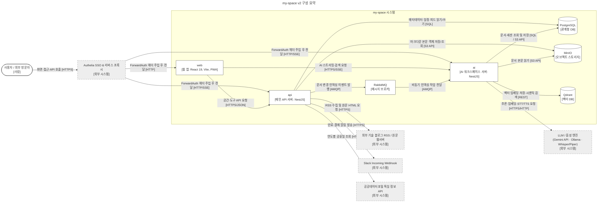

# ARC-001 시스템 개요

## 이 문서는

- **목적**: `my-space` v2 시스템이 무엇이고 어떤 큰 덩어리(컨테이너와 외부 시스템)로 이루어지는지 한 문서로 보여준다. 아키텍처 문서의 시작점이다. 외부 시스템과 경계는 [ARC-003 시스템 컨텍스트와 외부 시스템](arc-003-system-context.md), 구성 요소 이름과 책임은 [ARC-004 컨테이너와 주요 컴포넌트](arc-004-containers-components.md)가 기준이고, 결정 이유는 [ARC-006 아키텍처 의사결정 기록(ADR)](arc-006-adr.md)에 있다.
- **대상 독자**: 프로젝트 소유자, 프론트엔드·백엔드·인프라 개발자, AI 에이전트
- **작성 시점**: 요구사항([PRD-002](../product/prd-002-requirements-scope.md))과 비기능 요구사항([PRD-006](../product/prd-006-nfr.md))이 승인된 직후. 주요 기술 결정(ADR)이 생길 때마다 갱신한다.
- **등급**: 필수 — 모든 프로젝트

## 선행 문서와 관련 문서

| 관계 | 문서 | 이유 |
|---|---|---|
| 선행 | [PRD-001 제품 개요와 비전](../product/prd-001-product-overview.md) | 시스템이 해결하려는 문제와 공간·도구 분리 비전 |
| 선행 | [PRD-002 요구사항과 범위](../product/prd-002-requirements-scope.md) | 시스템이 맡는 범위(`REQ-001`~`REQ-031`)와 범위 밖 |
| 관련 | [PRD-006 비기능 요구사항](../product/prd-006-nfr.md) | 아키텍처가 만족해야 할 성능·가용성·보안 목표(`NFR-001`~`NFR-008`) |
| 관련 | [OPS-001 용어집](../operations/ops-001-glossary.md) | 구성 요소 이름과 도메인·기술 용어의 정의 |
| 후행 | [ARC-002 아키텍처 원칙과 제약](arc-002-principles-constraints.md) | 구조를 정할 때 따르는 원칙(`AP-`)과 제약(`CON-`) |
| 후행 | [ARC-003 시스템 컨텍스트와 외부 시스템](arc-003-system-context.md) | 사용자 유형과 외부 연동 시스템의 상세 |
| 후행 | [ARC-004 컨테이너와 주요 컴포넌트](arc-004-containers-components.md) | 구성 요소 상세. 이 문서의 구성 그림보다 우선한다 |
| 후행 | [ARC-005 데이터 흐름](arc-005-data-flow.md) | 공간 데이터·민감 파일·테스트 계정의 데이터 흐름과 신뢰 경계 |
| 후행 | [ARC-006 아키텍처 의사결정 기록(ADR)](arc-006-adr.md) | 이 문서에 요약한 결정의 이유와 대안 비교 |
| 후행 | [ARC-007 보안 아키텍처](arc-007-security-architecture.md) | 신뢰 경계별 보안 통제와 인증·인가·시크릿 위치 |
| 후행 | [ARC-008 품질 속성](arc-008-quality-attributes.md) | `NFR-` 목표를 달성하는 아키텍처 전술과 트레이드오프 |

## 시스템 목적과 범위 [필수]

`my-space`는 개인이 일상과 개발 업무에서 반복해서 쌓아 두는 **공간(노트, 피드, 관리, AI)**과 입력 즉시 변환·계산 결과를 얻는 일회성 **도구(문서, 이미지, 개발, 계산)**를 단일 워크스페이스에서 제공하는 웹 애플리케이션이다. 주 사용자는 민감한 문서·이미지·토큰을 외부 광고성 사이트에 올리지 않고 브라우저 로컬(Web Worker·WASM)과 자체 홈랩 서버(`qpdf`)에서 안전하게 처리하며, 외부 방문자는 격리된 테스트 계정으로 모든 기능을 체험할 수 있다. 제품 비전과 문제 정의는 [PRD-001 제품 개요와 비전](../product/prd-001-product-overview.md)에 있다.

- **범위 안**:
  - `공간`: 마크다운 노트 및 버전(리비전) 관리, 기술 블로그 RSS 피드 수집·원문 본문 추출·키워드 필터링, 공통 날짜 모델 3유형(정기 결제·고정 만료일·단일 날짜) 관리, 홈랩 기동 시 누락 스케줄 보정(Catch-up) 및 알림, 실시간 음성·텍스트 AI 어시스턴트와 RAG 문서 검색.
  - `도구`: 하이브리드 PDF 조작(병합·분할·암호 해제), 마크다운 일회성 변환, 이미지 압축·리사이즈·포맷 변환 및 EXIF 조회·제거, RDB·NoSQL 스키마 시각화·변환, cron·정규식·JWT·타임스탬프 개발 도구, 더치페이·실수령액·대출/적금·단가 비교(PWA 오프라인)·영업일 계산기.
  - `플랫폼·보안`: Authelia ForwardAuth 기반 인증 연동, 외부 방문자용 테스트 계정 인메모리 샌드박스 격리. 전체 요구사항은 [PRD-002의 REQ-001~REQ-031](../product/prd-002-requirements-scope.md#요구사항-목록-필수)이다.
- **범위 밖**:
  - 사용자 비밀번호 저장·로그인 화면·2FA 검증: 홈랩 리버스 프록시 앞단의 외부 인증 게이트웨이(Authelia)가 맡는다.
  - 다중 사용자 간 실시간 공동 편집·일정 공유: 제품 비목표다([PRD-001 범위와 비목표](../product/prd-001-product-overview.md#범위와-비목표-필수)).
  - 상용 결제(PG) 연동 및 외부 고객 개인정보 수집: 구독 결제 관리는 일정·금액 추적 기능이며 실제 결제 트랜잭션을 수행하지 않는다.

## 이해관계자와 관심사 [선택]

[근거: 공식 표준 · ISO/IEC/IEEE 42010:2022 (공식 요약 확인) — 이해관계자·관심사·관점 개념. 표 형식은 자체 설계]

| 이해관계자 | 관심사 | 답하는 문서 |
|---|---|---|
| 프로젝트 소유자 (주 사용자) | 홈랩 서버가 꺼져 있다가 켜져도 일정 알림과 피드 수집이 누락되지 않는가, 민감 파일이 외부로 나가지 않는가 | [ARC-002](arc-002-principles-constraints.md), [ARC-005](arc-005-data-flow.md), [ARC-008](arc-008-quality-attributes.md) |
| 프론트엔드 개발자 | 어떤 도구를 브라우저 로컬(Web Worker·WASM)에서 처리하고 어떤 기능을 백엔드 API/SSE와 연동하는가 | [ARC-004](arc-004-containers-components.md), [ADR-0001](adr/adr-0001-hybrid-client-server-processing.md) |
| 백엔드 개발자 | 메인 API(`apps/api`)와 AI 서버(`apps/ai`)의 책임 경계는 무엇이고, DB·스토리지·큐를 어떻게 공유하는가 | [ARC-004](arc-004-containers-components.md), [ADR-0002](adr/adr-0002-backend-monorepo-api-ai-separation.md), [ADR-0003](adr/adr-0003-homelab-catchup-scheduler.md) |
| 보안·인프라 담당자 | 외부 방문자 테스트 계정이 주 사용자 데이터를 침범하지 않게 어느 지점에서 격리하는가 | [ARC-007](arc-007-security-architecture.md), [ADR-0004](adr/adr-0004-forward-auth-and-visitor-isolation.md) |

## 구성 요약 [필수]

| 모양 | 요소 종류 |
|---|---|
| 둥근 양 끝 사각형 | 사람 |
| 사각형 (실선) | 우리 시스템의 구성 요소 (실행 단위·메시지 브로커) |
| 원통 | 데이터 저장소 |
| 사각형 (점선, 회색) | 외부 시스템 |
| 묶음 상자 | 우리 시스템의 경계 |
| 화살표 | 요청 방향. 레이블은 "목적 [방식]" |

- **목적**: `my-space` v2를 이루는 실행 컨테이너, 데이터 저장소, 외부 연동 시스템을 한 장에 보여준다.
- **설명**: 모든 외부 요청은 리버스 프록시와 `Authelia SSO`를 거쳐 인증 헤더가 주입된 상태로 들어온다. 순수 클라이언트 도구(이미지 WASM 변환, EXIF, 개발 파서, 계산기)는 `web` 브라우저 내부에서 완결되며, 공간 데이터(노트, 피드, 관리)와 암호화 PDF 처리(`qpdf`), Catch-up 스케줄러는 `api`가 맡는다. 노트가 저장되면 `RabbitMQ`를 통해 `ai`가 비동기로 문서를 청킹·임베딩해 `Qdrant`에 색인하고, 실시간 음성·텍스트 스트리밍 대화를 처리한다.
- **관련 문서**: [ARC-003](arc-003-system-context.md), [ARC-004](arc-004-containers-components.md) (기준: ARC-004)

| 구성 요소 | 역할 | 기술 | 상세 문서 |
|---|---|---|---|
| `web` | 공간·도구 UI 렌더링, Web Worker/WASM 로컬 도구 실행, PWA 오프라인 캐싱을 담당하는 단일 페이지 웹앱 | React 19, TypeScript, Vite, Vanilla CSS | [ARC-004](arc-004-containers-components.md#컨테이너-목록-필수) |
| `api` | 공간(노트·피드·관리·알림) REST API, `qpdf` 하이브리드 PDF 처리, 홈랩 기동 Catch-up 스케줄러, 테스트 계정 샌드박스를 담당하는 메인 API 서버 | NestJS 12, TypeScript, Prisma, `qpdf` | [ARC-004](arc-004-containers-components.md#api-메인-api-서버) |
| `ai` | 실시간 음성·텍스트 AI 어시스턴트(SSE 스트리밍·즉시 중단), RabbitMQ 기반 비동기 문서 인덱싱 워커, Qdrant 시맨틱 검색을 담당하는 AI 전용 서버 | NestJS 12, TypeScript, `@google/genai` | [ARC-004](arc-004-containers-components.md#ai-ai-워크스페이스-서버) |
| `PostgreSQL` | 폴더·노트 메타데이터/리비전, 피드 구독원·아티클·키워드, 관리 일정(공통 날짜 모델 3유형), 인앱 알림, 공휴일 캐시를 저장하는 주 관계형 데이터베이스 | PostgreSQL 18 | [ARC-004](arc-004-containers-components.md#컨테이너-목록-필수) |
| `MinIO` | 마크다운 노트의 버전별 원문(`.md`) 본문 객체를 저장하는 S3 호환 오브젝트 스토리지 | MinIO (S3 API) | [ARC-004](arc-004-containers-components.md#컨테이너-목록-필수) |
| `Qdrant` | 마크다운 문서 청크의 벡터 임베딩을 저장하고 시맨틱 유사도 검색을 수행하는 벡터 데이터베이스 | Qdrant | [ARC-004](arc-004-containers-components.md#컨테이너-목록-필수) |
| `RabbitMQ` | 노트 생성·수정·삭제 시 벡터 인덱싱 작업을 `api`에서 `ai` 워커로 비동기 전달하는 메시지 브로커 | RabbitMQ 3.12 (AMQP 0-9-1) | [ARC-004](arc-004-containers-components.md#컨테이너-목록-필수) |

## 주요 결정 [필수]

이 시스템의 구조를 정한 ADR 목록이다. 결정 내용은 [ARC-006](arc-006-adr.md) 및 `adr/` 하위 문서에만 쓰고 여기서는 한 줄로 요약한다.

| ADR | 제목 | 결정 상태 | 한 줄 요약 |
|---|---|---|---|
| [ADR-0001](adr/adr-0001-hybrid-client-server-processing.md) | 민감 도구 연산의 브라우저 로컬 처리와 백엔드(`qpdf`) 하이브리드 분리 | 제안됨 | 민감 파일·토큰 유출 방지와 즉각 응답을 위해 파서·이미지·일반 PDF는 브라우저(Web Worker·WASM)에서 처리하고, 암호화 PDF 해제·대용량 PDF만 백엔드 `qpdf`로 처리한다 |
| [ADR-0002](adr/adr-0002-backend-monorepo-api-ai-separation.md) | 백엔드 메인 API(`api`)와 AI 워크스페이스 서버(`ai`) 프로세스 분리 | 제안됨 | Nest CLI 모노레포 안에서 `api`와 `ai`를 독립 프로세스로 분리해 LLM 스트리밍·인덱싱 부하를 격리하고 `libs/`로 저장소·인증 모듈을 공유한다 |
| [ADR-0003](adr/adr-0003-homelab-catchup-scheduler.md) | 홈랩 비-상시 구동 환경을 위한 DB 기반 누락 스케줄 보정(Catch-up) | 제안됨 | 서버 종료 중 지나간 만료 판별·정기 결제 갱신·RSS 수집을 복구하기 위해 DB의 `lastRunAt`을 기준으로 기동 직후 멱등 Catch-up을 수행한다 |
| [ADR-0004](adr/adr-0004-forward-auth-and-visitor-isolation.md) | Authelia ForwardAuth 인증 위임 및 외부 방문자 테스트 계정 샌드박스 격리 | 제안됨 | 인증은 리버스 프록시 앞단의 Authelia ForwardAuth 헤더에 위임하고, 테스트 계정은 세션별 인메모리 샌드박스 저장소로 라우팅해 주 사용자 DB 오염을 원천 차단한다 |
| [ADR-0005](adr/adr-0005-notification-channel-abstraction.md) | 인앱 알림함과 외부 알림 채널(Slack Webhook) 추상화 구조 | 제안됨 | 모든 일정·만료 알림은 인앱 알림함(DB)에 우선 저장하고 `NotificationChannel` 어댑터를 통해 Slack Incoming Webhook 등 외부 채널로 비동기 발송한다 |

## 아키텍처 문서 지도 [선택]

| 문서 | 작성 여부 | 설명 |
|---|---|---|
| [ARC-001 시스템 개요](arc-001-system-overview.md) | 작성 | 시스템 목적, 구성 요약 다이어그램, 주요 ADR 목록 |
| [ARC-002 아키텍처 원칙과 제약](arc-002-principles-constraints.md) | 작성 | 홈랩 환경 제약(`CON-`) 및 설계 원칙(`AP-`), 가정(`ASM-`) |
| [ARC-003 시스템 컨텍스트와 외부 시스템](arc-003-system-context.md) | 작성 | 주 사용자·외부 방문자와 5대 외부 연동 시스템 경계 |
| [ARC-004 컨테이너와 주요 컴포넌트](arc-004-containers-components.md) | 작성 | 7개 컨테이너(`web`, `api`, `ai`, `PostgreSQL`, `MinIO`, `Qdrant`, `RabbitMQ`)와 내부 모듈 책임 |
| [ARC-005 데이터 흐름](arc-005-data-flow.md) | 작성 | 공간 영속 흐름, 로컬 격리 흐름, 하이브리드 PDF 흐름, 테스트 계정 샌드박스 흐름 |
| [ARC-006 아키텍처 의사결정 기록(ADR)](arc-006-adr.md) | 작성 | ADR 색인 및 `ADR-0001`~`ADR-0005` 개별 기록 |
| [ARC-007 보안 아키텍처](arc-007-security-architecture.md) | 작성 | 신뢰 경계, ForwardAuth·테스트 계정 인가 위치, 임시 파일 및 시크릿 보호 |
| [ARC-008 품질 속성](arc-008-quality-attributes.md) | 작성 | `NFR-001`~`NFR-008` 달성을 위한 품질 시나리오(`QS-`), 전술 및 트레이드오프 |

## 검토 체크리스트

- [x] 목적과 범위가 [PRD-001](../product/prd-001-product-overview.md), [PRD-002](../product/prd-002-requirements-scope.md)와 어긋나지 않는다
- [x] 구성 그림의 요소와 구성 요소 표의 행이 일치한다
- [x] 그림 아래에 범례 표가 있고, 그림의 모양 규칙과 범례가 같다
- [x] [ARC-004](arc-004-containers-components.md)와 구성 요소 이름이 같다
- [x] 기술 선택마다 근거 ADR이 링크되어 있다
- [x] 구성 요소 이름이 [OPS-001 용어집](../operations/ops-001-glossary.md)과 정합성을 유지한다

## 작성 예시

예시 없음 — 실무 프로젝트 문서 본문

## 변경 이력

| 날짜 | 버전 | 변경 내용 | 작성자 |
|---|---|---|---|
| 2026-11-05 | 0.1.0 | my-space v2 시스템 개요(ARC-001) 최초 작성 | Antigravity (사용자 검토 대기) |
