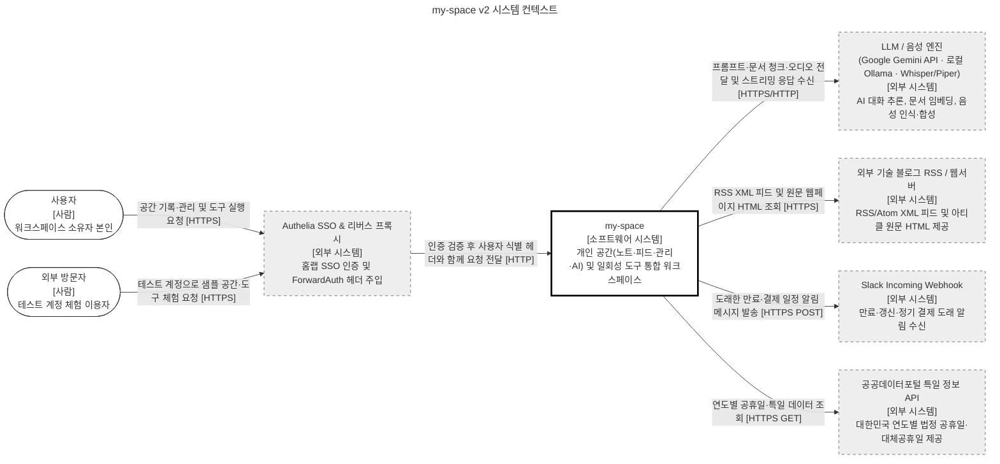

# ARC-003 시스템 컨텍스트와 외부 시스템

## 이 문서는

- **목적**: `my-space` v2 시스템을 상자 하나로 보고, 어떤 사용자 유형이 사용하며 어떤 외부 시스템과 무엇을 주고받는지 정의한다. C4 model의 시스템 컨텍스트 다이어그램(1단계)에 해당하며, 외부 시스템 목록과 시스템 경계의 **기준 문서**다.
- **대상 독자**: 프로젝트 소유자, 개발자, 인프라·보안 담당자, AI 에이전트
- **작성 시점**: 시스템 개요([ARC-001](arc-001-system-overview.md)) 작성 직후, 컨테이너 설계([ARC-004](arc-004-containers-components.md)) 전.
- **등급**: 조건부 — 외부 인증 게이트웨이, 외부 AI/LLM, RSS 피드 서버, Slack Webhook, 공공데이터포털 API와 연동하는 프로젝트

## 선행 문서와 관련 문서

| 관계 | 문서 | 이유 |
|---|---|---|
| 선행 | [ARC-001 시스템 개요](arc-001-system-overview.md) | 시스템 이름과 전체 범위 |
| 선행 | [PRD-001 제품 개요와 비전](../product/prd-001-product-overview.md) | 대상 사용자 유형(사용자, 외부 방문자)의 정의 |
| 선행 | [PRD-003 사용자 스토리와 수용 기준](../product/prd-003-user-stories.md) | 사용자 유형별 주요 행동과 스토리(`US-001`~`US-024`) |
| 관련 | [OPS-001 용어집](../operations/ops-001-glossary.md) | 사용자, 외부 방문자 등 표준 용어 |
| 후행 | [ARC-004 컨테이너와 주요 컴포넌트](arc-004-containers-components.md) | 이 문서의 시스템 상자를 열어 내부 컨테이너를 그린다 |
| 후행 | [ARC-005 데이터 흐름](arc-005-data-flow.md) | 외부 시스템과 주고받는 데이터의 흐름과 신뢰 경계 |
| 후행 | [ARC-007 보안 아키텍처](arc-007-security-architecture.md) | 시스템 경계에서의 인증·인가 및 보안 통제 |

## 시스템 컨텍스트 다이어그램 [필수]

| 모양 | 요소 종류 |
|---|---|
| 둥근 양 끝 사각형 | 사람 |
| 사각형 (굵은 실선) | 우리 시스템 (`my-space`) |
| 사각형 (점선, 회색) | 외부 시스템 |
| 화살표 | 요청이나 알림의 방향. 레이블은 "목적 [방식]" |

- **목적**: `my-space` 시스템의 경계와 두 사용자 유형, 5개 외부 의존 시스템을 한눈에 보여준다.
- **설명**: `사용자`와 `외부 방문자`의 모든 웹 요청은 홈랩 앞단의 `Authelia SSO & 리버스 프록시`를 통과하며 인증된다. `my-space`가 외부로 나가는 호출은 모두 단방향 아웃바운드(Outgoing) 요청이며, 외부 시스템이 `my-space`로 인바운드 웹훅을 호출하는 경로는 없다.
- **관련 문서**: [ARC-004](arc-004-containers-components.md), [ARC-007](arc-007-security-architecture.md)

## 사용자와 역할 [필수]

| 사람 | 설명 | 시스템으로 하는 일 | 사용자 유형 |
|---|---|---|---|
| 사용자 | `my-space` 워크스페이스의 실제 데이터를 소유하고 일상·업무에서 사용하는 주 사용자 본인 | 공간(노트 작성·리비전 복원, RSS 피드 구독·키워드 필터링, 정기 결제·만료일·D-day 관리, 음성·텍스트 AI 대화)에 데이터를 축적하고, 18종의 문서·이미지·개발·계산 도구를 실행한다 | [OPS-001 사용자](../operations/ops-001-glossary.md#도메인-용어-필수), [PRD-003 US-001~US-023](../product/prd-003-user-stories.md) |
| 외부 방문자 | 외부 접속이 열려 있을 때 전용 테스트 계정으로 로그인해 샘플 데이터와 도구를 체험하는 이용자 | 격리된 샘플 데이터 환경에서 공간 기능(노트·피드·관리·AI)을 자유롭게 조작해 보고, 모든 일회성 도구를 동일하게 실행한다 (주 사용자 데이터 접근 불가) | [OPS-001 외부 방문자](../operations/ops-001-glossary.md#도메인-용어-필수), [PRD-003 US-024](../product/prd-003-user-stories.md) |

## 외부 시스템 [필수]

| 외부 시스템 | 제공자 | 목적 | 방향 | 방식 | 주고받는 데이터 | 개인정보 | 장애 시 영향 | 연동 관련 문서 |
|---|---|---|---|---|---|---|---|---|
| Authelia SSO & 리버스 프록시 | 홈랩 공통 인프라 (`Traefik` + `Authelia`) | 사용자·외부 방문자 로그인 인증 및 신뢰된 사용자 식별 헤더 주입 | 받음 (프록시 경유 요청 수신) | HTTP ForwardAuth 헤더 (`Remote-User`, `Remote-Groups`, `X-Forwarded-Auth-Secret`) | 사용자 식별자(`username`), 표시명, 이메일, 그룹 목록 | 없음 (본인 및 테스트 계정 식별자만 사용) | 비로컬 환경에서 인증 헤더 누락 시 모든 백엔드 API가 `401 Unauthorized`로 차단됨 (이미 캐시된 PWA 오프라인 도구는 브라우저에서 단독 동작 가능) | [ARC-007](arc-007-security-architecture.md), [ADR-0004](adr/adr-0004-forward-auth-and-visitor-isolation.md) |
| LLM / 음성 엔진 (`Google Gemini API` · 로컬 `Ollama` · `Whisper`/`Piper`) | Google Cloud 및 홈랩 로컬 AI 런타임 | `공간 › AI`의 텍스트·음성 대화 추론, 노트 RAG 임베딩 생성, STT(음성→텍스트)·TTS(텍스트→음성) 처리 | 보냄 (요청 후 응답·스트림 수신) | HTTPS REST / SSE (`@google/genai`), 로컬 HTTP (`Ollama`, STT/TTS 어댑터) | 사용자 프롬프트, RAG 참조 노트 발췌문, PTT 음성 오디오 버퍼, 합성 오디오 | 없음 | AI 대화 및 신규 노트 벡터 인덱싱만 실패 안내를 표시하며, 기존 노트 열람·편집과 다른 공간·도구는 정상 동작함 (`AP-04`) | [ADR-0002](adr/adr-0002-backend-monorepo-api-ai-separation.md), [PRD-005 FN-010](../product/prd-005-functional-spec.md) |
| 외부 기술 블로그 RSS / 웹서버 | 외부 기술 블로그 및 뉴스 사이트 | `공간 › 피드`의 RSS/Atom 피드 목록 수집 및 Readability 원문 본문 추출 | 보냄 (수집 요청) | HTTPS GET (XML 및 HTML 조회) | RSS/Atom XML 피드, 아티클 웹페이지 HTML | 없음 | 해당 피드 구독원의 신규 글 수집만 지연되거나 원문 추출 실패 시 요약본+원문 링크 열기로 폴백됨 (`AP-04`) | [PRD-005 FN-004](../product/prd-005-functional-spec.md) |
| Slack Incoming Webhook | Slack (Salesforce) | `공간 › 관리`의 정기 결제일·고정 만료일·D-day 알림을 외부 메신저로 전송 | 보냄 (단방향 발송) | HTTPS POST (JSON Webhook Payload) | 일정 제목, 유형, 기준일/남은 일수(`D-N`), 금액 요약 메시지 | 없음 | 외부 Slack 알림만 발송 실패로 기록되며, 인앱 알림함과 홈 대시보드 브리핑은 정상 표시됨 (`AP-04`) | [ADR-0005](adr/adr-0005-notification-channel-abstraction.md), [PRD-005 FN-009](../product/prd-005-functional-spec.md) |
| 공공데이터포털 특일 정보 API | 한국천문연구원 / 행정안전부 공공데이터포털 | `도구 › 계산`의 날짜·영업일 계산기에서 연도별 법정 공휴일·대체공휴일 정보를 갱신 | 보냄 (조회 요청) | HTTPS GET (REST JSON/XML) | 연도·월 기준 공휴일 날짜(`locdate`) 및 명칭(`dateName`) | 없음 | DB에 캐시된 공휴일 데이터 또는 프론트엔드 내장 기본 공휴일 테이블로 즉시 폴백하여 영업일 계산이 중단 없이 동작함 (`AP-04`) | [PRD-005 FN-024](../product/prd-005-functional-spec.md) |

## 외부 의존 전제 [선택]

| 외부 시스템 | 전제 | 출처 | 전제가 깨지면 |
|---|---|---|---|
| 외부 기술 블로그 RSS / 웹서버 | 원문 웹서버가 과도한 요청이나 비정상 User-Agent를 차단할 수 있으며, 일부 사이트는 클라이언트 JS 렌더링만 지원한다 | [ARC-002 ASM-01](arc-002-principles-constraints.md#가정-선택) | 수집 타임아웃(10초)과 동시 요청 제한을 두고, 본문 추출 실패 시 RSS 요약본과 `원문 새 탭 열기` 버튼을 제공한다 |
| 공공데이터포털 특일 정보 API | 무료 활용 신청 키의 일일 트래픽 한도가 존재하며, 당해 및 익년도 특일 정보만 제공될 수 있다 | 공공데이터포털 특일 정보 활용 가이드 | 조회 결과를 연도 단위로 `PostgreSQL`에 캐싱하여 동일 연도 재호출을 막고, API 미응답·미고시 연도는 내장 기본 공휴일 규칙으로 계산한다 |
| Google Gemini API | 외부 클라우드 API 할당량(Quota) 제한이나 네트워크 단절이 발생할 수 있다 | Google Gemini API 정책 | 프로바이더 추상화 계층을 통해 로컬 `Ollama` 모델로 전환하거나 명확한 스트리밍 오류 이벤트를 반환한다 |

## 검토 체크리스트

- [x] 그림에 우리 시스템(`my-space`)의 내부 구성 요소가 없다
- [x] 그림의 모든 요소가 사용자 표나 외부 시스템 표에 있고, 반대도 같다
- [x] 모든 화살표에 한 방향과 구체적인 레이블이 있다
- [x] 그림 아래 범례 표가 있고 모양 규칙이 그림과 같다
- [x] 사람 이름이 [OPS-001 용어집](../operations/ops-001-glossary.md) 및 [PRD-001](../product/prd-001-product-overview.md)의 사용자 유형과 같다
- [x] 외부 시스템마다 장애 시 영향이 명시되어 있다

## 작성 예시

예시 없음 — 실무 프로젝트 문서 본문

## 변경 이력

| 날짜 | 버전 | 변경 내용 | 작성자 |
|---|---|---|---|
| 2026-11-05 | 0.1.0 | my-space v2 시스템 컨텍스트와 외부 시스템(ARC-003) 최초 작성 | Antigravity (사용자 검토 대기) |
| 2026-11-12 | 1.0.0 | 아키텍처 검토 완료 및 정식 승인 | @bob (Keunhyeok Lim) |
