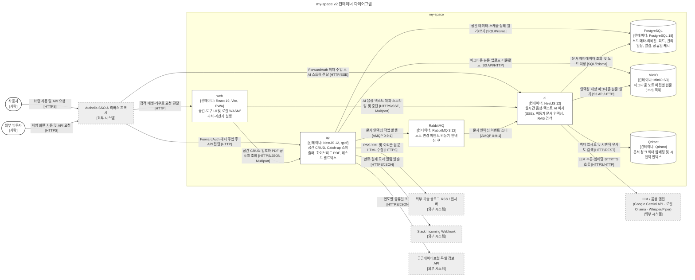

# ARC-004 컨테이너와 주요 컴포넌트

## 이 문서는

- **목적**: `my-space` v2 시스템을 실행 단위(컨테이너)와 그 안의 주요 컴포넌트(모듈)로 나누고, 서로 어떻게 통신하는지 정의한다. C4 model의 컨테이너(2단계)와 컴포넌트(3단계)에 해당하며, 구성 요소 이름과 책임의 **기준 문서**다. [ARC-001](arc-001-system-overview.md)의 구성 그림은 이 문서를 요약한 것이다.
- **대상 독자**: 프론트엔드·백엔드·인프라 개발자, AI 에이전트
- **작성 시점**: 시스템 개요([ARC-001](arc-001-system-overview.md))와 컨텍스트([ARC-003](arc-003-system-context.md)) 작성 직후, 프론트엔드·백엔드·인프라 세부 설계 전.
- **등급**: 조건부 — 다중 백엔드 앱(`api`, `ai`)과 다중 데이터 저장소(`PostgreSQL`, `MinIO`, `Qdrant`, `RabbitMQ`), 클라이언트 워커(`Web Worker/WASM`)를 조합하는 프로젝트

## 선행 문서와 관련 문서

| 관계 | 문서 | 이유 |
|---|---|---|
| 선행 | [ARC-001 시스템 개요](arc-001-system-overview.md) | 구성 요약과 전체 시스템 범위 |
| 선행 | [ARC-003 시스템 컨텍스트와 외부 시스템](arc-003-system-context.md) | 다이어그램에 함께 등장하는 사람과 외부 시스템의 기준 |
| 관련 | [ARC-006 아키텍처 의사결정 기록(ADR)](arc-006-adr.md) | 컨테이너 분리(`ADR-0001`, `ADR-0002`)와 기술 선택의 이유 |
| 관련 | [PRD-005 기능 명세](../product/prd-005-functional-spec.md) | 각 컴포넌트가 수행하는 세부 기능(`FN-001`~`FN-025`) |
| 후행 | [ARC-005 데이터 흐름](arc-005-data-flow.md) | 컨테이너 사이를 지나는 주요 데이터 흐름 |
| 후행 | [ARC-007 보안 아키텍처](arc-007-security-architecture.md) | 컨테이너 사이의 신뢰 경계와 보안 통제 |
| 후행 | [ARC-008 품질 속성](arc-008-quality-attributes.md) | 컨테이너별 성능·가용성 달성 전술 |

## 컨테이너 다이어그램 [필수]

| 모양 | 요소 종류 |
|---|---|
| 둥근 양 끝 사각형 | 사람 |
| 사각형 (실선) | 컨테이너 (실행 단위·메시지 브로커) |
| 원통 | 컨테이너 (데이터 저장소) |
| 사각형 (점선, 회색) | 외부 시스템 |
| 묶음 상자 | 우리 시스템의 경계 |
| 화살표 | 호출 방향. 레이블은 "목적 [프로토콜]" |

- **목적**: 사용자 요청과 백그라운드 작업이 어느 컨테이너를 거쳐 처리되고 저장되는지 보여준다.
- **설명**:
  - **클라이언트 완결 경로**: 순수 로컬 도구(이미지 압축·변환, EXIF, 스키마, cron, 정규식, JWT, 계산기)는 `web` 컨테이너 내부(메인 스레드 및 Web Worker/WASM)에서만 실행되며 `api`나 외부로 네트워크 요청을 보내지 않는다([ADR-0001](adr/adr-0001-hybrid-client-server-processing.md)).
  - **동기 API 경로**: 공간(노트·피드·관리·알림) 조회·저장과 암호화 PDF 처리(`qpdf`)는 `web`에서 `api`로 호출하며, `api`가 `PostgreSQL`과 `MinIO`에 기록한다.
  - **비동기 인덱싱 및 AI 스트리밍 경로**: `api`에서 노트가 저장되면 `RabbitMQ`에 이벤트를 발행하고 즉시 응답한다. `ai`가 큐에서 이벤트를 소비해 `MinIO`의 본문을 읽고 청킹·임베딩하여 `Qdrant`에 적재한다([ADR-0002](adr/adr-0002-backend-monorepo-api-ai-separation.md)).
- **관련 문서**: [ARC-003](arc-003-system-context.md) (사람·외부 시스템의 기준)

## 컨테이너 목록 [필수]

| 컨테이너 | 종류 | 책임 | 기술 | 소유 | 결정 | 관련 요구사항 |
|---|---|---|---|---|---|---|
| `web` | 웹 앱 (SPA & PWA) | `공간`·`도구` 2계층 UI 렌더링, 브라우저 로컬 파서·계산기 및 Web Worker/WASM 이미지·일반 PDF 처리, Service Worker 기반 오프라인 도구 캐싱을 담당한다 | React 19, TypeScript, Vite, Vanilla CSS, Web Worker, WASM, `pdf-lib` (`my-space-front/apps/web`) | `@bob` | [ADR-0001](adr/adr-0001-hybrid-client-server-processing.md) | `REQ-001`~`REQ-025`, `REQ-027`, `REQ-029`, `REQ-031` |
| `api` | 메인 API 서버 & 스케줄러 | 공간(노트·피드·관리·알림) REST API, `qpdf` 기반 암호화/대용량 PDF 처리, 기동 시 누락 스케줄 Catch-up 및 주기적 수집·만료 판별, 외부 방문자 테스트 계정 인메모리 샌드박스 격리를 담당한다 | NestJS 12, TypeScript, Prisma 6, `qpdf` CLI (`my-space-backend/apps/api`) | `@bob` | [ADR-0001](adr/adr-0001-hybrid-client-server-processing.md), [ADR-0002](adr/adr-0002-backend-monorepo-api-ai-separation.md), [ADR-0003](adr/adr-0003-homelab-catchup-scheduler.md), [ADR-0004](adr/adr-0004-forward-auth-and-visitor-isolation.md), [ADR-0005](adr/adr-0005-notification-channel-abstraction.md) | `REQ-002`~`REQ-010`, `REQ-012`, `REQ-025`, `REQ-026`, `REQ-028`, `REQ-030` |
| `ai` | AI 워크스페이스 서버 & 인덱싱 워커 | 실시간 음성(PTT)·텍스트 AI 스트리밍 대화(SSE) 및 즉시 중단(`AbortController`), RAG 도구 호출(`search_my_documents`, `read_document`, `save_to_markdown`), `RabbitMQ` 문서 인덱싱 워커를 담당한다 | NestJS 12, TypeScript, `@google/genai`, Ollama/STT/TTS 어댑터 (`my-space-backend/apps/ai`) | `@bob` | [ADR-0002](adr/adr-0002-backend-monorepo-api-ai-separation.md) | `REQ-003`, `REQ-011`, `REQ-026` |
| `PostgreSQL` | 관계형 데이터베이스 | 주 사용자의 폴더·노트 메타데이터/리비전, 피드 구독원·아티클·키워드 규칙, 관리 일정(공통 날짜 모델 3유형)과 스케줄 실행 이력(`lastRunAt`), 인앱 알림함, 연도별 공휴일 캐시를 영속 저장한다 | PostgreSQL 18 | `@bob` | [ADR-0002](adr/adr-0002-backend-monorepo-api-ai-separation.md), [ADR-0003](adr/adr-0003-homelab-catchup-scheduler.md) | `REQ-002`~`REQ-010`, `REQ-025`, `REQ-028` |
| `MinIO` | 오브젝트 스토리지 | 마크다운 노트의 현재 본문과 버전별 리비전 스냅샷(`.md` 파일 객체)을 저장한다 | MinIO (S3 호환 API) | `@bob` | [ADR-0002](adr/adr-0002-backend-monorepo-api-ai-separation.md) | `REQ-003`, `REQ-028` |
| `Qdrant` | 벡터 데이터베이스 | 마크다운 노트를 청킹·임베딩한 고차원 벡터와 문서 메타데이터 페이로드를 저장하고 시맨틱 유사도 검색을 수행한다 | Qdrant | `@bob` | [ADR-0002](adr/adr-0002-backend-monorepo-api-ai-separation.md) | `REQ-003`, `REQ-011` |
| `RabbitMQ` | 메시지 브로커 | `api`에서 발생한 마크다운 문서 생성·수정·삭제 이벤트를 `ai` 인덱싱 워커로 비동기 전달한다 (Dead Letter Queue 포함) | RabbitMQ 3.12 | `@bob` | [ADR-0002](adr/adr-0002-backend-monorepo-api-ai-separation.md) | `REQ-003`, `REQ-011` |

## 컨테이너 간 통신 [필수]

| 호출하는 쪽 | 호출받는 쪽 | 목적 | 프로토콜·형식 | 동기/비동기 | 관련 기능 명세 |
|---|---|---|---|---|---|
| `web` | `api` | 홈 브리핑, 노트·폴더·태그·리비전, 피드·키워드, 관리 일정(3유형), 인앱 알림, 공휴일 캐시 조회 및 변경 | HTTPS / JSON (`REST API`) | 동기 | [PRD-005 FN-001~FN-009, FN-024, FN-025](../product/prd-005-functional-spec.md) |
| `web` | `api` | 암호화 PDF 해제 및 서버 위임 PDF 병합·분할 요청과 결과 파일 다운로드 | HTTPS / `multipart/form-data` → `application/pdf` (또는 `application/zip`) | 동기 | [PRD-005 FN-011](../product/prd-005-functional-spec.md) |
| `web` | `ai` | 텍스트·음성(PTT 오디오 Blob) AI 대화 시작 및 토큰·전사·벤치마크·오디오 완료 이벤트 수신, 발화 즉시 중단 요청 | HTTPS / `multipart/form-data` & `text/event-stream` (`SSE`), JSON | 동기 스트리밍 | [PRD-005 FN-010](../product/prd-005-functional-spec.md) |
| `api` | `PostgreSQL` | 공간 엔티티 트랜잭션 처리, Catch-up 스케줄러 상태(`lastRunAt`) 조회·갱신 | TCP / SQL (Prisma Client) | 동기 | [PRD-005 FN-002~FN-009](../product/prd-005-functional-spec.md) |
| `api` | `MinIO` | 마크다운 노트 원문 및 리비전 스냅샷 객체 업로드·다운로드·삭제 | HTTP / AWS S3 SDK v3 | 동기 | [PRD-005 FN-003](../product/prd-005-functional-spec.md) |
| `api` | `RabbitMQ` | 문서 생성·수정(`DOCUMENT_UPSERT`) 및 삭제(`DOCUMENT_DELETE`) 인덱싱 메시지 발행 | TCP / AMQP 0-9-1 (JSON Payload) | 비동기 | [PRD-005 FN-003](../product/prd-005-functional-spec.md) |
| `RabbitMQ` | `ai` | 인덱싱 큐 메시지 소비 및 문서 벡터화 워커 실행 | TCP / AMQP 0-9-1 | 비동기 | [PRD-005 FN-003, FN-010](../product/prd-005-functional-spec.md) |
| `ai` | `PostgreSQL` / `MinIO` | 인덱싱 대상 문서 본문 조회 및 AI 대화 결과의 신규 마크다운 노트 저장(`save_to_markdown`) | TCP / SQL & HTTP / S3 API | 동기 | [PRD-005 FN-010](../product/prd-005-functional-spec.md) |
| `ai` | `Qdrant` | 문서 청크 임베딩 벡터 저장·삭제 및 질의 벡터 유사도 검색 | HTTP / REST JSON (`@qdrant/js-client-rest`) | 동기 | [PRD-005 FN-010](../product/prd-005-functional-spec.md) |

## 주요 컴포넌트 [선택]

### `web` (프론트엔드 웹 애플리케이션)

| 컴포넌트 | 책임 | 의존하는 컴포넌트·컨테이너 | 관련 요구사항 |
|---|---|---|---|
| 앱 셸 & 라우터 (`AppShell`) | 좌측 확장형·축소형 2계층 사이드바(`공간`/`도구`), 한 줄 공통 상단바(경로·알림·버전·사용자), 3단 반응형 레이아웃 전환을 담당한다 | `api` (알림·버전·사용자 프로필) | `REQ-001`, `REQ-002`, `REQ-031` |
| 공간 모듈 (`SpaceModules`) | 홈 대시보드 브리핑, 노트 스튜디오(폴더·태그·실시간 프리뷰·리비전 Diff), 피드 리더(키워드 규칙·원문 뷰), 관리 공간(정기 결제·만료일·D-day), AI 어시스턴트(PTT 음성·SSE 스트리밍) 화면과 상태를 담당한다 | `api`, `ai` | `REQ-002`~`REQ-011`, `REQ-026` |
| 하이브리드 문서 도구 (`DocTools`) | `pdf-lib` 기반 로컬 PDF 사전 검사·일반 병합/분할, 암호화·대용량 PDF의 `api` 위임 호출, 마크다운 → PDF·HTML 일회성 변환을 담당한다 | `api` (암호화·대용량 PDF 시) | `REQ-012`, `REQ-013`, `REQ-030` |
| 로컬 미디어 워커 (`ImageWorker`) | `ArrayBuffer`/`DataView` 순수 바이너리 파서 기반 EXIF 조회·제거와 Web Worker·WASM 기반 이미지 압축·리사이즈·WebP/AVIF 변환을 메인 스레드 차단 없이 수행한다 | 없음 (브라우저 내부 완결) | `REQ-014`, `REQ-015`, `REQ-027`, `REQ-030` |
| 로컬 개발 도구 엔진 (`DevTools`) | DBML·NoSQL(JSON/MongoDB) 스키마 추론 및 ERD·SQL 변환, cron 파서·생성기, 정규식 AST 파서·철도 다이어그램, 로컬 JWT 디코더, 타임스탬프 변환을 수행한다 | 없음 (브라우저 내부 완결) | `REQ-016`~`REQ-020`, `REQ-027`, `REQ-030` |
| 일상 계산 엔진 & PWA (`CalcTools`) | 더치페이 최소 송금 정산, 연도별 세율 분리형 실수령액, 원 단위 정수 대출·적금 이자, PWA 오프라인 단가 비교기, 영업일·D-day 계산을 수행한다 | `api` (공휴일 캐시 동기화 시, 오프라인 시 내장 데이터 폴백) | `REQ-021`~`REQ-025`, `REQ-029` |

### `api` (메인 API 서버)

| 컴포넌트 | 책임 | 의존하는 컴포넌트·컨테이너 | 관련 요구사항 |
|---|---|---|---|
| 인증 & 테스트 계정 격리 계층 (`Auth & Sandbox`) | Authelia ForwardAuth 헤더를 검증하고, 요청자가 외부 방문자(`visitor`)일 경우 주 사용자 DB 대신 세션별 인메모리 샌드박스 저장소로 요청을 라우팅한다 | Authelia SSO, 인메모리 샌드박스 스토어 | `REQ-026`, `REQ-030` |
| 노트 모듈 (`MarkdownModule`) | 폴더·태그·노트 메타데이터 및 리비전 이력 CRUD, 버전 간 Diff 및 복원, 마크다운 ZIP 내보내기, 문서 변경 시 인덱싱 이벤트 발행을 담당한다 | `PostgreSQL`, `MinIO`, `RabbitMQ` | `REQ-003` |
| 피드 모듈 (`FeedModule`) | RSS/Atom 구독원 등록·삭제, 피드 XML 파싱 및 중복 제거, Mozilla Readability 기반 원문 본문 추출, 관심·제외 키워드 규칙 적용을 담당한다 | `PostgreSQL`, 외부 RSS/웹서버 | `REQ-004`, `REQ-005` |
| 관리 & 일정 모듈 (`ManagementModule`) | 공통 날짜 모델 3유형(`RECURRING_PAYMENT`, `EXPIRATION`, `SINGLE_DATE`) CRUD, 월 구독 합계 환산, 만료 연장(갱신) 처리를 담당한다 | `PostgreSQL` | `REQ-006`, `REQ-007`, `REQ-008` |
| Catch-up 스케줄러 & 알림 모듈 (`Catchup & NotificationModule`) | 서버 기동 시 및 주기적 루프에서 `lastRunAt`을 대조해 누락된 정기 결제일 갱신·만료 판별·RSS 수집을 멱등 실행하고, 인앱 알림함 저장 및 `NotificationChannel`(Slack Webhook) 발송을 수행한다 | `FeedModule`, `ManagementModule`, `PostgreSQL`, `Slack Incoming Webhook` | `REQ-002`, `REQ-009`, `REQ-010`, `REQ-028` |
| PDF 유틸리티 모듈 (`PdfModule`) | 업로드 크기 검증(50MB 이하), `qpdf` 자식 프로세스(`stdin` 비밀번호 전달)를 통한 암호화 PDF 해제·병합·분할 및 임시 파일 즉시 삭제를 담당한다 | 로컬 임시 파일시스템 (`/tmp`), `qpdf` | `REQ-012`, `REQ-030` |
| 공휴일 캐시 모듈 (`HolidayModule`) | 공공데이터포털 특일 정보 API를 조회해 연도별 공휴일을 `PostgreSQL`에 캐싱하고 프론트엔드 영업일 계산기에 제공한다 | `PostgreSQL`, `공공데이터포털 특일 정보 API` | `REQ-025` |

### `ai` (AI 워크스페이스 서버)

| 컴포넌트 | 책임 | 의존하는 컴포넌트·컨테이너 | 관련 요구사항 |
|---|---|---|---|
| 음성·텍스트 스트리밍 모듈 (`JarvisVoice & ChatModule`) | 텍스트 및 PTT 오디오 입력을 받아 STT 전사, LLM 토큰 생성, RAG 문맥 참조, TTS 음성 합성을 단일 SSE 스트림으로 다중화하고, `ActiveStreamRegistry`(`AbortController`)로 즉각 중단을 제어한다 | `LLM / 음성 엔진`, `SearchModule` | `REQ-011` |
| 시맨틱 검색 & 도구 모듈 (`Search & ToolsModule`) | 사용자 질의를 임베딩해 `Qdrant`에서 관련 노트를 검색(`search_my_documents`)하고, 원문 열람(`read_document`) 및 대화 결과의 노트 저장(`save_to_markdown`)을 수행한다 | `Qdrant`, `PostgreSQL`, `MinIO` | `REQ-003`, `REQ-011` |
| 비동기 인덱싱 워커 (`IndexingModule`) | `RabbitMQ`에서 노트 변경 이벤트를 수신해 `MinIO`의 마크다운 본문을 청킹하고 임베딩 벡터를 생성해 `Qdrant`에 업서트한다 | `RabbitMQ`, `MinIO`, `Qdrant`, `LLM / 음성 엔진` | `REQ-003`, `REQ-011` |

## 검토 체크리스트

- [x] 그림의 컨테이너와 컨테이너 목록 표의 행이 일치한다
- [x] 사람과 외부 시스템 이름이 [ARC-003](arc-003-system-context.md)과 같다
- [x] 모든 화살표에 목적과 프로토콜이 있다
- [x] 그림 아래 범례 표가 있고 모양 규칙이 그림과 같다
- [x] 복제 수나 클라우드 리전 같은 인프라 배포 정보를 섞지 않았다
- [x] 기술 선택마다 ADR이 링크되어 있다
- [x] [ARC-001](arc-001-system-overview.md)의 구성 요약과 구성 요소 이름이 같다

## 작성 예시

예시 없음 — 실무 프로젝트 문서 본문

## 변경 이력

| 날짜 | 버전 | 변경 내용 | 작성자 |
|---|---|---|---|
| 2026-11-05 | 0.1.0 | my-space v2 컨테이너와 주요 컴포넌트(ARC-004) 최초 작성 | Antigravity (사용자 검토 대기) |
