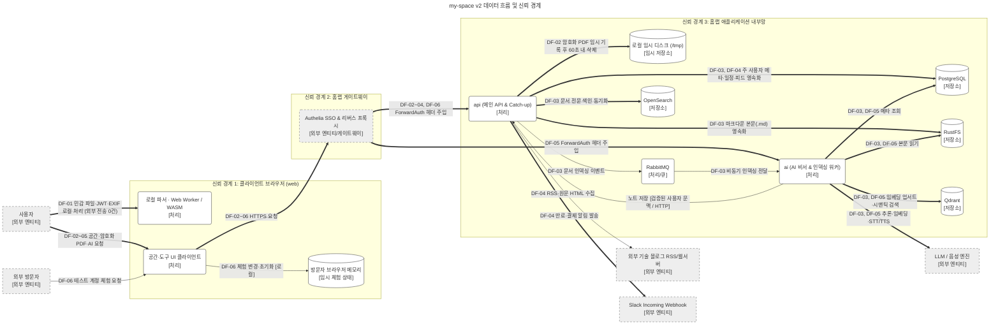

# ARC-005 데이터 흐름

> v2 설계 승인 (2026-11-20): 사용자 검토 및 승인 완료. ADR-0007~0010은 2026-11-19 승인되었다. 문서 승인으로, v2 구현·시험 완료를 의미하지 않는다. 대체된 ADR 본문은 과거 결정 기록으로 보존한다.

## 이 문서는

- **목적**: `my-space` v2에서 중요한 데이터(주 사용자의 공간 데이터, 민감 로컬 도구 입력, 암호화 PDF 임시 스트림, 외부 방문자 테스트 계정 데이터)가 어디서 들어와 어느 구성 요소를 거쳐 어디에 저장되거나 폐기되는지 보여준다. 신뢰 경계와 데이터 격리 경로를 명확히 하여 보안 아키텍처([ARC-007](arc-007-security-architecture.md))의 입력으로 쓴다.
- **대상 독자**: 개발자, 보안·인프라 담당자, AI 에이전트
- **작성 시점**: 컨테이너([ARC-004](arc-004-containers-components.md))가 정해진 뒤, 보안 아키텍처([ARC-007](arc-007-security-architecture.md)) 작성 전.
- **등급**: 조건부 — 외부 고객의 개인정보는 수집하지 않으나([PRD-006](../product/prd-006-nfr.md)), 민감 파일·토큰의 로컬 격리(`NFR-006`)와 주 사용자/테스트 계정 간 데이터 분리(`REQ-026`)가 핵심 요구사항이므로 작성한다.

## 선행 문서와 관련 문서

| 관계 | 문서 | 이유 |
|---|---|---|
| 선행 | [ARC-001 시스템 개요](arc-001-system-overview.md) | 전체 구성 요소 이름과 범위 |
| 선행 | [ARC-004 컨테이너와 주요 컴포넌트](arc-004-containers-components.md) | 데이터가 지나는 컨테이너의 기준 |
| 선행 | [PRD-002 요구사항과 범위](../product/prd-002-requirements-scope.md) | 데이터를 다루는 요구사항(`REQ-`) |
| 관련 | [ARC-003 시스템 컨텍스트와 외부 시스템](arc-003-system-context.md) | 데이터를 주고받는 외부 시스템 |
| 관련 | [PRD-004 사용자 여정과 업무 흐름](../product/prd-004-user-journeys.md) | 하이브리드 도구 및 홈랩 Catch-up 업무 흐름 |
| 관련 | [PRD-006 비기능 요구사항](../product/prd-006-nfr.md) | 로컬 격리·업로드 제한·계정 분리 목표(`NFR-006`) |
| 후행 | [ARC-007 보안 아키텍처](arc-007-security-architecture.md) | 이 문서의 신뢰 경계에 보안 통제를 배치 |

## 주요 데이터 흐름 목록 [필수]

| 흐름 ID | 이름 | 시작 → 끝 | 민감 데이터·격리 대상 | 관련 요구사항 |
|---|---|---|---|---|
| DF-01 | 로컬 전용 도구 처리 (이미지·EXIF·JWT·개발·계산) | 사용자 브라우저(`web`) 내부 메모리/Worker → 브라우저 다운로드 (네트워크 전송 없음) | 있음 (원본 사진·GPS EXIF, JWT 토큰, 스키마) | `REQ-014`~`REQ-024`, `REQ-030`, `NFR-006` |
| DF-02 | 하이브리드 PDF 서버 처리 (`qpdf`) | 사용자 브라우저(`web`) → `api` 임시 파일(`/tmp`) → 복호화 스트림 반환 후 즉시 삭제 | 있음 (암호화 PDF 원본 및 비밀번호) | `REQ-012`, `REQ-030`, `NFR-006` |
| DF-03 | 마크다운 노트 저장·버전 스냅샷 및 비동기 RAG 인덱싱 | 사용자(`web`) → `api` → `RustFS` → `PostgreSQL`·Outbox 커밋 → `OpenSearch` 갱신 / `RabbitMQ` → `ai` → `LLM/임베딩` → `Qdrant` | 있음 (주 사용자 개인 노트 원문) | `REQ-003`, `REQ-011`, `REQ-028` |
| DF-04 | 홈랩 Catch-up 스케줄링 (피드 수집·만료 판별·알림 발송) | `api` 스케줄러 → 외부 RSS / `PostgreSQL` → 인앱 알림함(`PostgreSQL`) & `Slack Incoming Webhook` | 있음 (정기 결제·만료 일정 내역) | `REQ-004`, `REQ-006`~`REQ-010`, `REQ-028`, `NFR-004` |
| DF-05 | AI 음성·텍스트 실시간 스트리밍 대화 및 노트 저장 | 사용자(`web`) → `ai` → `Qdrant`(RAG 조회) & `LLM/음성 엔진` → `web`(SSE) / `api`의 DF-03(노트 저장 시) | 있음 (음성 오디오 버퍼, 대화 프롬프트) | `REQ-011` |
| DF-06 | 방문자 체험 | 읽기 전용 샘플 → 브라우저 메모리 변경 → 새로고침 시 초기화 | 주 사용자 데이터 접근 금지 | `REQ-026`, `REQ-030`, `NFR-006` |

## 데이터 흐름도 [필수]

| 모양 | 요소 종류 |
|---|---|
| 사각형 (점선, 회색) | 외부 엔티티 (사람, 외부 시스템, 게이트웨이) |
| 둥근 모서리 사각형 | 처리 ([ARC-004](arc-004-containers-components.md)의 컨테이너 또는 컴포넌트) |
| 원통 | 저장소 (영속 DB·스토리지 및 임시 저장소) |
| 묶음 상자 | 신뢰 경계. 상자 이름에 경계 이름을 쓴다 |
| 굵은 화살표 | 주 사용자의 민감 데이터·개인 자산이 포함된 데이터 흐름 |
| 가는 화살표 | 공개 데이터 또는 샘플(테스트 계정) 데이터 흐름 |

- **목적**: 민감한 로컬 처리 데이터가 브라우저 밖으로 나가지 않는 경로(`DF-01`)와, 백엔드를 거치는 공간 데이터(`DF-03`~`DF-05`), 임시 처리 후 즉시 파기되는 PDF(`DF-02`), 테스트 계정 격리 경로(`DF-06`)를 구분해 보여준다.
- **설명**:
  - `신뢰 경계 1(클라이언트 브라우저)` 내부의 `DF-01`은 네트워크 경계를 전혀 넘지 않는다.
  - `신뢰 경계 2(홈랩 게이트웨이)`에서 `Authelia`가 신원을 검증하고 `Remote-User`를 주입한다.
  - **신뢰 경계 3(홈랩 내부망)**: 방문자에게는 읽기 전용 샘플만 반환하고 주 사용자 저장소 접근·공간 쓰기를 차단한다. 체험 변경은 경계 1의 브라우저 메모리에서 처리한다.
- **관련 문서**: [ARC-004](arc-004-containers-components.md) (구성 요소의 기준), [ARC-007](arc-007-security-architecture.md) (경계별 통제)

## 흐름 상세 [필수]

| 흐름 ID | 단계 | 출발 → 도착 | 데이터 항목 | 전송 방식·보호 | 신뢰 경계 넘음 |
|---|---|---|---|---|---|
| DF-01 | 1 | `사용자` → `로컬 파서 · Web Worker / WASM` | 이미지 원본(EXIF 포함), JWT 문자열, DBML/NoSQL 스키마, 정규식·cron·계산 입력값 | 브라우저 메모리(`ArrayBuffer`, Worker `Transferable`) — 네트워크 전송 없음 | 아니요 (`신뢰 경계 1` 내부 완결) |
| DF-02 | 1 | `공간·도구 UI 클라이언트` → `api` (게이트웨이 경유) | 서버 위임 PDF(파일당 50MB·총합 100MB·최대 20개) 및 필요한 해제 비밀번호 | HTTPS `multipart/form-data` (외부 TLS → 내부 ForwardAuth 헤더 검증) | 예 (`신뢰 경계 1` → `2` → `3`) |
| DF-02 | 2 | `api` → `로컬 임시 디스크 (/tmp)` | 임시 입력 PDF 및 `qpdf` 처리 결과 PDF (비밀번호는 `stdin` 파이프로 전달) | 로컬 파일시스템 쓰기·스트림 읽기 후 `finally` 블록에서 즉시 `unlink` 삭제 (NFR-006 잔존 목표 및 ADR-0009 비정상 종료 정리 적용) | 아니요 (`신뢰 경계 3` 내부) |
| DF-03 | 1 | `공간·도구 UI 클라이언트` → `api` → `RustFS` → `PostgreSQL`·Outbox (커밋 후 전문 색인 갱신) | 마크다운 노트 제목·폴더·태그 메타데이터, `.md` 원문 본문 및 전문 색인 | HTTPS JSON → 내부 SQL, S3 API 및 REST | 예 (`신뢰 경계 1` → `2` → `3`) |
| DF-03 | 2 | `api` → `RabbitMQ` → `ai` → `Qdrant` | 문서 ID·소유자 ID 이벤트 → 마크다운 청크 텍스트 → 벡터 임베딩 배열 | 내부 AMQP 메시지 및 HTTP REST | 아니요 (`신뢰 경계 3` 내부, 외부 LLM 임베딩 사용 시에만 HTTPS 외부 전송) |
| DF-04 | 1 | `api` → `외부 기술 블로그 RSS/웹서버` → `PostgreSQL` | 구독 피드 URL 요청 → RSS XML 및 아티클 원문 본문 HTML → 정제된 본문 저장 | HTTPS GET (타임아웃 및 HTML Sanitize 적용) | 예 (`신뢰 경계 3` → 외부 웹서버) |
| DF-04 | 2 | `api` → `PostgreSQL` & `Slack Incoming Webhook` | 도래한 정기 결제·만료일·D-day 알림 메시지 | 내부 SQL 저장 후 HTTPS POST 웹훅 발송 | 예 (`신뢰 경계 3` → 외부 Slack) |
| DF-05 | 1 | `공간·도구 UI 클라이언트` → `ai` → `LLM / 음성 엔진` | 텍스트 질의 또는 PTT 음성 Blob, RAG 참조 노트 청크, SSE 스트리밍 응답 토큰·합성 오디오 | HTTPS Multipart & SSE (`text/event-stream`) | 예 (`신뢰 경계 1` → `2` → `3` → 외부/로컬 LLM) |
| DF-06 | 1 | 샘플 API → 브라우저 체험 어댑터 | 읽기 전용 샘플, 변경분은 탭 메모리에서만 유지 | 샘플 조회 HTTPS / 변경 로컬 | 샘플 조회만 경계 1→2→3, 변경은 경계 1 내부 |

## 개인정보 흐름 [필수]

본 시스템은 외부 불특정 다수 고객의 개인정보(주민등록번호, 결제 카드번호 등)를 수집·보관하지 않는다([PRD-006 NFR 범주](../product/prd-006-nfr.md#nfr-범주-필수)). 다만 주 사용자 본인의 프라이버시 보호 대상 데이터와 인증 식별자의 처리 경로는 아래와 같이 통제한다.

| 보호 대상 항목 | 수집·입력 지점 | 흐름 ID | 저장 위치 | 외부 전송 (받는 쪽·목적) | 보존·파기 기준 |
|---|---|---|---|---|---|
| 주 사용자 인증 프로필 (`username`, `email`) | `Authelia` 로그인 게이트웨이 | DF-02~DF-05 | `PostgreSQL` (`ownerId` 식별자) 및 감사 로그 | 없음 | 워크스페이스 운영 기간 동안 유지 |
| 민감 로컬 도구 입력 (사진 EXIF GPS, JWT 토큰) | 이미지·EXIF 도구, JWT 디코더 화면 | DF-01 | 저장 안 함 (브라우저 휘발성 메모리) | **없음 (`NFR-006` 외부 전송 0건)** | 탭 닫기 또는 초기화 시 브라우저 메모리에서 즉시 소멸 |
| 암호화 PDF 파일 및 비밀번호 | PDF 도구 화면 | DF-02 | `api` 컨테이너 `/tmp` 임시 디스크 (비밀번호는 디스크 미기록, `stdin` 전달) | 없음 | 응답 스트림 종료·오류 즉시 삭제 (최대 잔존 `60초` 이하, `NFR-006`) |
| 외부 방문자 체험 입력 데이터 | 테스트 계정 세션의 모든 공간 화면 | DF-06 | `방문자 브라우저 메모리 체험 상태` (`PostgreSQL`·`RustFS`·`OpenSearch` 미기록) | 없음 (테스트 계정은 외부 Slack 웹훅 발송 차단) | 새로고침·명시적 초기화·탭 종료 시 메모리에서 즉시 파기 |

## 데이터 저장소 [선택]

| 저장소 | 담는 데이터 | 주요 도메인 대상 | 민감·개인 자산 여부 | 백업 및 복구 목표 |
|---|---|---|---|---|
| `PostgreSQL` | 폴더, 노트 메타데이터, 리비전 이력, RSS 피드 구독원·아티클·키워드, 관리 일정(공통 날짜 모델 3유형), 스케줄 실행 상태(`lastRunAt`), 인앱 알림, 공휴일 캐시 | 공간 전체 메타데이터 및 일정·피드 | 있음 (주 사용자 개인 기록·일정) | 호스트 디스크 볼륨(`postgres-pvc`) 영속화, RPO `0건` / RTO `5분` 이내 ([PRD-006 복구 목표](../product/prd-006-nfr.md#복구-목표-선택)) |
| `RustFS` | 마크다운 노트 버전별 원문(`.md`) 객체 | `공간 › 노트` 본문 및 리비전 파일 | 있음 (주 사용자 기술·일상 노트 원문) | 호스트 디스크 볼륨(`rustfs-pvc`) 영속화 |
| `OpenSearch` | 마크다운 문서 본문·제목·태그의 키워드 전문 색인 및 스니펫 | `공간 › 노트` 전문 검색 인덱스 | 있음 (노트 파생 색인) | 호스트 디스크 볼륨(`opensearch-storage`) 영속화, 유실 시 `PostgreSQL`·`RustFS` 원본으로부터 전체 재색인 가능 |
| `Qdrant` | 마크다운 노트 청크의 임베딩 벡터 및 문서 참조 페이로드 | `공간 › AI` 시맨틱 검색 인덱스 | 있음 (노트 파생 벡터) | 유실 시 `PostgreSQL`·`RustFS` 원본으로부터 전체 재인덱싱 가능 |
| `방문자 브라우저 메모리 체험 상태` | 샘플 복제본과 탭의 임시 변경분 | 체험 공간 | 사용자 입력 포함 가능 | 영속화하지 않고 새로고침·초기화·탭 종료 시 폐기 |

## 저장 성공 및 복구 경계

[ADR-0008](adr/adr-0008-note-write-consistency.md)의 본문 객체 저장 → DB의 메타데이터·리비전·Outbox 커밋 완료를 서버 저장 성공으로 본다. 검색 색인은 성공 응답 이후 복구 가능한 파생 처리다. AI save_to_markdown도 api를 거쳐 DF-03으로 합류한다. DF-03 이벤트의 버전·삭제 표식·중복 처리는 같은 ADR을 따른다.

## Catch-up 및 알림 재시작 경계

`targetDate`는 알림 대상 일정의 발생 기준일, `daysBefore`는 사전 알림 간격이다. 알림의 의미상 중복 키는 `(scheduleItemId, targetDate, daysBefore)`로 통일한다. 동일 항목·구간의 동시 실행을 DB 잠금 또는 원자적 실행권 획득으로 직렬화한다. 일정 주기 전진·인앱 알림 생성·해당 작업의 성공 체크포인트를 같은 DB 트랜잭션에서 커밋한다. 외부 RSS 수집은 별도 작업별 체크포인트를 사용하고 실패 시 성공 시각을 전진시키지 않는다. 시간대·월말·날짜 계산 상세는 후행 BE 계약에서 제품 기준에 맞춰 확정한다.

외부 발송은 커밋된 PENDING 알림을 기동 시 및 주기적으로 재조회한다. 호출 중에는 실행권을 확보하고 중단된 실행권은 만료 후 회수한다. 성공 확인 후 SENT, 일시 실패는 재시도, 상한 초과는 FAILED로 기록한다. Slack 수신 성공 직후 응답 유실·프로세스 종료 시 재시도로 외부 중복이 생길 수 있으므로 외부 exactly-once를 보장하지 않는다. 인앱 알림의 중복 0건과 외부 전달의 재시도 의미를 구분한다. 지연된 일정 알림을 모두 생성하되 발송량은 제한한다. RSS는 재기동 시 제공되는 피드 항목을 수집하며 이미 제공 종료된 과거 글의 복원을 보장하지 않는다.

## PDF 작업 수명

DF-02는 암호화 파일뿐 아니라 ADR-0009의 서버 위임 작업 전체에 적용한다. 파일당 50MB·총합 100MB·최대 20개 제한과 취소·강제 종료 후 정리는 [ADR-0009](adr/adr-0009-local-tool-execution-contract.md)를 따른다.

## 검토 체크리스트

- [x] 민감 데이터·인증 정보·테스트 계정 격리가 지나는 핵심 흐름(`DF-01`~`DF-06`)이 모두 목록에 있다
- [x] 흐름도의 화살표와 흐름 상세 표의 행이 일치하고, 주 사용자 민감 자산 흐름은 굵은 화살표로 구분했다
- [x] 신뢰 경계 이름(`신뢰 경계 1`~`3`)이 [ARC-007](arc-007-security-architecture.md)과 일치한다
- [x] 로컬 처리 데이터(`DF-01`)와 암호화 PDF 임시 파일(`DF-02`), 테스트 계정 샌드박스(`DF-06`)의 파기 기준이 [PRD-006 NFR-006](../product/prd-006-nfr.md)과 일치한다

## 작성 예시

예시 없음 — 실무 프로젝트 문서 본문

## 변경 이력

| 날짜 | 버전 | 변경 내용 | 작성자 |
|---|---|---|---|
| 2026-11-05 | 0.1.0 | my-space v2 데이터 흐름(ARC-005) 최초 작성 | Antigravity (사용자 검토 대기) |
| 2026-11-12 | 1.0.0 | 아키텍처 검토 완료 및 정식 승인 | @bob (Keunhyeok Lim) |
| 2026-11-16 | 1.1.0 | v2 문서 정합성·실패 복구 경계 수정, 승인 대기 | AI 에이전트 |
| 2026-11-19 | 1.1.1 | ADR 4건 승인·대체 관계 반영; ARC 검토 상태 유지 | @bob (Keunhyeok Lim) |
| 2026-11-20 | 1.2.0 | 사용자 최종 검토 완료 및 ARC 문서 정식 승인 | @bob (Keunhyeok Lim) |
