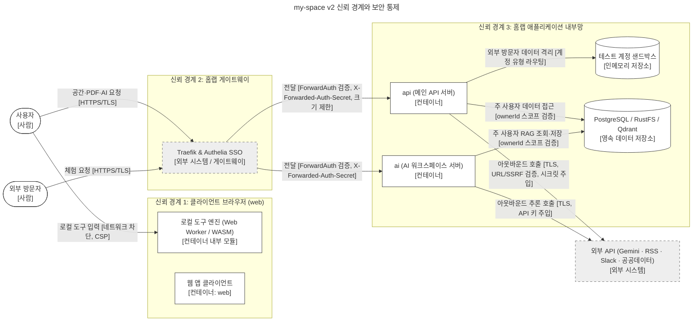

# ARC-007 보안 아키텍처

## 이 문서는

- **목적**: `my-space` v2의 보안 통제를 시스템의 **어디에** 두는지 정한다. 신뢰 경계, 인증·인가가 일어나는 위치, 민감 파일·데이터 보호 구간, 비밀 정보(시크릿) 보관 위치를 다루며 보안 구조의 **기준 문서**다.
- **대상 독자**: 프로젝트 소유자, 백엔드·프론트엔드·인프라 개발자, AI 에이전트
- **작성 시점**: 컨테이너([ARC-004](arc-004-containers-components.md))와 데이터 흐름([ARC-005](arc-005-data-flow.md))이 정해진 뒤 작성한다.
- **등급**: 조건부 — 홈랩 서버에 배포하고 외부 방문자 체험 계정(`visitor`)과 민감 문서·토큰 처리를 함께 제공하는 프로젝트

## 선행 문서와 관련 문서

| 관계 | 문서 | 이유 |
|---|---|---|
| 선행 | [ARC-001 시스템 개요](arc-001-system-overview.md) | 보호할 시스템의 전체 범위 |
| 선행 | [ARC-004 컨테이너와 주요 컴포넌트](arc-004-containers-components.md) | 보안 통제를 배치할 컨테이너와 모듈 |
| 선행 | [ARC-005 데이터 흐름](arc-005-data-flow.md) | 신뢰 경계(`신뢰 경계 1`~`3`)를 넘는 데이터 흐름(`DF-01`~`DF-06`) |
| 관련 | [ARC-002 아키텍처 원칙과 제약](arc-002-principles-constraints.md) | 로컬 격리(`CON-02`), 테스트 계정 분리(`CON-03`), Authelia 위임(`CON-05`) 제약 |
| 관련 | [ARC-006 아키텍처 의사결정 기록(ADR)](arc-006-adr.md) | 하이브리드 처리(`ADR-0001`) 및 인증·격리(`ADR-0004`) 결정 기록 |
| 관련 | [PRD-006 비기능 요구사항](../product/prd-006-nfr.md) | 보안 정량 목표 및 검증 조건(`NFR-006`) |

## 신뢰 경계 [필수]

| 모양 | 요소 종류 |
|---|---|
| 둥근 양 끝 사각형 | 사람 |
| 사각형 (실선) / 원통 | 우리 시스템의 컨테이너 / 데이터 저장소 |
| 사각형 (점선, 회색) | 외부 시스템 및 게이트웨이 |
| 묶음 상자 | 신뢰 경계 ([ARC-005](arc-005-data-flow.md)와 동일한 경계 이름) |
| 화살표 | 경계를 넘는 흐름. 레이블은 "목적 [통제]" |

- **목적**: 신뢰 수준이 다른 3개 구간(`클라이언트 브라우저`, `홈랩 게이트웨이`, `홈랩 애플리케이션 내부망`)과 외부 시스템 사이의 보안 통제 지점을 보여준다.
- **설명**:
  - 가장 중요한 첫 번째 통제는 **민감 도구 데이터를 아예 네트워크에 태우지 않는 것**(`신뢰 경계 1` 내부 완결)이다.
  - 두 번째 통제는 `신뢰 경계 2`에서 `Traefik + Authelia`가 미인증 요청을 차단하고 `X-Forwarded-Auth-Secret`을 주입해 내부 포트 직접 우회 접근을 막는 것이다.
  - 세 번째 통제는 `신뢰 경계 3`의 `api`·`ai` 진입점에서 `Remote-User`가 외부 방문자(`visitor`)인지 판별하여 주 사용자의 영속 저장소(`PostgreSQL`, `RustFS`, `Qdrant`) 접근을 원천 차단하는 것이다.
- **관련 문서**: [ARC-005](arc-005-data-flow.md) (신뢰 경계 이름과 `DF-` 흐름의 기준)

| 경계 | 안쪽 구성 요소 | 넘는 흐름 | 경계에서의 통제 | 관련 요구사항·NFR |
|---|---|---|---|---|
| `신뢰 경계 1: 클라이언트 브라우저 (web)` | `web` (UI 및 로컬 Web Worker/WASM) | `DF-01` (내부 완결), `DF-02`~`DF-06` (발신) | 로컬 전용 도구(`FN-013`, `FN-014`, `FN-018`) 실행 중 외부 네트워크 전송 `0건` 강제, RSS 추출 본문 렌더링 시 XSS 방지를 위한 HTML Sanitize 적용 | `REQ-014`, `REQ-015`, `REQ-019`, `REQ-030`, `NFR-006` |
| `신뢰 경계 2: 홈랩 게이트웨이` | `Traefik` & `Authelia SSO` | `DF-02`~`DF-06` | HTTPS TLS 종료, SSO 세션 검증(Fail-Closed), `Remote-User` 등 신뢰 헤더 덮어쓰기(클라이언트 스푸핑 방지) 및 `X-Forwarded-Auth-Secret` 주입 | `REQ-026`, `REQ-030`, `NFR-006` |
| `신뢰 경계 3: 홈랩 애플리케이션 내부망` | `api`, `ai`, `PostgreSQL`, `RustFS`, `Qdrant`, `RabbitMQ` | `DF-02`~`DF-06` | 프록시 공유 시크릿(`AUTH_FORWARDED_SECRET`) 검증, 사용자 식별자 정규식 검증, 주 사용자(`ownerId`) vs 테스트 계정(`visitor`) 저장소 라우팅 분리, PDF 업로드 `50MB` 상한 및 `qpdf` 비밀번호 `stdin` 전달 | `REQ-012`, `REQ-026`, `REQ-030`, `NFR-006` |

## 인증·인가 위치 [필수]

| 대상 | 인증하는 곳 | 인가를 판단하는 곳 | 세션·토큰 보관 위치 | 관련 결정 및 명세 |
|---|---|---|---|---|
| 사용자 (주 사용자) | `Authelia SSO` 게이트웨이 (`신뢰 경계 2`) | `api` 및 `ai`의 전역 인증 가드(`AutheliaAuthGuard`) + 모든 DB/스토리지 쿼리의 `ownerId` 일치 검증 | 브라우저 `HttpOnly, Secure` SSO 세션 쿠키 (Authelia 관리) | [ADR-0004](adr/adr-0004-forward-auth-and-visitor-isolation.md), 백엔드 `authelia-auth.md` |
| 외부 방문자 (테스트 계정) | `Authelia SSO` 게이트웨이 (테스트 전용 계정 로그인) | `api` 및 `ai`의 계정 격리 가드/인터셉터 (`visitor` 식별 시 영속 DB 쿼리 차단 및 인메모리 샌드박스 라우팅, 외부 웹훅 발송 차단) | 브라우저 `HttpOnly, Secure` SSO 세션 쿠키 + 백엔드 인메모리 세션 샌드박스 키 | [ADR-0004](adr/adr-0004-forward-auth-and-visitor-isolation.md), [PRD-005 FN-025](../product/prd-005-functional-spec.md) |
| 로컬 개발 환경 (`IS_LOCAL=true`) | 로컬 개발 바이패스 (`AutheliaAuthGuard`) | 명시적으로 `IS_LOCAL=true`가 설정되고 `Remote-User`가 없을 때만 `local-admin` Mock 유저 주입 (비로컬 환경은 무조건 Fail-Closed 거부) | 해당 없음 (로컬 개발 전용) | 백엔드 `authelia-auth.md` (`BR-A02`) |

인가는 백엔드 서버(`api`, `ai`)에서 모든 요청마다 판단하며, 프론트엔드 UI 숨김 처리만으로 인가를 대신하지 않는다. [근거: 공식 기술 문서 · OWASP Cheat Sheet Series — Authorization]

## 데이터 보호 [필수]

| 데이터 | 분류 | 전송 중 보호 구간 | 저장 시 보호 | 표시·로그 처리 | 근거 |
|---|---|---|---|---|---|
| 사진 원본·EXIF(GPS 포함), JWT 토큰 | 민감 로컬 도구 데이터 | 전송 안 함 (`신뢰 경계 1` 브라우저 메모리 내 처리) | 영속 저장 안 함 (메모리 휘발) | 서버 액세스 로그·애플리케이션 로그에 기록되지 않음 | `REQ-015`, `REQ-019`, `REQ-030`, [PRD-006 NFR-006](../product/prd-006-nfr.md) |
| 암호화 PDF 파일 및 해제 비밀번호 | 민감 문서·인증 정보 | 클라이언트~게이트웨이 HTTPS TLS | PDF 파일은 `/tmp`에 일시 생성 후 처리 완료·오류 시 즉시 삭제(`60초` 이하). 비밀번호는 디스크에 쓰지 않고 `qpdf` 프로세스 `stdin`으로만 전달 | CLI 인자(`ps aux`) 및 Pino 로그에 비밀번호 평문 노출 금지(`0건`) | `REQ-012`, `REQ-030`, [PRD-006 NFR-006](../product/prd-006-nfr.md) |
| 주 사용자 공간 데이터 (노트, 피드, 관리 일정, AI 대화) | 개인 워크스페이스 자산 | 클라이언트~게이트웨이 HTTPS TLS, 내부 k3s 클러스터 네트워크 격리 | 홈랩 호스트 로컬 스토리지 볼륨(`PostgreSQL`, `RustFS`, `Qdrant`)에 소유자(`ownerId`) 스코프로 격리 저장 | 감사 로그에 `[AUDIT] <user> <method> <url>`만 기록하고 노트 본문·일정 상세는 로그에서 제외 | `REQ-003`~`REQ-011`, `REQ-028`, `NFR-006` |
| 외부 방문자 테스트 계정 데이터 | 체험용 임시 데이터 | 클라이언트~게이트웨이 HTTPS TLS | 영속 디스크에 저장하지 않고 백엔드 인메모리 샌드박스에만 임시 보관 후 TTL 만료·초기화 시 파기 | 주 사용자 영역과 완전 분리 | `REQ-026`, `REQ-030`, `NFR-006` |

## 비밀 정보 위치 [필수]

[근거: 기업 공식 가이드 · AWS Well-Architected Security Pillar SEC02-BP03 — 필요한 시크릿, 저장 위치, 접근 권한자를 목록으로 관리한다]

| 비밀 정보 | 사용하는 구성 요소 | 보관 위치 | 접근 권한 | 비고 |
|---|---|---|---|---|
| 프록시 공유 시크릿 (`AUTH_FORWARDED_SECRET`) | `Traefik/Authelia`, `api`, `ai` | 홈랩 Kubernetes Secret 및 로컬 `.env` (Git 커밋 제외) | 인프라·백엔드 런타임 프로세스 | 게이트웨이를 우회한 직접 포트 호출 차단용 |
| 데이터베이스 및 스토리지 접속 정보 (`DATABASE_URL`, `RUSTFS_*` / `S3_*`, `RABBITMQ_URL`) | `api`, `ai` | 홈랩 Kubernetes Secret 및 로컬 `.env` | 백엔드 런타임 프로세스 | 코드 및 컨테이너 이미지에 하드코딩 금지 |
| 외부 LLM API 키 (`GEMINI_API_KEY`) | `ai` | 홈랩 Kubernetes Secret 및 로컬 `.env` | `ai` 컨테이너 런타임 | 프론트엔드(`web`) 번들에 절대 노출하지 않음 |
| Slack Incoming Webhook URL (`SLACK_WEBHOOK_URL`) | `api` (`NotificationModule`) | 홈랩 Kubernetes Secret (또는 주 사용자 전용 암호화 설정) | `api` 컨테이너 런타임 | 테스트 계정(`visitor`) 세션에는 노출·발송하지 않음 |
| 공공데이터포털 API 인증키 (`HOLIDAY_API_KEY`) | `api` (`HolidayModule`) | 홈랩 Kubernetes Secret 및 로컬 `.env` | `api` 컨테이너 런타임 | 프론트엔드가 직접 외부 API를 부르지 않고 `api`가 대리 조회·캐싱 |

## 보안 통제 배치 [선택]

[근거: 공식 표준 · OWASP ASVS 5.0.0 챕터 분류]

| 통제 | 위치 | ASVS 5.0.0 챕터 | 대응 요구사항·NFR | 관련 결정 |
|---|---|---|---|---|
| 게이트웨이 ForwardAuth 검증 및 공유 시크릿 확인 | `Traefik/Authelia`, `api`, `ai` | V6 인증 / V12 보안 통신 | `REQ-026`, `NFR-006` | [ADR-0004](adr/adr-0004-forward-auth-and-visitor-isolation.md) |
| 주 사용자(`ownerId`) vs 테스트 계정(`visitor`) 강제 격리 라우팅 | `api`, `ai` 인가 계층 | V8 인가 | `REQ-026`, `REQ-030`, `NFR-006` | [ADR-0004](adr/adr-0004-forward-auth-and-visitor-isolation.md) |
| 로컬 도구 무통신 격리 (Browser-Only Execution) | `web` (`ImageWorker`, `DevTools`) | V14 데이터 보호 | `REQ-014`, `REQ-015`, `REQ-019`, `NFR-006` | [ADR-0001](adr/adr-0001-hybrid-client-server-processing.md) |
| PDF 업로드 크기 상한(`50MB`), `qpdf` 비밀번호 `stdin` 파이프 전달, 임시 파일 즉시 삭제 | `api` (`PdfModule`) | V13 구성 / V14 데이터 보호 | `REQ-012`, `REQ-030`, `NFR-006` | [ADR-0001](adr/adr-0001-hybrid-client-server-processing.md) |
| 외부 RSS/원문 수집 시 사설 IP 대역 차단(SSRF 방어) 및 본문 HTML Sanitize | `api` (`FeedModule`), `web` | V12 보안 통신 / V13 구성 | `REQ-004` | [ARC-002 AP-04](arc-002-principles-constraints.md) |

## 검토 체크리스트

- [x] 신뢰 경계 이름과 흐름 ID(`DF-01`~`DF-06`)가 [ARC-005](arc-005-data-flow.md)와 같다
- [x] 경계를 넘는 모든 흐름에 통제가 명시되어 있다
- [x] 두 사용자 유형(주 사용자, 외부 방문자)마다 인증 위치와 인가 판단 위치가 있다
- [x] 민감 도구 입력과 인증 정보마다 전송·저장·파기 보호 방식이 있다
- [x] 비밀 정보 표에 실제 시크릿 값이 없고 보관 위치가 코드·이미지가 아니다
- [x] 통제마다 [PRD-002](../product/prd-002-requirements-scope.md)의 `REQ-` 및 [PRD-006](../product/prd-006-nfr.md)의 `NFR-006`이 연결되어 있다

## 작성 예시

예시 없음 — 실무 프로젝트 문서 본문

## 변경 이력

| 날짜 | 버전 | 변경 내용 | 작성자 |
|---|---|---|---|
| 2026-11-05 | 0.1.0 | my-space v2 보안 아키텍처(ARC-007) 최초 작성 | Antigravity (사용자 검토 대기) |
