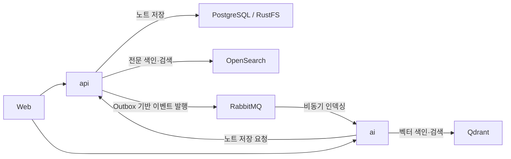
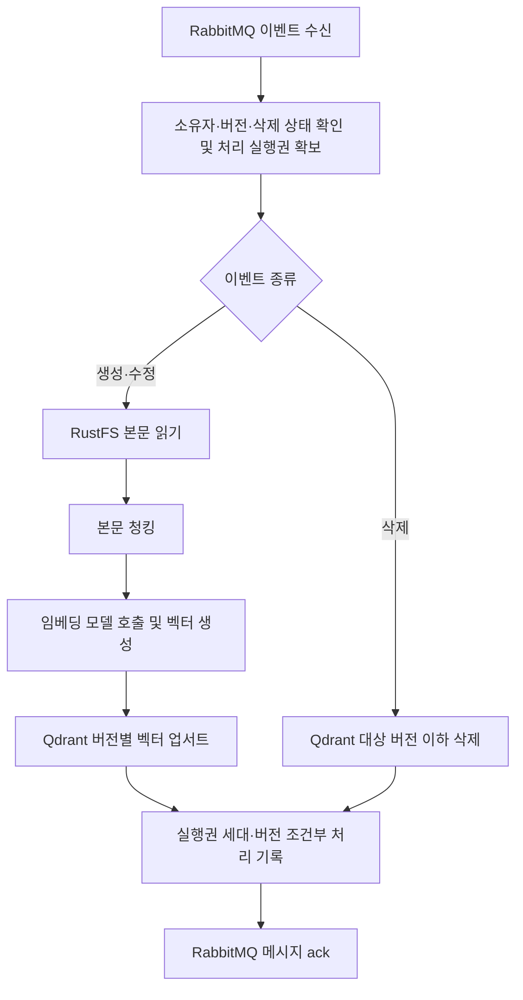

# BE-001 백엔드 아키텍처와 모듈 구조

## 범위와 기준

이 문서는 v2 구현을 위한 검토 명세다. 현재 백엔드 저장소는 v1 구현이며, 아래의 v2 모듈·계약이 구현되었다는 뜻이 아니다. 2026-11-22에 `my-space-backend/package.json`, `pnpm-lock.yaml`, `nest-cli.json`, Dockerfile 및 공통 가드·파이프를 확인했다.

기준: [ARC-004](../architecture/arc-004-containers-components.md), [ARC-005](../architecture/arc-005-data-flow.md), [ADR-0002](../architecture/adr/adr-0002-backend-monorepo-api-ai-separation.md), [ADR-0007](../architecture/adr/adr-0007-visitor-browser-state.md), [ADR-0008](../architecture/adr/adr-0008-note-write-consistency.md), [ADR-0009](../architecture/adr/adr-0009-local-tool-execution-contract.md), [ADR-0010](../architecture/adr/adr-0010-rustfs-v2-adoption.md).

## 기술 기준

| 영역 | 저장소 확인 결과 | 해석 |
|---|---|---|
| TypeScript | 선언 `^6.0.3`, lock `6.0.3` | 6.x |
| NestJS common/core | 선언 `^12.0.1`, lock `12.0.3` | 12.x; 개별 Nest 패키지의 패치 버전은 다를 수 있음 |
| Node.js | Dockerfile `24.22.1-bookworm-slim` | 이미지 선언 기준; 배포 실행 버전 확인과 구분 |
| pnpm | `packageManager` 및 Dockerfile `12.4.2` | pnpm workspaces |
| 빌드 | Nest CLI monorepo, Rspack | api/ai 독립 빌드 |
| Prisma | CLI `6.19.3`, Client `^6.19.3` | PostgreSQL 스키마 관리 |
| S3 SDK | `@aws-sdk/client-s3 ^3.1146.0` | SDK 버전과 RustFS 서버 버전은 별개 |
| OpenSearch SDK | `@opensearch-project/opensearch ^3.9.0` | 서버 버전은 INF 배포 설정에서 검증 |
| Qdrant SDK | `@qdrant/js-client-rest ^1.19.0` | 서버 버전과 구분 |
| RabbitMQ 클라이언트 | `amqplib ^2.2.0` | 브로커 버전과 구분 |
| 입력 검증 | `zod ^4.6.5`, `ZodValidationPipe` | Joi/class-validator 도입을 전제하지 않음 |
| 검사 | Vitest, Oxlint, TypeScript | 실행 명령은 backend package.json 기준 |
| PDF | API 이미지에 qpdf 설치 | 현재 apt 설치는 버전 미고정; 배포 재현성 검증 때 버전 확인 |

RustFS는 ADR-0010에 따라 검증한 이미지로 고정하고 실제 사용하는 S3 기능과 재기동 보존을 시험한다. 이 문서는 현재 서버 버전이나 전체 S3 호환성을 검증 완료로 선언하지 않는다.

## 계층과 책임

DDD와 클린 아키텍처의 방향에 따라 기능별 업무 규칙을 내부에 두고 프레임워크·저장소·전송 방식은 외부 구현으로 분리한다. 아래는 프로젝트의 계층 구분이며 NestJS 구성 요소 자체를 계층명으로 사용하지 않는다.

| 계층 | 책임 | 구현 예 |
|---|---|---|
| 인터페이스 (Interface) | 외부 요청·이벤트를 유스케이스 입력으로 변환, 인증 문맥·입력 검증, HTTP/SSE·메시지 결과 변환 | Controller, Guard, Pipe, 메시지 Consumer, Exception Filter |
| 애플리케이션 (Application) | 유스케이스 실행과 조합, 트랜잭션 경계·실행권 제어, 권한 정책 적용 | Use Case, Application Service, 입출력 포트 |
| 도메인 (Domain) | BE-005의 업무 규칙·불변 조건·상태 전이 | Entity, Value Object, Domain Service |
| 인프라스트럭처 (Infrastructure) | 저장소·외부 시스템 포트 구현, 기술 오류를 내부 오류로 변환 | Prisma Repository, S3/Qdrant Adapter, 메시지 Publisher |

- 소스 코드 의존성은 내부로 향한다. 인터페이스는 애플리케이션을 호출하고, 애플리케이션은 도메인과 내부 포트에 의존한다. 인프라스트럭처가 포트를 구현하며 실행 시 조립 지점에서 주입한다.
- 도메인과 애플리케이션은 NestJS 요청 객체, Prisma 모델, Qdrant SDK 타입을 계약으로 사용하지 않는다. 저장소 인터페이스는 필요에 따라 내부 계층에 두며 구체 구현을 import하지 않는다.
- Guard의 인증 검사만으로 업무 인가를 끝내지 않는다. 소유권과 역할에 따른 유스케이스 허용 여부는 HTTP·큐·내부 호출 모두에서 동일하게 적용한다.
- 도메인·애플리케이션 오류를 BE-013의 HTTP/SSE 응답으로 변환하는 책임은 인터페이스 계층에 있다. 인프라스트럭처가 HTTP 상태를 결정하지 않는다.
- 아래 서비스 간 데이터 흐름은 런타임 통신이며 위의 소스 코드 의존성과 구분한다.

## 모노레포와 v2 모듈

기능 영역 이름은 `Markdown`, `Feed`, `Management`처럼 표기한다. `MarkdownModule` 등의 이름은 실제 NestJS 클래스명을 설명할 때만 사용한다. 각 영역을 모두 독립 Bounded Context로 확정한다는 의미는 아니다.

```text
apps/api  # 인증, 노트, 피드, 관리, Catch-up, 알림, PDF, 홈 요약/공휴일
apps/ai   # 텍스트/음성 대화, RAG, 벡터 색인 소비
libs/common        # 공통 가드, 파이프, 오류, 로그/헬스
libs/config        # 설정 및 검증
libs/storage       # 저장소 어댑터
libs/markdown-core # 공통 마크다운 처리
```

위 디렉터리 기반은 현재 저장소에 있다. 피드·관리·Catch-up 등 v2 기능별 모듈 완성 여부는 별도로 구현 검증한다. 디렉터리 예시는 예정 기능을 현재 존재하는 코드로 단정하지 않는다.

| 소유 모듈 | 데이터/작업 | 기준 |
|---|---|---|
| api Markdown | 노트 생성·수정·리비전 복원·삭제, 이미지, 태그 | BE-005 BR-001~004, ADR-0008 |
| api Feed | RSS 수집, 읽음/북마크, 키워드, 본문 추출 | BR-010~012 |
| api Management/Catchup | 3대 날짜 모델, 작업별 체크포인트 | BR-020~024 |
| api Notification | 인앱 알림 및 외부 채널 전송 재시도 | BR-021, ARC-005 |
| api PDF | 사용자 실행에 따른 임시 파일 연산 | BR-050, ADR-0009 |
| api Home/Holiday | 소유자별 공간 요약, 공휴일 캐시 조회·갱신 | PRD-005 FN-002·023 |
| ai Chat/Voice | 생성·스트리밍·중단, 대화 세션 | BR-030 |
| ai Index/Search | RabbitMQ 소비, Qdrant 파생 색인, 소유자 필터 RAG | BR-004·031 |

## 의존성과 데이터 흐름

### 개요도 — 서버와 저장소의 역할

노트 저장은 `api`, 벡터 인덱싱과 RAG 검색은 `ai`가 담당한다. 아래 선은 주요 런타임 통신을 나타내며 상세 처리 순서와 소스 코드 의존성은 생략한다.



`api`는 노트·Outbox 커밋 후 저장 성공을 반환한다. OpenSearch 갱신과 RabbitMQ 발행은 커밋된 Outbox를 처리하는 비동기 작업이며, 노트 저장 응답이 Qdrant 반영을 기다리지 않는다. `ai`의 원문·메타데이터 읽기와 모델 호출은 아래 상세 처리도에서 설명한다.

### 상세 처리도 — 벡터 인덱싱

아래는 `ai` 인덱싱 워커가 노트 변경 이벤트를 처리하는 순서다. 청킹·임베딩 단계는 같은 `apps/ai` 내부 작업이며 별도 서버를 추가하는 의미가 아니다.



- 메타데이터·현재 버전·삭제 상태는 PostgreSQL에서 확인한다. 타깃별 문서 실행권으로 처리를 직렬화하고, Qdrant 반영 전에도 실행권과 적용 가능 버전을 검증한다. 반영 후에는 실행권 세대·만료·버전 조건으로 완료를 기록하며, 조건 불일치는 새 실행권이나 처리 버전을 변경하지 않는다.
- 이미 처리한 이벤트나 오래된 버전은 다시 반영하지 않고 안전하게 확인 처리한다. 삭제 표식은 늦게 도착한 수정 이벤트로 문서가 부활하는 것을 막는다.
- 삭제 이벤트는 원문 읽기·청킹·임베딩을 생략한다. 유효한 생성·수정 이벤트만 모델을 호출한다.
- 외부 반영과 처리 상태 기록이 끝난 뒤 ack한다. 중간 장애는 재전달 시 중복에 안전하게 처리하며, 실패는 제한된 재시도 후 수동 복구 대상으로 남긴다. 상세 복구 계약은 [ADR-0008](../architecture/adr/adr-0008-note-write-consistency.md)과 [BE-005 BR-004](be-005-domain-model-rules.md)를 따른다.

### 의존성 규칙

- `apps/api`와 `apps/ai` 사이의 직접 코드 import 및 `libs/*`의 앱 역참조를 금지한다. 내부 HTTP와 큐 통신은 허용한다.
- 노트의 쓰기 소유자는 api다. AI `save_to_markdown`도 검증된 사용자 문맥과 요청 식별자를 전달하여 동일 유스케이스를 호출한다. ai는 노트 DB·본문 객체를 직접 수정하지 않는다.
- 내부 호출은 네트워크 위치만 신뢰하지 않는다. 호출자 인증과 전달 사용자·역할을 검증하고 원 요청의 소유자 범위로 제한한다. 내부 저장 경로는 외부 Ingress에 공개하지 않는다.
- 공유 저장소 어댑터가 있어도 모든 앱에 모든 쓰기 권한을 주지 않는다. 대화 데이터는 ai, 노트는 api가 소유한다.
- OpenSearch와 Qdrant는 파생 데이터다. Outbox·발행 확인·소비 확인·버전 순서·삭제 표식은 [BE-005](be-005-domain-model-rules.md), 물리 상태는 [BE-006](be-006-database-erd.md)를 따른다.

## 횡단 관심사와 실행 경계

실제 공통 구현은 `RemoteUserGuard`, `ZodValidationPipe`, `AllExceptionsFilter`다. 현재 사용자 구조의 식별자는 `username`이며 임의의 `req.user.id`를 구현 사실로 쓰지 않는다. v2 역할·소유자 정책은 [BE-004](be-004-authn-authz.md), 오류 계약은 [BE-013](be-013-error-handling.md), HTTP는 [BE-002](be-002-api-design-guide.md)를 따른다.

방문자 변경은 브라우저 메모리에만 반영한다. 서버 세션 저장소나 SandboxInterceptor를 만들지 않는다. 개인 공간·외부 AI·Slack·색인 쓰기를 거부하고 PDF의 임시 서버 처리는 별도 허용한다.

로그에는 요청 식별자, operationId, 결과 코드, 소요 시간만 필요한 범위로 남긴다. 비밀번호·인증 헤더·노트 본문·음성 원본·AI 프롬프트·외부 비밀 값은 기록하지 않는다. 외부 호출은 타임아웃과 취소를 전달하며, 재시도 가능한 파생 작업만 제한된 재시도 후 운영자 복구 대상으로 전환한다. 구체 상태는 BE-006, 실패 응답은 BE-013이 기준이다.

배포 전 검증: 신뢰 헤더 우회, 방문자 데이터 접근, 동시 저장, 커밋 직후 종료, 색인 순서 역전, Catch-up 중복 실행, PDF 강제 종료 정리를 확인한다. 이 문서 수정은 이 시험의 통과를 뜻하지 않는다.

## 색인 동시성 보안 계약

상세 처리도의 사전 실행권 검사는 외부 저장소의 오래된 쓰기를 원자적으로 차단하지 못한다. Qdrant는 버전·임베딩 설정별 point ID를 사용하고 검색/RAG는 PostgreSQL의 현재 소유자·버전·미삭제 상태로 후보를 검증한다. 실행권 세대에 따른 조건부 완료 기록과 고아 색인 정리를 함께 적용한다. [BE-005 BR-004 보완](be-005-domain-model-rules.md), [BE-006](be-006-database-erd.md)이 상세 기준이다. 기존 api/ai 책임과 비동기 저장 성공 기준은 유지한다.

## 변경 이력

| 날짜 | 버전 | 변경 내용 | 작성자 |
|---|---|---|---|
| 2026-11-22 | 1.1.3 | 벡터 상세 처리도에 버전별 쓰기·삭제와 조건부 완료 계약 반영 | AI 에이전트 |
| 2026-11-12 | 1.0.0 | 최초 검토안 | @bob (Keunhyeok Lim) |
| 2026-11-22 | 1.1.0 | 실제 기술 설정 및 승인된 PRD·ADR·ARC와 정합성 보완. 사용자 검토 대기 | AI 에이전트 |
| 2026-11-22 | 1.1.1 | DDD·클린 아키텍처 계층/의존 규칙, 기능 영역 명칭, 비동기 벡터 인덱싱 흐름 명확화 | AI 에이전트 |
| 2026-11-22 | 1.1.2 | 서버·저장소 개요도와 벡터 인덱싱 상세 처리도 분리; 책임 및 저장 경계 유지 | AI 에이전트 |
