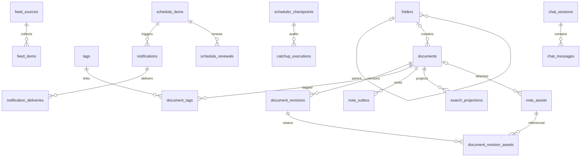

# BE-006 데이터베이스 설계와 ERD

## 기준과 구현 상태

v2 물리 모델의 검토안이다. 현재 v1 `prisma/schema.prisma`와 일치하는 구현 완료 스키마로 취급하지 않는다. 기존 ENT-001~013 번호를 유지하고 저장 복구·캐시·첨부에 필요한 ENT-014~022를 추가한다. 상태·규칙은 [BE-005](be-005-domain-model-rules.md), 원자성은 [ADR-0008](../architecture/adr/adr-0008-note-write-consistency.md)과 [ARC-005](../architecture/arc-005-data-flow.md)를 따른다.

## 공통 규칙

snake_case 테이블·컬럼, UUID 기본 키, UTC TIMESTAMPTZ와 DATE를 구분한다. 원 단위 금액은 정수다. 아래 표의 `/`로 묶인 이름은 같은 타입·제약의 별도 컬럼이다. NULL 허용 여부를 명시하며 상태 목록은 BE-005를 기준으로 CHECK/enum으로 구현한다. 이름·본문·사용자 식별자·일정·대화는 개인 정보가 포함될 수 있는 사용자 데이터이며 샘플로 노출하지 않는다. 비밀번호·토큰은 저장하지 않는다.

삭제는 객체별 FK 정책을 따른다. 노트 삭제 표식은 사용자 복원용 휴지통이 아니라 파생 색인의 부활 방지용이다. 데이터 보존 기간·백업·파기는 운영 정책과 연결하며 무기한 본문 보관을 기본값으로 단정하지 않는다. 조회는 deleted_at IS NULL 및 owner_id를 항상 적용한다.

## 엔티티 목록

| ENT ID | 테이블 | 도메인 객체 |
|---|---|---|
| ENT-001 | `folders` | Folder |
| ENT-002 | `documents` | Document |
| ENT-003 | `document_revisions` | DocumentRevision |
| ENT-004 | `tags` | Tag |
| ENT-005 | `document_tags` | DocumentTag |
| ENT-006 | `feed_sources` | FeedSource |
| ENT-007 | `feed_items` | FeedItem |
| ENT-008 | `feed_filter_rules` | FeedFilterRule |
| ENT-009 | `schedule_items` | ScheduleItem |
| ENT-010 | `notifications` | Notification |
| ENT-011 | `catchup_executions` | CatchupExecution |
| ENT-012 | `chat_sessions` | ChatSession |
| ENT-013 | `chat_messages` | ChatMessage |
| ENT-014 | `note_outbox` | NoteOutbox |
| ENT-015 | `request_dedup` | RequestDedup |
| ENT-016 | `scheduler_checkpoints` | SchedulerCheckpoint |
| ENT-017 | `notification_deliveries` | NotificationDelivery |
| ENT-018 | `schedule_renewals` | ScheduleRenewal |
| ENT-019 | `search_projections` | SearchProjection |
| ENT-020 | `holiday_cache` | HolidayCache |
| ENT-021 | `note_assets` | NoteAsset |
| ENT-022 | `document_revision_assets` | DocumentRevisionAsset |

## 관계와 ERD

FK와 삭제 동작은 각 필드 표가 기준이다. owner_id는 외부 인증 식별자이므로 로컬 users FK가 아니다. RequestDedup, HolidayCache, FeedFilterRule은 독립 루트다. CatchupExecution은 개별 Notification의 부모가 아니라 작업 실행 기록이다. 이 모델에 없는 FK 관계를 ERD에 추가하지 않는다.

## 테이블 정의

### ENT-001 `folders` — Folder

| 컬럼 | 타입 | 제약·의미 |
|---|---|---|
| id | UUID | PK |
| owner_id | TEXT | NOT NULL |
| parent_id | UUID | NULL, FK folders SET NULL |
| name | TEXT | NOT NULL, 공백 제거 후 빈 이름 금지 |
| created_at / updated_at | TIMESTAMPTZ | NOT NULL |

UNIQUE(owner_id, parent_id, name), 루트 parent_id IS NULL에는 UNIQUE(owner_id, name) 부분 인덱스를 추가한다. 계층 순환은 트랜잭션 내 BR-002 검증.

### ENT-002 `documents` — Document

| 컬럼 | 타입 | 제약·의미 |
|---|---|---|
| id | UUID | PK |
| owner_id | TEXT | NOT NULL |
| folder_id | UUID | NULL, FK folders SET NULL |
| title | TEXT | NOT NULL, 정규화된 제목 |
| current_version | INT | NOT NULL, >0 |
| object_key | TEXT | NULL은 삭제 표식일 때만 허용 |
| deleted_at | TIMESTAMPTZ | NULL, 사용자 삭제 시 설정 |
| created_at / updated_at | TIMESTAMPTZ | NOT NULL |

미삭제 문서에 UNIQUE(owner_id, folder_id, title), 루트 미삭제 문서에는 UNIQUE(owner_id, title) 부분 인덱스. INDEX(owner_id, updated_at, id). current_version 조건부 갱신으로 동시 수정 검사. deleted_at은 휴지통이 아니라 재색인·재처리 방어용 표식이다.

### ENT-003 `document_revisions` — DocumentRevision

| 컬럼 | 타입 | 제약·의미 |
|---|---|---|
| id | UUID | PK |
| document_id | UUID | NOT NULL, FK documents RESTRICT |
| version | INT | NOT NULL, >0 |
| title / object_key | TEXT | NOT NULL |
| created_at | TIMESTAMPTZ | NOT NULL |

UNIQUE(document_id, version). 일반 쓰기 경로는 INSERT만 허용한다. unique만으로 불변성이 보장되는 것은 아니며 UPDATE 권한/서비스 경로를 제한한다. 본문 삭제 정리는 별도 운영 작업이다.

### ENT-004 `tags` — Tag

| 컬럼 | 타입 | 제약·의미 |
|---|---|---|
| id | UUID | PK |
| owner_id / name | TEXT | NOT NULL |
| created_at | TIMESTAMPTZ | NOT NULL |

UNIQUE(owner_id, name). 이름 앞뒤 공백 제거·빈 값 거부.

### ENT-005 `document_tags` — DocumentTag

| 컬럼 | 타입 | 제약·의미 |
|---|---|---|
| document_id | UUID | FK documents CASCADE |
| tag_id | UUID | FK tags CASCADE |

PRIMARY KEY(document_id, tag_id), INDEX(tag_id). 문서와 태그 소유자 동일성은 저장 트랜잭션에서 검사한다.

### ENT-006 `feed_sources` — FeedSource

| 컬럼 | 타입 | 제약·의미 |
|---|---|---|
| id | UUID | PK |
| owner_id / url / normalized_url / title | TEXT | NOT NULL |
| status | TEXT | NOT NULL, BE-005 FeedSource 상태 |
| etag / last_modified / last_error_code | TEXT | NULL |
| last_success_at | TIMESTAMPTZ | NULL, 최초 수집 전 |
| created_at / updated_at | TIMESTAMPTZ | NOT NULL |

UNIQUE(owner_id, normalized_url), INDEX(owner_id, status). 삭제와 수집 결과 커밋을 직렬화한다.

### ENT-007 `feed_items` — FeedItem

| 컬럼 | 타입 | 제약·의미 |
|---|---|---|
| id | UUID | PK |
| source_id | UUID | NOT NULL, FK feed_sources CASCADE |
| dedup_key / title / url | TEXT | NOT NULL |
| summary / content | TEXT | NULL |
| content_status | TEXT | NOT NULL, SUMMARY/EXTRACTED/FAILED |
| classification | TEXT | NOT NULL, BE-005 분류 |
| score | INT | NOT NULL, >=0 |
| is_read / is_starred | BOOLEAN | NOT NULL, DEFAULT false |
| published_at | TIMESTAMPTZ | NULL |
| collected_at / updated_at | TIMESTAMPTZ | NOT NULL |

UNIQUE(source_id, dedup_key), INDEX(source_id, collected_at, id). 소유자는 출처를 통해 확인한다.

### ENT-008 `feed_filter_rules` — FeedFilterRule

| 컬럼 | 타입 | 제약·의미 |
|---|---|---|
| id | UUID | PK |
| owner_id / keyword / normalized_keyword | TEXT | NOT NULL |
| rule_type | TEXT | NOT NULL, INCLUDE/EXCLUDE |
| weight | INT | NOT NULL, INCLUDE는 1~10, EXCLUDE는 0 |
| is_active | BOOLEAN | NOT NULL |
| created_at / updated_at | TIMESTAMPTZ | NOT NULL |

UNIQUE(owner_id, normalized_keyword). 가중치 범위는 구현 계약의 검토 제안이다. 변경 시 해당 소유자의 기존 글을 재평가한다.

### ENT-009 `schedule_items` — ScheduleItem

| 컬럼 | 타입 | 제약·의미 |
|---|---|---|
| id | UUID | PK |
| owner_id / title / category | TEXT | NOT NULL |
| schedule_type | TEXT | NOT NULL, BE-005 3유형 |
| base_date / target_date | DATE | NOT NULL, 원 기준일/다음 또는 고정 대상일 |
| amount_krw | BIGINT | NULL, 정기 결제만 >=0 |
| cycle_unit | TEXT | NULL, WEEK/MONTH/YEAR |
| cycle_interval | INT | NULL, 정기 결제만 >0 |
| annual_repeat | BOOLEAN | NOT NULL, DEFAULT false |
| days_before | INT[] | NOT NULL, 0 이상 중복 없는 값 |
| is_active | BOOLEAN | NOT NULL, DEFAULT true |
| version | INT | NOT NULL, DEFAULT 1, >0 |
| created_at / updated_at | TIMESTAMPTZ | NOT NULL |

INDEX(owner_id, target_date, id). 정기 결제는 금액·주기 필수, 다른 유형은 null. annual_repeat=true는 SINGLE_DATE만 허용. 상태는 날짜와 활성 여부로 계산한다. 모든 수정은 version 조건부 갱신.

### ENT-010 `notifications` — Notification

| 컬럼 | 타입 | 제약·의미 |
|---|---|---|
| id | UUID | PK |
| owner_id | TEXT | NOT NULL |
| schedule_item_id | UUID | NOT NULL, FK schedule_items CASCADE |
| target_date | DATE | NOT NULL, 당시 발생 기준일 |
| days_before | INT | NOT NULL, >=0 |
| title / message / target_route | TEXT | NOT NULL, 내부 경로만 허용 |
| is_read / is_catchup | BOOLEAN | NOT NULL, DEFAULT false |
| notify_at / created_at | TIMESTAMPTZ | NOT NULL |

UNIQUE(schedule_item_id, target_date, days_before), INDEX(owner_id, created_at, id). 일정 삭제는 대기 전송도 취소한다. 완료된 외부 전송은 취소할 수 없다.

### ENT-011 `catchup_executions` — CatchupExecution

| 컬럼 | 타입 | 제약·의미 |
|---|---|---|
| id | UUID | PK |
| task_key | TEXT | NOT NULL, FK scheduler_checkpoints RESTRICT |
| from_at | TIMESTAMPTZ | NULL, 최초 실행 |
| to_at / started_at | TIMESTAMPTZ | NOT NULL |
| finished_at | TIMESTAMPTZ | NULL |
| status | TEXT | NOT NULL, RUNNING/COMPLETED/FAILED |
| processed_count | INT | NOT NULL, >=0 |
| error_code | TEXT | NULL |

INDEX(task_key, started_at). 마지막 종료 시각을 필수 입력으로 삼지 않는다. 실패 기록은 성공 체크포인트를 전진시키지 않는다.

### ENT-012 `chat_sessions` — ChatSession

| 컬럼 | 타입 | 제약·의미 |
|---|---|---|
| id | UUID | PK |
| owner_id / title | TEXT | NOT NULL |
| mode | TEXT | NOT NULL, CHAT/VOICE/RAG |
| created_at / updated_at | TIMESTAMPTZ | NOT NULL |

INDEX(owner_id, updated_at, id). ai가 소유하며 사용자 문맥을 검증한다.

### ENT-013 `chat_messages` — ChatMessage

| 컬럼 | 타입 | 제약·의미 |
|---|---|---|
| id | UUID | PK |
| session_id | UUID | NOT NULL, FK chat_sessions CASCADE |
| request_id | UUID | NOT NULL |
| role | TEXT | NOT NULL, USER/ASSISTANT/SYSTEM |
| content | TEXT | NOT NULL |
| stream_status | TEXT | NOT NULL, BE-005 상태: FAILED 포함 |
| error_code | TEXT | NULL |
| token_count | INT | NULL, >=0 |
| created_at / updated_at | TIMESTAMPTZ | NOT NULL |

INDEX(session_id, created_at, id), UNIQUE(request_id, role). 원본 음성/TTS의 영구 보관을 기본으로 하지 않는다.

### ENT-014 `note_outbox` — NoteOutbox

| 컬럼 | 타입 | 제약·의미 |
|---|---|---|
| event_id | UUID | PK |
| owner_id | TEXT | NOT NULL |
| document_id | UUID | NOT NULL, FK documents RESTRICT |
| revision | INT | NOT NULL, >0 |
| event_type | TEXT | NOT NULL, UPSERT/DELETE |
| object_key | TEXT | UPSERT 필수, DELETE null |
| search_status / publish_status | TEXT | NOT NULL, PENDING/PROCESSING/SENT/FAILED |
| search_attempts / publish_attempts | INT | NOT NULL, >=0 |
| search_next_at / publish_next_at | TIMESTAMPTZ | NULL |
| lease_owner | TEXT | NULL |
| lease_until | TIMESTAMPTZ | NULL |
| last_error_code | TEXT | NULL |
| created_at | TIMESTAMPTZ | NOT NULL |

UNIQUE(document_id, revision, event_type), 각 status/next_at 인덱스. 검색 성공과 publisher confirm을 독립 기록한다. 만료된 실행권은 회수하며 실패 횟수 상한 이후 수동 복구한다.

### ENT-015 `request_dedup` — RequestDedup

| 컬럼 | 타입 | 제약·의미 |
|---|---|---|
| owner_id / operation_id / request_key | TEXT | 복합 PK |
| input_hash | TEXT | NOT NULL |
| status | TEXT | NOT NULL, PROCESSING/COMPLETED |
| lease_owner | TEXT | NULL |
| lease_until | TIMESTAMPTZ | NULL |
| response_status | INT | NULL, 완료 시 필수 |
| response_body | JSONB | NULL, 완료 응답의 최소 필드만 |
| created_at / expires_at | TIMESTAMPTZ | NOT NULL |

PRIMARY KEY(owner_id, operation_id, request_key). INDEX(expires_at). 노트 커밋과 결과 기록을 원자화하며 실행권 만료 후 복구한다. 저장 응답에는 본문을 넣지 않고 documentId/version만 재생한다.

### ENT-016 `scheduler_checkpoints` — SchedulerCheckpoint

| 컬럼 | 타입 | 제약·의미 |
|---|---|---|
| task_key | TEXT | PK, 일정 판별/소유자 또는 RSS/출처 단위 |
| last_run_at | TIMESTAMPTZ | NULL, 최초 실행 |
| lease_owner | TEXT | NULL |
| lease_until | TIMESTAMPTZ | NULL |
| updated_at | TIMESTAMPTZ | NOT NULL |

작업 키별 조건부 실행권 획득. 최초 실행은 활성 일정의 기준일부터 현재까지 판별하고 이미 저장된 중복 키는 건너뛴다. RSS는 현재 원천이 제공하는 범위만 수집한다. 커밋 때 실행권 소유자를 다시 검사한다.

### ENT-017 `notification_deliveries` — NotificationDelivery

| 컬럼 | 타입 | 제약·의미 |
|---|---|---|
| id | UUID | PK |
| notification_id | UUID | NOT NULL, FK notifications CASCADE |
| channel | TEXT | NOT NULL, SLACK |
| status | TEXT | NOT NULL, BE-005 전송 상태 |
| attempts | INT | NOT NULL, >=0 |
| next_attempt_at / sent_at | TIMESTAMPTZ | NULL |
| lease_owner | TEXT | NULL |
| lease_until | TIMESTAMPTZ | NULL |
| last_error_code | TEXT | NULL |
| created_at / updated_at | TIMESTAMPTZ | NOT NULL |

UNIQUE(notification_id, channel), INDEX(status, next_attempt_at). 웹훅 비밀은 테이블에 넣지 않고 Secret 설정에서 읽는다.

### ENT-018 `schedule_renewals` — ScheduleRenewal

| 컬럼 | 타입 | 제약·의미 |
|---|---|---|
| id | UUID | PK |
| schedule_item_id | UUID | NOT NULL, FK schedule_items CASCADE |
| old_date / new_date | DATE | NOT NULL, new_date > old_date |
| version | INT | NOT NULL, 갱신 후 버전 |
| created_at | TIMESTAMPTZ | NOT NULL |

UNIQUE(schedule_item_id, version). 갱신과 일정 변경은 같은 트랜잭션이다.

### ENT-019 `search_projections` — SearchProjection

| 컬럼 | 타입 | 제약·의미 |
|---|---|---|
| document_id | UUID | NOT NULL, FK documents RESTRICT |
| target | TEXT | NOT NULL, OPENSEARCH 또는 QDRANT:모델:컬렉션 |
| applied_revision | INT | NOT NULL, >=0 |
| is_deleted | BOOLEAN | NOT NULL |
| last_event_id | UUID | NULL |
| lease_owner | TEXT | NULL |
| lease_generation | BIGINT | NOT NULL, >=0, 실행권 획득마다 증가 |
| lease_until | TIMESTAMPTZ | NULL |
| updated_at | TIMESTAMPTZ | NOT NULL |

PRIMARY KEY(document_id, target). 타깃별 문서 처리 직렬화. 외부 반영 후 버전 기록·ack하며 중단 후 같은 이벤트 재처리는 안전해야 한다. 삭제 표식은 모든 재시도/복구가 끝나기 전 제거하지 않는다.

실행권 재획득마다 generation을 증가시키고 외부 반영 후 owner·generation·만료 시각·버전 조건으로 갱신한다. 이 DB 조건은 외부 저장소 fencing 자체가 아니다. 버전별 색인 키, 조회 시 DB 검증, 고아 정리 및 장애 시나리오는 BE-005 BR-004 보완을 필수 적용한다.

### ENT-020 `holiday_cache` — HolidayCache

| 컬럼 | 타입 | 제약·의미 |
|---|---|---|
| country_code | TEXT | 복합 PK, KR |
| year | INT | 복합 PK |
| days | JSONB | NOT NULL, 날짜·이름 목록 |
| fetched_at | TIMESTAMPTZ | NOT NULL |
| last_error_code | TEXT | NULL |

PRIMARY KEY(country_code, year). 갱신 실패 시 기존 캐시와 fetchedAt·stale을 반환하고 데이터 없음은 오류로 구분한다.

### ENT-021 `note_assets` — NoteAsset

| 컬럼 | 타입 | 제약·의미 |
|---|---|---|
| id | UUID | PK |
| owner_id / object_key / mime_type | TEXT | NOT NULL |
| document_id | UUID | NULL, FK documents RESTRICT |
| size_bytes | BIGINT | NOT NULL, >0 |
| created_at | TIMESTAMPTZ | NOT NULL |

추가 필드: `status TEXT NOT NULL`(AVAILABLE/DELETING), `protected_until TIMESTAMPTZ NOT NULL`(서버가 제한하는 업로드·편집 보호 시각). 업로드 완료된 객체만 AVAILABLE로 등록한다.

UNIQUE(object_key), INDEX(owner_id, document_id), INDEX(status, protected_until). document_id가 null이면 사용자 초안 첨부다. 첫 저장 시 같은 소유자의 문서에 귀속시키며 다른 문서로 재귀속하지 않는다. 모든 보존 리비전의 ENT-022 참조와 활성 작업·유예를 검사한 후에만 정리한다. 연결과 GC는 첨부 행 잠금으로 직렬화하고 DELETING에는 새 참조를 금지한다. 상세는 BE-005 BR-001 보완을 따른다.

### ENT-022 `document_revision_assets` — DocumentRevisionAsset

| 컬럼 | 타입 | 제약·의미 |
|---|---|---|
| revision_id | UUID | NOT NULL, FK document_revisions RESTRICT |
| asset_id | UUID | NOT NULL, FK note_assets RESTRICT |

PRIMARY KEY(revision_id, asset_id), INDEX(asset_id). 리비전 생성과 함께 참조 집합을 원자적으로 저장한다. 리비전의 document_id와 첨부의 document_id 및 owner_id가 같음을 트랜잭션에서 검증한다. 리비전이 유지되는 동안 참조 집합은 변경하지 않으며 복원은 새 리비전에 복제한다. 보존 정책에 따른 리비전 파기 시 참조를 먼저 삭제하고 첨부 GC는 별도로 수행한다.

## 비관계형 저장소

### RustFS

검증한 버전/digest와 S3 기능만 사용한다([ADR-0010](../architecture/adr/adr-0010-rustfs-v2-adoption.md)). 버킷·접속 주소·자격 증명은 배포 설정이며 여기의 이름을 실제 운영값으로 단정하지 않는다. 본문 키는 `notes/{ownerId}/{documentId}/{writeId}.md`로 실행별 고유하며 DB 리비전이 정확한 키를 참조한다. 동일 버전 번호를 경쟁 요청이 덮어쓰지 않는다. 이미지도 난수 키를 사용하고 파일 원래 이름·비밀번호를 경로에 넣지 않는다. 첨부 조회는 문서 소유권을 확인한다.

미참조 객체는 유예 기간 후 DB 참조와 활성 실행권을 재확인하여 정리한다. 삭제된 노트의 본문/리비전 객체 정리는 색인 삭제 완료와 재처리 안전성을 확인한 후 수행한다. 백업 보존 정책과 사용자 데이터 파기는 별도 운영 기준에 연결한다.

### OpenSearch

PostgreSQL/RustFS에서 재생성 가능한 파생 색인이다. documentId, ownerId, revision, title, body, tags, updatedAt을 색인하며 한국어 분석기 지원을 실제 서버에서 검증한다. 문서 버전 조건과 삭제 표식은 BR-004를 따른다. SDK 3.x로 서버 제품 버전을 추론하지 않는다.

### Qdrant

현재 코드 `QdrantService.vectorDimension`은 768이며 기본 설정은 Gemini `gemini-embedding-001` / Ollama `nomic-embed-text`다. 이는 현재 코드 설정 확인값이며 실배포 모델 응답 검증 결과는 아니다. v2도 검증된 모델·출력 차원·거리·컬렉션 조합을 고정한다. OpenAI 1536차원을 기본 사실로 쓰지 않는다. 모델/차원 변경 시 기존 컬렉션에 혼합하지 않고 새 컬렉션 재색인 후 전환한다.

페이로드는 ownerId, documentId, revision, chunkId, embeddingModel, embeddingConfigId, text를 포함한다. ownerId/embeddingModel 필터와 현재 문서 상태 확인을 적용한다. 삭제 표식과 appliedRevision은 ENT-019에 기록한다. ai 소비자는 Qdrant 반영과 실행권 세대에 따른 조건부 처리 기록이 끝난 뒤에만 완료 ack한다. 오래된 이벤트의 안전한 폐기는 현재 DB 상태 검증을 전제로 한다.

## 무결성·복구 검증

루트 폴더/문서 중복, 교차 소유자 FK, 폴더 순환, 동시 버전 갱신, 리비전 불변성, 알림 중복 키, 실행권 만료 회수, 외부 전송 직후 종료, 이벤트 순서 역전, 삭제 후 오래된 이벤트, 원본으로 전체 재색인을 검증한다. 독립 BE-007~012 파일을 추가하지 않아도 이 제약과 ADR의 책임을 생략하지 않는다.

## 파생 색인 키와 조회 안전성

OpenSearch는 `(documentId, revision)`을 문서 키로 사용한다. Qdrant는 `(documentId, revision, embeddingConfigId, chunkId)`를 결정적인 point ID로 변환한다. 페이로드에는 ownerId, documentId, revision, embeddingModel, embeddingConfigId, chunkId를 포함한다. 모델·차원·청킹 설정이 바뀌면 embeddingConfigId를 새로 부여한다.

기존 `applied_revision`은 처리 진행 상태이며 검색 후보의 유효성 증명이 아니다. 실제 검색/모델 입력은 현재 PostgreSQL 문서의 소유자·미삭제·revision과 일치해야 한다. DB 검증 실패 시 반환하지 않는다. 삭제/정리 작업은 버전 범위를 제한하고 DB와 주기적으로 대조해 오래된 작업자가 다시 만든 고아 색인까지 제거한다. 상세 동시성 계약은 [BE-005 BR-004 보완](be-005-domain-model-rules.md)을 따른다.

## 피드 조회 배지와 일괄 갱신 연결

ENT-007의 matchedKeywords API 값은 ENT-008 활성 관심 규칙과 제목·본문/요약을 대조하여 계산하는 파생 값이다. 별도 사용자 태그 테이블을 추가하지 않는다. 서버는 목록 필터·분류·점수·배지에 동일한 규칙 평가 결과를 적용한다. 모두 읽음은 출처 소유권을 확인하고 collected_at 상한 및 필터 조건으로 미읽음 행을 한 트랜잭션에서 갱신한다. 성능 최적화 시 파생 캐시의 무효화도 같은 계약을 지켜야 한다.

## 변경 이력

| 날짜 | 버전 | 변경 내용 | 작성자 |
|---|---|---|---|
| 2026-11-22 | 1.1.2 | API·화면·검증 범위 계약 불일치 보완 | AI 에이전트 |
| 2026-11-22 | 1.1.1 | 리비전 첨부 연결 ENT-022·GC 상태·실행권 generation·버전별 색인 키 추가 | AI 에이전트 |
| 2026-11-12 | 1.0.0 | 최초 검토안 | @bob (Keunhyeok Lim) |
| 2026-11-22 | 1.1.0 | 실제 기술 설정 및 승인된 PRD·ADR·ARC와 정합성 보완. 사용자 검토 대기 | AI 에이전트 |
