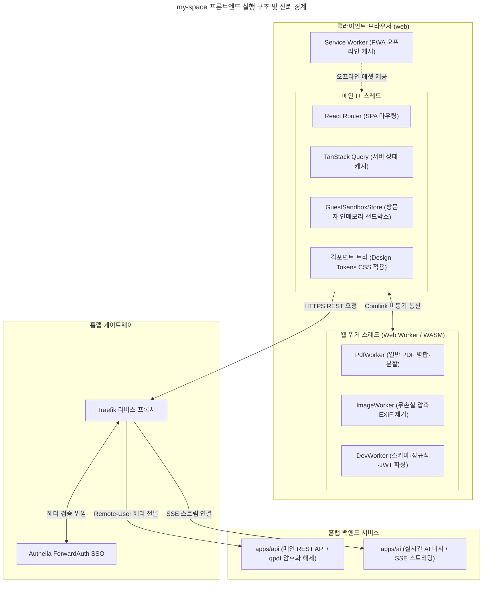

# FE-001 프론트엔드 기술 구조

## 이 문서는

- **목적**: `my-space` v2 프론트엔드 웹 애플리케이션(`apps/web`)의 핵심 기술 스택, 렌더링 방식, 클라이언트 로컬 격리 실행 구조(Web Worker·WASM), PWA 오프라인 지원 정책 및 브라우저 호환성 기준을 정의한다.
- **대상 독자**: 프론트엔드 개발자, 백엔드·인프라 개발자, AI 에이전트
- **작성 시점**: 시스템 개요([ARC-001](../architecture/arc-001-system-overview.md)) 및 디자인 시스템([DSN-005](../design/dsn-005-design-system-tokens.md)) 승인 직후.
- **등급**: 조건부 — UI (화면이 있는 통합 워크스페이스 웹 애플리케이션)

## 선행 문서와 관련 문서

| 관계 | 문서 | 이유 |
|---|---|---|
| 선행 | [ARC-001 시스템 개요](../architecture/arc-001-system-overview.md) | 전체 시스템 컨테이너 중 프론트엔드(`web`)의 위치와 책임 |
| 관련 | [ARC-002 아키텍처 원칙과 제약](../architecture/arc-002-principles-constraints.md) | 브라우저 로컬 우선 처리 원칙(`AP-01`) 및 개인정보 로컬 완결 제약(`CON-02`) |
| 관련 | [ARC-004 컨테이너와 주요 컴포넌트](../architecture/arc-004-containers-components.md) | `web` 컨테이너 내부 컴포넌트(`ImageWorker`, `PdfWorker` 등)와 `api`, `ai` 연동 경로 |
| 관련 | [ADR-0001 하이브리드 로컬 연산](../architecture/adr/adr-0001-hybrid-client-server-processing.md) | 민감 파일 브라우저 로컬 완결 및 암호화 PDF 백엔드(`qpdf`) 위임 결정 |
| 관련 | [ADR-0004 ForwardAuth 및 샌드박스](../architecture/adr/adr-0004-forward-auth-and-visitor-isolation.md) | Authelia SSO 헤더 연동 및 방문자 인메모리 샌드박스 격리 결정 |
| 관련 | [DSN-005 디자인 시스템과 디자인 토큰](../design/dsn-005-design-system-tokens.md) | CSS 변수 토큰 규격 및 라이트 테마 정의 |
| 관련 | [PRD-006 비기능 요구사항](../product/prd-006-nfr.md) | 응답 시간(`NFR-001`~`003`), PWA 오프라인(`NFR-005`), 보안 격리(`NFR-006`) 수치 |
| 후행 | [FE-002 디렉터리와 모듈 구조](fe-002-directory-modules.md) | 본 기술 스택을 적용한 코드 디렉터리 및 모듈 의존 규칙 |
| 후행 | [FE-003 라우팅과 페이지 구성](fe-003-routing-pages.md) | 페이지별 렌더링 방식 및 URL 라우팅 매핑 |
| 후행 | [FE-005 상태 관리](fe-005-state-management.md) | 서버 상태 캐시 및 클라이언트 인메모리 샌드박스 상태 관리 |

## 기술 스택 [필수]

| 영역 | 선택 | 버전 | 선택 이유 (한 줄) | 근거 / ADR |
|---|---|---|---|---|
| 모노레포 관리 | Nx + pnpm | Nx 20+, pnpm 9+ | 플러그인 기반 빠른 태스크 실행 및 독립 프론트엔드 모노레포 관리 | `my-space-front/AGENTS.md` |
| UI 라이브러리 | React | 19.x | 최신 컴포넌트 모델, React Compiler 및 안정적인 동시성 렌더링 지원 | [ARC-001](../architecture/arc-001-system-overview.md) |
| 언어 | TypeScript | 5.5+ | 정적 타입 검증을 통한 안정적인 컴포넌트 인터페이스 보장 | [ARC-001](../architecture/arc-001-system-overview.md) |
| 번들러 & 개발 서버 | Vite | 6.x | 초고속 HMR, 최적화된 ESM 빌드 및 Rollup 생태계 활용 | [ARC-001](../architecture/arc-001-system-overview.md) |
| 서버 상태 관리 | TanStack Query | v5 | 공간 데이터(노트, 피드, 일정)의 선언적 캐싱, 백그라운드 갱신 및 가비지 컬렉션 | [ARC-004](../architecture/arc-004-containers-components.md) |
| 스타일링 | Vanilla CSS (CSS Variables) | 표준 CSS | 외부 UI 라이브러리 의존성 없이 Figma v2 디자인 토큰을 순수 CSS 변수로 직접 제어 | [DSN-005](../design/dsn-005-design-system-tokens.md) |
| 오프라인 & PWA | vite-plugin-pwa | 최신 안정 | 계산기 5종 및 개발 도구 5종의 완전 오프라인 캐싱 및 Service Worker 지원 | [PRD-006 NFR-005](../product/prd-006-nfr.md) |
| 로컬 백그라운드 연산 | Web Worker & WebAssembly | 브라우저 표준 | 이미지 무손실 압축, EXIF 파싱, 일반 PDF 조작 시 메인 UI 스레드 블로킹 방지 | [ADR-0001](../architecture/adr/adr-0001-hybrid-client-server-processing.md) |
| 마크다운 렌더링 | markdown-it / PrismJS | 최신 안정 | 노트 스튜디오 및 일회성 변환기의 마크다운 실시간 렌더링과 코드 하이라이팅 | [PRD-005 FN-002](../product/prd-005-functional-spec.md) |
| 테스트 도구 | Vitest + RTL | Vitest 2+, RTL 16+ | Vite와 동일한 파이프라인으로 동작하는 초고속 JSDOM 단위 및 컴포넌트 테스트 | `my-space-front/AGENTS.md` |

## 렌더링 방식 [필수]

`my-space`는 개인 홈랩 워크스페이스이므로 외부 검색엔진 노출(SEO)을 위한 서버 사이드 렌더링(SSR)이 필요하지 않다. 모든 화면은 **단일 페이지 애플리케이션(SPA) 기반의 클라이언트 사이드 렌더링(CSR)**으로 구동되며, 도구 유형에 따라 PWA 오프라인 캐시를 적극 활용한다.

| 페이지 유형 | 렌더링 방식 | 데이터 갱신 방식 | 이유 |
|---|---|---|---|
| 홈 대시보드 (`SCR-001`) | 클라이언트 렌더링 (CSR) | 화면 진입 시 병렬 갱신 + 5분 주기 백그라운드 재검증 | 4개 공간의 요약 정보를 개별 카드 단위로 비동기 로딩하여 빠른 첫 화면 렌더링 달성 |
| 공간: 노트·피드·관리 (`SCR-010`~`SCR-030`) | 클라이언트 렌더링 (CSR) | TanStack Query 캐시 우선 표시 + 사용자 액션 성공 시 무효화 | 개인화 데이터의 즉각적인 UI 반영 및 낙관적 업데이트 지원 |
| 공간: AI 비서 (`SCR-040`) | 클라이언트 렌더링 (CSR) | Server-Sent Events (SSE) 실시간 누적 렌더링 | 음성 전사 텍스트 및 LLM 토큰의 즉각적인 스트리밍 출력 |
| 도구: 계산기 5종 (`SCR-062`~`SCR-066`) | 클라이언트 렌더링 (CSR + PWA 오프라인) | 사용자 입력 즉시 로컬 연산 (서버 통신 0회) | 마트 현장이나 지하철 등 오프라인 환경에서도 100% 정상 계산 동작 보장 (`NFR-005`) |
| 도구: 문서·이미지·개발 (`SCR-051`~`SCR-061`) | 클라이언트 렌더링 (CSR) | Web Worker 비동기 연산 후 UI 상태 반영 | 대용량 파일 처리 중에도 UI 멈춤 없이 부드러운 반응성 유지 (`NFR-001`, `NFR-002`) |
| 방문자 체험 안내 (`SCR-090`) | 클라이언트 렌더링 (CSR) | 인메모리 샌드박스 상태 참조 (서버 저장 차단) | 외부 방문자의 데이터가 주 사용자 DB에 영속화되는 것을 원천 차단 (`ADR-0004`) |

## 실행 구조 [필수]

- **목적**: 브라우저 메인 스레드, 백그라운드 Worker 스레드, PWA Service Worker 및 홈랩 백엔드 통신 경로를 한눈에 보여준다.
- **설명**: 
  1. 민감 파일과 토큰은 브라우저 Worker 스레드에서만 처리되고 외부로 전송되지 않는다([ADR-0001](../architecture/adr/adr-0001-hybrid-client-server-processing.md)).
  2. 공간 데이터 통신은 Traefik을 거치며, Authelia ForwardAuth를 통해 인증된 주 사용자 요청에만 `Remote-User` 헤더가 부착되어 백엔드로 전달된다([ADR-0004](../architecture/adr/adr-0004-forward-auth-and-visitor-isolation.md)).
  3. 외부 방문자의 경우 클라이언트 `GuestSandboxStore`가 모든 쓰기 요청을 인메모리에서 모킹하여 백엔드 DB 오염을 방지한다.
- **관련 문서**: [ARC-004 컨테이너와 주요 컴포넌트](../architecture/arc-004-containers-components.md), [ARC-007 보안 아키텍처](../architecture/arc-007-security-architecture.md)

## 지원 브라우저와 기기 [필수]

| 구분 | 지원 범위 | 확인 방법 |
|---|---|---|
| 데스크톱 브라우저 | Chrome, Edge, Firefox, Safari 최신 2개 버전 | Chromium 기반 및 WebKit/Gecko 수동 검증 및 Vitest JSDOM 검증 |
| 모바일 브라우저 | iOS Safari (iOS 16+), Android Chrome (Android 12+) | 375px 모바일 뷰포트 에뮬레이션 및 터치 인터랙션 수동 확인 |
| 화면 해상도 | 최소 320px 리플로 지원, 기준 테스트: 375px / 768px / 1440px | [PRD-006 NFR-007](../product/prd-006-nfr.md) 및 [DSN-007](../design/dsn-007-responsive.md) 반응형 검증 |
| 하드웨어 가속 | Canvas 2D, Web Worker, WebAssembly 지원 브라우저 | Worker 초기화 및 WASM 인스턴스화 런타임 기능 감지 |

## 환경 설정 [선택]

빌드 시점에 번들에 주입되는 환경 변수(`VITE_`)는 누구나 브라우저 개발자 도구에서 볼 수 있으므로 비밀 정보(Secret)를 절대 포함하지 않는다.

| 설정 | 주입 시점 | 브라우저 노출 | 설명 / 출처 |
|---|---|---|---|
| `VITE_API_BASE_URL` | 빌드 / 실행 (런타임 주입) | 예 | 백엔드 메인 API 프록시 기본 엔드포인트 (기본값: `/api`) |
| `VITE_AI_STREAM_URL` | 빌드 / 실행 (런타임 주입) | 예 | AI 비서 SSE 스트리밍 엔드포인트 (기본값: `/ai/stream`) |
| `VITE_APP_VERSION` | 빌드 시점 | 예 | 앱 버전 및 빌드 타임스탬프 (`vite-plugin-version`) |
| `VITE_DEMO_MODE` | 빌드 / 실행 | 예 | 외부 방문자용 테스트 계정 샌드박스 강제 활성화 여부 |

## 검토 체크리스트

- [x] 기술 스택 표의 모든 행에 버전과 선택 이유가 있다
- [x] 대안이 있었던 선택은 관련 ADR(`ADR-0001`, `ADR-0004` 등)로 명확히 연결되어 있다
- [x] 렌더링 방식이 페이지 유형별로 정의되어 있으며 [FE-003](fe-003-routing-pages.md)과 일치한다
- [x] 실행 구조 다이어그램이 [ARC-004](../architecture/arc-004-containers-components.md)의 컨테이너 및 컴포넌트 구조와 일치한다
- [x] 지원 브라우저 범위가 [PRD-006](../product/prd-006-nfr.md) 및 [DSN-007](../design/dsn-007-responsive.md)과 일치한다
- [x] 브라우저에 노출되는 설정에 서버 시크릿이나 비밀번호가 없다

## 작성 예시

예시 없음 — 실무 프로젝트 문서 본문

## 변경 이력

| 날짜 | 버전 | 변경 내용 | 작성자 |
|---|---|---|---|
| 2026-11-22 | 0.1.1 | DSN-004 확정 SCR 번호(SCR-051~066) 동기화 | @bob (Keunhyeok Lim) |
| 2026-11-12 | 0.1.0 | my-space v2 프론트엔드 기술 구조(FE-001) 최초 작성 | @bob (Keunhyeok Lim) |
