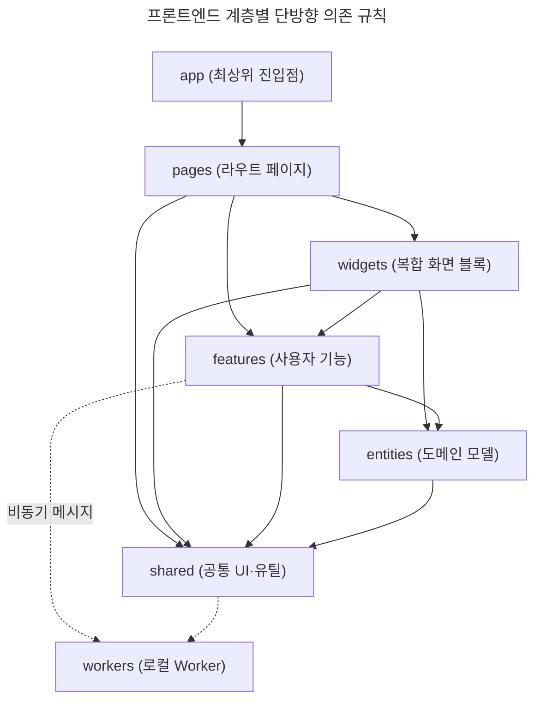

# FE-002 디렉터리와 모듈 구조

## 이 문서는

- **목적**: `my-space` 프론트엔드 모노레포(`apps/web`)의 디렉터리 구성, 모듈 분리 기준 및 계층 간 의존 규칙을 정의한다. 새로운 기능이나 컴포넌트를 추가할 때 파일의 위치와 import 규칙의 기준이 된다.
- **대상 독자**: 프론트엔드 개발자, 코드 리뷰어, AI 에이전트
- **작성 시점**: 기술 구조([FE-001](fe-001-tech-stack.md)) 작성 직후, 화면 및 컴포넌트 구현 전.
- **등급**: 선택 — 기능이 15개 이상(공간 4종, 도구 15종)인 통합 워크스페이스 프로젝트

## 선행 문서와 관련 문서

| 관계 | 문서 | 이유 |
|---|---|---|
| 선행 | [FE-001 프론트엔드 기술 구조](fe-001-tech-stack.md) | Nx 모노레포 및 React 19/Vite 환경 규약 |
| 관련 | [FE-003 라우팅과 페이지 구성](fe-003-routing-pages.md) | 라우트 단위 페이지 컴포넌트의 위치 |
| 관련 | [FE-005 상태 관리](fe-005-state-management.md) | 전역 상태, 샌드박스 스토어 및 쿼리 훅의 위치 |
| 관련 | [FE-006 공통 컴포넌트와 디자인 시스템 연계](fe-006-components-design-system.md) | 디자인 토큰 및 재사용 공통 컴포넌트의 위치 |
| 관련 | [ARC-004 컨테이너와 주요 컴포넌트](../architecture/arc-004-containers-components.md) | `web` 컨테이너 내부 컴포넌트 책임 |
| 관련 | [OPS-001 용어집](../operations/ops-001-glossary.md) | 공간·도구 표준 용어 및 디렉터리 식별자 |

## 디렉터리 구조 [필수]

`apps/web/src`는 계층형 아키텍처(FSD 기반)를 채택하여 책임과 범위를 분리한다:

```text
apps/web/src/
  app/                    # 애플리케이션 진입점, 전역 프로바이더, 라우터, 글로벌 CSS/토큰
  pages/                  # URL 경로에 1:1 매핑되는 최상위 페이지 컴포넌트
  widgets/                # 독립적으로 조합 가능한 복합 UI 블록 (사이드바, 헤더, 대시보드 카드 등)
  features/               # 사용자 인터랙션 단위의 비즈니스 기능 (노트 편집, 피드 모달, PDF 병합 등)
  entities/               # 도메인 모델 단위의 상태, 쿼리 훅 및 기본 뷰 (note, feed, schedule, user)
  shared/                 # 도메인에 종속되지 않는 재사용 UI 컴포넌트, 유틸리티, 디자인 토큰
  workers/                # 메인 UI 스레드와 분리된 Web Worker 및 WASM 연산 스크립트
```

| 디렉터리 | 책임 | 여기에 두지 않는 것 |
|---|---|---|
| `app/` | `main.tsx`, `App.tsx`, 전역 스타일(`tokens.css`, `reset.css`), QueryClient/라우터 설정 | 특정 화면 전용 컴포넌트나 비즈니스 로직 |
| `pages/` | `FE-003`의 라우트별 페이지 조립 (위젯들을 배치) | 구체적인 API 호출 로직이나 복잡한 폼 검증 로직 |
| `widgets/` | `Sidebar`, `HeaderBar`, `DashboardGrid`, `NoteEditorPanel` 등 굵직한 화면 구역 | 다른 페이지에서 쓸 수 없는 초세부 비즈니스 로직 |
| `features/` | `note-editor`, `feed-filter-modal`, `pdf-merger`, `cron-builder` 등 인터랙션 단위 | 전역 레이아웃 또는 다른 feature의 내부 상태 참조 |
| `entities/` | `note`, `feed`, `schedule`, `guest` 등 도메인 엔티티 타입, TanStack Query 키 및 API 클라이언트 | 화면 전체를 구성하는 레이아웃 구조 |
| `shared/` | `Button`, `Input`, `Modal`, `Toast`, `date-utils`, `crypto-utils` 등 공통 자산 | 특정 도메인(노트, 일정)에만 종속적인 비즈니스 로직 |
| `workers/` | `pdf.worker.ts`, `image.worker.ts`, `dev-tools.worker.ts` 등 브라우저 로컬 연산 스레드 | DOM 객체 직접 조작 또는 메인 스레드 UI 상태 |

## 모듈 경계와 의존 규칙 [필수]



- **목적**: 상위 계층은 하위 계층을 사용할 수 있지만, 하위 계층이 상위 계층을 역참조하는 스파게티 의존성을 원천 차단한다.
- **규칙**:
  1. **단방향 의존성**: `app` → `pages` → `widgets` → `features` → `entities` → `shared` 순으로만 의존할 수 있다. 하위 레이어가 상위 레이어를 `import`하는 것은 엄격히 금지된다.
  2. **수평 참조 금지**: `features/note-editor`가 `features/feed-filter-modal`을 직접 참조할 수 없다. 공통 데이터는 `entities`나 `shared`로 내려서 참조한다.
  3. **공개 진입점 (`index.ts`)**: 각 모듈은 루트의 `index.ts`를 통해서만 외부로 심볼을 노출하며, 모듈 내부의 세부 구현 파일(예: `features/note-editor/internal/parser.ts`)을 외부에서 직접 import하지 않는다.

| 모듈 | 의존 가능 계층 | 의존 금지 대상 | 검사 방법 |
|---|---|---|---|
| `pages` | `widgets`, `features`, `entities`, `shared` | `app` | ESLint (`import/order`, 경계 규칙) |
| `widgets` | `features`, `entities`, `shared` | `app`, `pages` | ESLint 규칙 및 코드 리뷰 |
| `features` | `entities`, `shared`, `workers` | `app`, `pages`, `widgets`, 타 `feature` | ESLint 규칙 및 코드 리뷰 |
| `entities` | `shared` | `app`, `pages`, `widgets`, `features` | ESLint 규칙 및 빌드 검증 |
| `shared` | 없음 (완전 독립) | 상위 모든 계층 (`app`, `pages`, `widgets`, `features`, `entities`) | ESLint 규칙 및 빌드 검증 |

## 명명 규칙 [선택]

| 대상 | 규칙 | 예시 |
|---|---|---|
| 디렉터리명 | 소문자 `kebab-case` | `note-editor`, `pdf-tools`, `cron-builder` |
| 컴포넌트 파일 | `PascalCase.tsx` | `Button.tsx`, `ModalDialog.tsx`, `Sidebar.tsx` |
| 유틸리티 및 훅 | `camelCase.ts` | `useNoteQuery.ts`, `formatDate.ts`, `authStore.ts` |
| 테스트 파일 | `*.spec.tsx` 또는 `*.test.ts` | `Button.spec.tsx`, `cronBuilder.test.ts` |
| Worker 파일 | `*.worker.ts` | `pdf.worker.ts`, `image.worker.ts` |

## 검토 체크리스트

- [x] 최상위 디렉터리마다 명확한 책임과 배제 대상이 명시되어 있다
- [x] 의존 다이어그램과 단방향 의존성 규칙 표가 일치한다
- [x] 모듈 간 수평 의존 및 하위 레이어의 상위 역참조 금지 규칙이 명시되어 있다
- [x] 기능 모듈 식별자가 [OPS-001 용어집](../operations/ops-001-glossary.md)의 도메인 용어와 일치한다
- [x] 프레임워크 및 번들러 규약(`Vite`, `Nx`)이 [FE-001](fe-001-tech-stack.md)과 일치한다

## 작성 예시

예시 없음 — 실무 프로젝트 문서 본문

## 변경 이력

| 날짜 | 버전 | 변경 내용 | 작성자 |
|---|---|---|---|
| 2026-11-12 | 0.1.0 | my-space v2 프론트엔드 디렉터리와 모듈 구조(FE-002) 최초 작성 | @bob (Keunhyeok Lim) |
