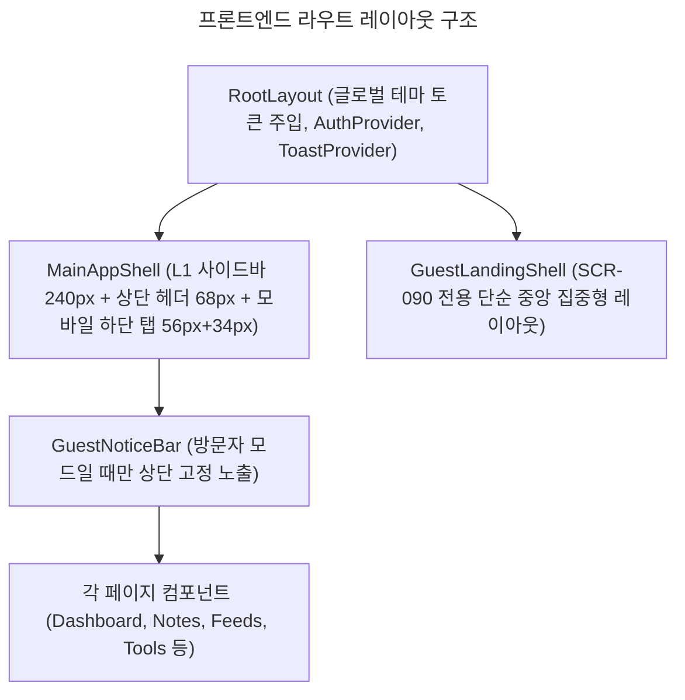

# FE-003 라우팅과 페이지 구성

## 이 문서는

- **목적**: `my-space` v2 전체 화면(`SCR-001`~`SCR-090`)을 브라우저 URL 경로에 1:1로 대응시키고, 각 페이지의 레이아웃, 렌더링 방식, 접근 권한, 경로 파라미터 및 쿼리 스트링 규칙을 정의한다.
- **대상 독자**: 프론트엔드 개발자, QA 엔지니어, AI 에이전트
- **작성 시점**: 화면 목록 및 와이어프레임([DSN-004](../design/dsn-004-wireframes-screen-spec.md)) 승인 직후.
- **등급**: 조건부 — UI

화면 ID와 화면명은 [DSN-004](../design/dsn-004-wireframes-screen-spec.md)가 단일 기준 문서다. 이 문서는 새로운 화면을 만들지 않고 경로와 파라미터 규격만 정의한다.

## 선행 문서와 관련 문서

| 관계 | 문서 | 이유 |
|---|---|---|
| 선행 | [DSN-002 정보 구조와 사이트맵](../design/dsn-002-information-architecture.md) | 공간 5영역, 도구 4군 15종 메뉴 계층과 URL 계층을 맞춘다 |
| 선행 | [DSN-004 와이어프레임과 화면 명세](../design/dsn-004-wireframes-screen-spec.md) | 화면 ID(`SCR-001`~`SCR-090`)의 기준 |
| 선행 | [FE-001 프론트엔드 기술 구조](fe-001-tech-stack.md) | SPA 라우팅 방식 및 PWA 오프라인 렌더링 방식 |
| 관련 | [DSN-003 사용자 흐름](../design/dsn-003-user-flows.md) | 화면 간 전환 및 복귀 흐름 |
| 관련 | [FE-008 인증·권한에 따른 UI](fe-008-auth-ui.md) | 주 사용자 인증 및 외부 방문자 체험 계정 접근 제어 |
| 관련 | [FE-009 오류와 로딩 상태](fe-009-error-loading.md) | 404 Not Found 화면 및 전역 라우트 에러 바운더리 |

## URL 규칙 [필수]

| 항목 | 규칙 | 예시 |
|---|---|---|
| 경로 명명 | 소문자, 여러 단어는 `kebab-case`, 계층은 복수형 명사 사용 | `/spaces/notes`, `/tools/documents/pdf` |
| 영역 구분 | 공간은 `/spaces/{공간명}`, 도구는 `/tools/{카테고리}/{도구명}`, 방문자 모드는 `/guest` | `/spaces/feeds`, `/tools/development/cron` |
| 식별자 파라미터 | 동적 세그먼트 `:id` 또는 쿼리 스트링. UUID 또는 슬러그를 사용 | `/spaces/notes?id=note-123` |
| 공유 상태 쿼리 | 필터, 뷰 모드, 활성 탭 등 북마크/공유가 필요한 상태는 쿼리 스트링으로 관리 | `?view=split`, `?tab=subscription` |
| 모달 다이얼로그 | 부모 화면의 컨텍스트를 유지해야 하므로 별도 URL 경로를 파지 않고 쿼리 파라미터 또는 로컬 상태로 제어 | `?modal=keyword-filter` |
| 끝 슬래시 (Trailing Slash) | 붙이지 않는다. 끝 슬래시가 붙은 경로는 슬래시 없는 경로로 자동 정규화 | `/spaces/notes/` → `/spaces/notes` |

## 라우트 표 [필수]

접근 권한 표기:
- `주 사용자`: Authelia SSO 인증 통과 사용자 (`owner`)
- `방문자`: 외부 방문자 체험 계정 (`visitor` 인메모리 샌드박스)
- `공통`: 주 사용자 및 외부 방문자 모두 사용 가능
- `오프라인`: 인터넷 연결이 없는 상태에서도 PWA Service Worker 캐시를 통해 구동 가능

| 경로 | 화면 ID | 화면 이름 | 레이아웃 | 렌더링 | 접근 권한 | 파라미터 및 쿼리 |
|---|---|---|---|---|---|---|
| `/` | SCR-001 | 홈 대시보드 | 메인 셸 (L1 사이드바 + 상단바) | CSR | 공통 | — |
| `/notifications` | SCR-002 | 알림함 | 메인 셸 | CSR | 공통 | `?filter=all\|unread` |
| `/spaces/notes` | SCR-010 | 공간 › 노트 스튜디오 | 메인 셸 (3열 패널) | CSR | 공통 | `?noteId=:id`, `?view=editor\|split\|preview`, `?folder=:folderId` |
| `/spaces/feeds` | SCR-020 | 공간 › 피드 리더 | 메인 셸 (2열 패널) | CSR | 공통 | `?feedId=:id`, `?filter=unread\|all\|starred`, `?view=default\|priority\|excluded`, `?tag=:tag` |
| `/spaces/schedules` | SCR-030 | 공간 › 관리 (일정·결제) | 메인 셸 | CSR | 공통 | `?tab=subscription\|expiry\|dday`, `?year=:year` |
| `/spaces/ai` | SCR-040 | 공간 › AI 비서 | 메인 셸 | CSR (SSE) | 공통 | `?session=:sessionId` |
| `/tools` | SCR-050 | 도구 탐색 카탈로그 | 메인 셸 | CSR + 오프라인 | 공통 | `?category=documents\|images\|dev\|calc` |
| `/tools/documents/pdf` (기본 `/merge` 리다이렉트) / `/tools/documents/pdf/merge` | SCR-051 | 도구 › PDF 병합 | 메인 셸 | CSR (Worker) | 공통 | — |
| `/tools/documents/pdf/split` | SCR-051A | 도구 › PDF 페이지 추출·분할 | 메인 셸 | CSR (Worker) | 공통 | — |
| `/tools/documents/pdf/unlock` | SCR-051B | 도구 › PDF 암호 해제 | 메인 셸 | CSR (`qpdf` 위임) | 공통 | — |
| `/tools/documents/markdown` | SCR-052 | 도구 › 마크다운 변환 | 메인 셸 | CSR | 공통 | — |
| `/tools/images/compress` | SCR-053 | 도구 › 이미지 압축 | 메인 셸 | CSR (Worker) | 공통 | — |
| `/tools/images/resize` | SCR-054 | 도구 › 이미지 크기 조절 | 메인 셸 | CSR (Worker) | 공통 | — |
| `/tools/images/convert` | SCR-055 | 도구 › 이미지 포맷 변환 | 메인 셸 | CSR (Worker) | 공통 | — |
| `/tools/images/exif` | SCR-056 | 도구 › EXIF 조회·제거 | 메인 셸 | CSR (Worker) | 공통 | — |
| `/tools/development/schema` | SCR-057 | 도구 › RDB·NoSQL 스키마 | 메인 셸 | CSR | 공통 | `?type=rdb\|nosql` |
| `/tools/development/cron` | SCR-058 | 도구 › Cron 해석·생성 | 메인 셸 | CSR + 오프라인 | 공통 | `?expr=:cronExpr` |
| `/tools/development/regex` | SCR-059 | 도구 › 정규식 테스터 | 메인 셸 | CSR + 오프라인 | 공통 | — |
| `/tools/development/jwt` | SCR-060 | 도구 › JWT 디코더·검증 | 메인 셸 | CSR + 오프라인 | 공통 | — |
| `/tools/development/timestamp` | SCR-061 | 도구 › 타임스탬프 변환 | 메인 셸 | CSR + 오프라인 | 공통 | — |
| `/tools/calculator/dutchpay` | SCR-062 | 도구 › 더치페이 계산기 | 메인 셸 | CSR + 오프라인 | 공통 | — |
| `/tools/calculator/salary` | SCR-063 | 도구 › 급여·실수령액 계산기 | 메인 셸 | CSR + 오프라인 | 공통 | `?year=:year` |
| `/tools/calculator/loan` | SCR-064 | 도구 › 대출·예적금 계산기 | 메인 셸 | CSR + 오프라인 | 공통 | `?type=loan\|savings` |
| `/tools/calculator/unit-price` | SCR-065 | 도구 › 단가 비교 계산기 | 메인 셸 | CSR + 오프라인 | 공통 | — |
| `/tools/calculator/date` | SCR-066 | 도구 › 날짜·D-day 계산기 | 메인 셸 | CSR + 오프라인 | 공통 | `?tab=dday\|workdays` |
| `/guest` | SCR-090 | 외부 방문자 체험 안내 및 샌드박스 시작 | 단독 셸 (체험 안내) | CSR | 방문자 전용 | `?redirect=:targetPath` |
| `*` | — | 404 Not Found 화면 | 메인 셸 | CSR | 공통 | — |

> **SCR 번호 참고**: `SCR-060`은 현재 **JWT 디코더·검증**이며 과거 초안의 이미지 도구 번호와 혼동하지 않는다.

## 모달 다이얼로그 라우팅 규칙 [선택]

화면 전환 없이 오버레이로 뜨는 모달은 부모 URL 위에 쿼리 파라미터(`?modal=...`)로 연동하여, 뒤로 가기(Back) 버튼 클릭 시 자연스럽게 모달이 닫히도록 한다:

| 화면 ID | 모달 명칭 | 트리거 쿼리 파라미터 | 닫기 시 동작 |
|---|---|---|---|
| SCR-020 | 피드 키워드 필터 설정 팝업 | `?modal=keyword-filter` | 관심 가중치·제외 규칙·키워드 삭제를 단일 팝업 내 상태로 전환하고, 취소/`✕` 또는 저장 후 닫기 시 쿼리 제거 및 포커스 복귀 |
| SCR-020 | RSS 피드 추가 및 구독 출처 관리 모달 | `?modal=feed-sources` | 신규 RSS 등록 및 구독 출처 관리(채널 삭제 확인 포함), 닫기 시 쿼리 제거 |
| SCR-010 | 노트 버전 히스토리 비교 모달 | `?modal=version-diff&versionId=:vId` | 비교 모달 닫기 |
| SCR-030 | 관리 일정 등록/편집 모달 | `?modal=schedule-form&type=:type` | 저장 후 일정 목록 갱신 |

## 레이아웃 계층 다이어그램 [필수]

## 검토 체크리스트

- [x] [DSN-004](../design/dsn-004-wireframes-screen-spec.md)의 모든 화면(`SCR-001`~`SCR-090`)이 빠짐없이 표에 등록되어 있다
- [x] 모바일 하단 탭 내비게이션 대상 화면과 딥링크 경로가 올바르게 정의되어 있다
- [x] 모달 다이얼로그와 뷰 모드(`?view=split`) 등 북마크/공유 상태가 쿼리 파라미터로 명시되어 있다
- [x] 계산기 및 오프라인 도구에 PWA 오프라인 지원 여부가 명시되어 있다
- [x] 외부 방문자 모드(`SCR-090`) 및 샌드박스 진입 경로가 명확히 분리되어 있다

## 작성 예시

예시 없음 — 실무 프로젝트 문서 본문

## 변경 이력

| 날짜 | 버전 | 변경 내용 | 작성자 |
|---|---|---|---|
| 2026-11-26 | 0.2.2 | 피드 쿼리(`filter=starred`, `view=default\|priority\|excluded`) 확장 및 `RootLayout` 프로바이더(`AuthProvider`) 현행화 | @bob (Keunhyeok Lim) |
| 2026-11-22 | 0.2.1 | 현재 ADR 참조·설명 및 문서 인덱스 정합성 정리; 기존 결정 유지 | AI 에이전트 |
| 2026-11-22 | 0.2.0 | DSN-004 확정 SCR-051~066 번호, 68px 상단바 및 피드 단일 키워드 필터 팝업 규격 동기화 | @bob (Keunhyeok Lim) |
| 2026-11-12 | 0.1.0 | my-space v2 라우팅과 페이지 구성(FE-003) 최초 작성 | @bob (Keunhyeok Lim) |
