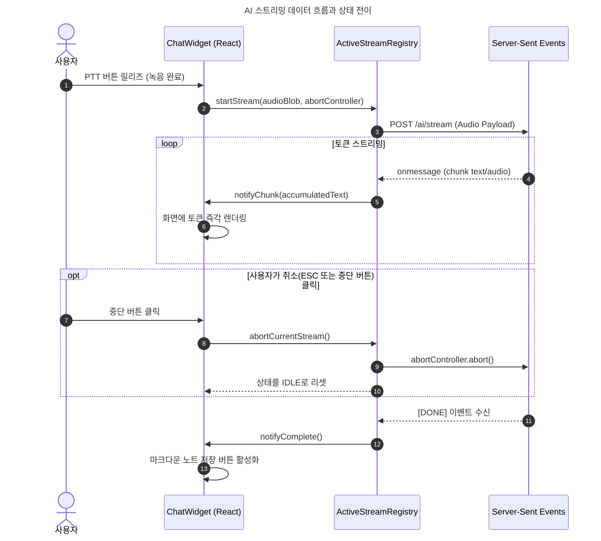

# FE-005 상태 관리

## 이 문서는

- **목적**: `my-space` v2 프론트엔드의 상태를 서버 상태, 로컬 UI 상태, 전역 세션 상태, 실시간 스트리밍 상태 및 방문자 인메모리 샌드박스 상태의 5개 영역으로 분류하고, 각각의 관리 도구, 저장 위치, 생명주기 및 동기화 규칙을 정의한다.
- **대상 독자**: 프론트엔드 개발자, 코드 리뷰어, AI 에이전트
- **작성 시점**: 프론트엔드 기술 구조([FE-001](fe-001-tech-stack.md)) 및 라우팅([FE-003](fe-003-routing-pages.md)) 작성 직후.
- **등급**: 선택 — 다중 공간 데이터 캐싱, AI SSE 스트리밍, 방문자 격리 샌드박스가 결합된 프로젝트

## 선행 문서와 관련 문서

| 관계 | 문서 | 이유 |
|---|---|---|
| 선행 | [FE-001 프론트엔드 기술 구조](fe-001-tech-stack.md) | TanStack Query 및 React 19 상태 관리 기술 기준 |
| 선행 | [ARC-004 컨테이너와 주요 컴포넌트](../architecture/arc-004-containers-components.md) | 백엔드 `api`, `ai` 컨테이너 및 브라우저 컴포넌트 경계 |
| 관련 | [FE-003 라우팅과 페이지 구성](fe-003-routing-pages.md) | URL 쿼리 파라미터 상태와의 동기화 |
| 관련 | [ARC-005 데이터 흐름](../architecture/arc-005-data-flow.md) | 공간 데이터 영속 경로 및 테스트 계정 샌드박스 격리 경로(`DF-06`) |
| 관련 | [ADR-0004 ForwardAuth 및 샌드박스](../architecture/adr/adr-0004-forward-auth-and-visitor-isolation.md) | 방문자 인메모리 샌드박스 격리 결정 |

## 상태 분류와 관리 도구 [필수]

| 상태 영역 | 담는 데이터 | 관리 도구 | 보관 위치 | 생명주기 |
|---|---|---|---|---|
| 1. 서버 상태 (Server State) | 공간별 데이터: 노트 목록/본문, RSS 피드 목록/아티클, 관리 일정, 상단 알림함 목록 | TanStack Query v5 | 브라우저 메모리 (Query Cache) | Stale 시간 동안 신선 유지, 컴포넌트 언마운트 후 5분간 가비지 컬렉션 유예 |
| 2. 로컬 UI 상태 (Local UI State) | 모달 열림 여부, 노트 3종 뷰 모드 토글(에디터/스플릿/프리뷰), 파일 드롭존 선택 파일 목록, 아코디언 접힘 | React `useState`, `useReducer` | 컴포넌트 인스턴스 | 해당 컴포넌트 마운트 중 유지, 언마운트 시 자동 파기 |
| 3. 전역 세션 상태 (Global Session State) | 현재 접속자 권한 모드(`owner` vs `visitor`), 네트워크 온라인/오프라인 감지 상태, 토스트 알림 큐 | 경량 Store (Zustand 또는 React Context) | 브라우저 메모리 | 브라우저 탭 세션 동안 유지 (새로고침 시 재평가) |
| 4. 실시간 스트리밍 상태 (Streaming State) | AI 음성 녹음 버퍼(PTT 오디오), SSE 수신 토큰 누적 버퍼, 실행 중인 요청 취소용 `AbortController` | `ActiveStreamRegistry` (클래스 인스턴스) | 브라우저 메모리 | 스트리밍 세션 연결 중 유지, 취소/완료 시 즉시 버퍼 해제 |
| 5. 방문자 샌드박스 상태 (Sandbox State) | 외부 방문자용 샘플 노트, 피드, 일정의 인메모리 복제본 및 임시 변경분 | `GuestSandboxStore` (인메모리 CRUD 저장소) | 브라우저 메모리 (`window.__GUEST_SANDBOX__`) | 브라우저 탭 유지 동안만 유효, 새로고침 또는 '샘플 초기화' 시 즉시 리셋 |

## 서버 상태 캐시 및 무효화 규칙 [필수]

TanStack Query의 쿼리 키는 일관된 배열 계층 구조를 따르며, 변경 작업(Mutation) 성공 시 관련 쿼리 키를 즉시 무효화(`invalidateQueries`)한다:

```typescript
// 쿼리 키 표준 구조
export const queryKeys = {
  notes: {
    all: ['notes'] as const,
    list: (folderId?: string) => ['notes', 'list', { folderId }] as const,
    detail: (id: string) => ['notes', 'detail', id] as const,
    versions: (id: string) => ['notes', 'versions', id] as const,
  },
  feeds: {
    all: ['feeds'] as const,
    channels: () => ['feeds', 'channels'] as const,
    items: (filter: 'all' | 'unread', tag?: string) => ['feeds', 'items', { filter, tag }] as const,
  },
  schedules: {
    all: ['schedules'] as const,
    byType: (type: 'subscription' | 'expiry' | 'dday') => ['schedules', type] as const,
  },
  notifications: {
    all: ['notifications'] as const,
    unread: () => ['notifications', 'unread'] as const,
  },
};
```

| 도메인 / 오퍼레이션 | Stale Time | Cache Time | 무효화 트리거 (Mutation) |
|---|---|---|---|
| `notes.list`, `notes.detail` | 1분 | 10분 | 노트 저장/수정, 삭제, 폴더 변경 성공 시 |
| `feeds.channels`, `feeds.items` | 3분 | 15분 | RSS 피드 추가/삭제, '모두 읽음' 클릭, 키워드 필터 변경 시 |
| `schedules.byType` | 5분 | 30분 | 새 일정/정기결제 등록, 수정, 삭제 성공 시 |
| `notifications.unread` | 30초 | 5분 | 알림 확인, '모두 읽음', 또는 새 만료 알림 수신 시 |

## 방문자 인메모리 샌드박스 (`GuestSandboxStore`) [필수]

외부 방문자가 접속하거나 데모 모드(`VITE_DEMO_MODE=true` 또는 `/guest`)로 진입한 경우, 모든 API 호출 계층은 백엔드 영속 DB 통신을 가로채고 브라우저 메모리 샌드박스로 라우팅한다([ADR-0004](../architecture/adr/adr-0004-forward-auth-and-visitor-isolation.md)):

```typescript
// GuestSandboxStore 인터페이스 규격
export interface GuestSandboxState {
  isGuest: boolean;
  notes: NoteEntity[];
  feeds: FeedChannelEntity[];
  feedItems: FeedItemEntity[];
  schedules: ScheduleEntity[];
  notifications: NotificationEntity[];
  // 액션
  resetToInitialSeed: () => void;
  createNote: (data: NoteCreateInput) => NoteEntity;
  updateNote: (id: string, data: NoteUpdateInput) => NoteEntity;
  deleteNote: (id: string) => void;
  markFeedAsRead: (itemId: string) => void;
  markAllFeedsAsRead: () => void;
}
```

- **격리 보장**: 방문자 모드에서는 `apiClient`의 HTTP `POST/PUT/PATCH/DELETE` 요청이 백엔드로 전송되지 않고 `GuestSandboxStore`의 내부 상태만 변경한다.
- **초기화 지원**: 상단 헤더의 '샘플 데이터 초기화' 버튼을 누르면 초기 번들 시드 데이터로 즉각 재설정된다.
- **영속화 금지**: `localStorage`나 `IndexedDB`에 저장하지 않고 순수 브라우저 메모리에만 유지하여 개인정보 잔존을 방지한다.

## 실시간 AI 스트리밍 상태 (`ActiveStreamRegistry`) [필수]

AI 음성(PTT) 및 텍스트 채팅 스트리밍(`SCR-040`)은 빈번한 토큰 누적과 즉각적인 취소 제어가 필요하므로, React 상태 렌더링 루프와 분리된 레지스트리로 관리한다:



## 검토 체크리스트

- [x] 상태가 5대 영역(서버, UI, 전역 세션, 스트리밍, 샌드박스)으로 명확히 구분되어 있다
- [x] TanStack Query 키 명명 규칙과 Stale/Cache 시간 및 무효화 트리거가 명시되어 있다
- [x] 방문자 샌드박스가 주 사용자 DB를 오염시키지 않도록 인메모리 격리 설계가 반영되어 있다
- [x] AI SSE 스트리밍의 즉각 취소(`AbortController`) 및 상태 전이 흐름이 명시되어 있다
- [x] 컴포넌트 언마운트 시 메모리 누수를 방지하는 가비지 컬렉션 정책이 정의되어 있다

## 작성 예시

예시 없음 — 실무 프로젝트 문서 본문

## 변경 이력

| 날짜 | 버전 | 변경 내용 | 작성자 |
|---|---|---|---|
| 2026-11-12 | 0.1.0 | my-space v2 상태 관리(FE-005) 최초 작성 | @bob (Keunhyeok Lim) |

인증된 방문자 판정 및 서버 권한은 [BE-004](../backend/be-004-authn-authz.md)를 따른다. 방문자의 개인 공간 GET도 OWNER API로 보내지 않고 읽기 전용 samples API와 브라우저 복제본을 사용한다. PDF 임시 처리·공휴일 조회·auth/me는 별도 허용 경로이며 전체 HTTP 요청을 무조건 가로채지 않는다.
