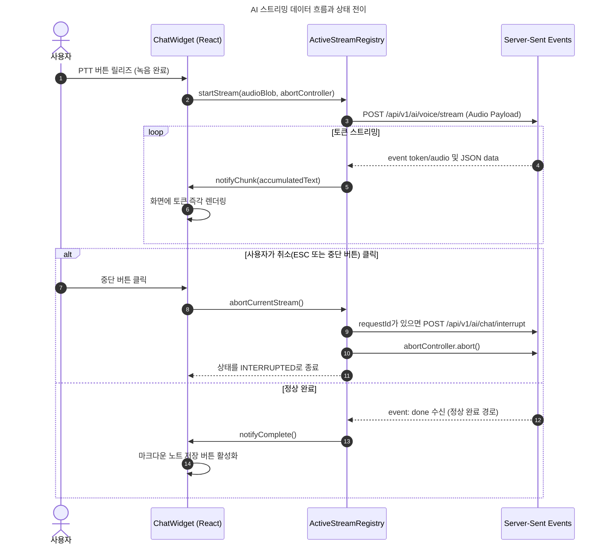

# FE-005 상태 관리

## 이 문서는

- **목적**: `my-space` v2 프론트엔드의 상태를 서버 상태, 로컬 UI 상태, 전역 세션 상태, 실시간 스트리밍 상태 및 방문자 인메모리 샌드박스 상태의 5개 영역으로 분류하고, 각각의 관리 도구, 저장 위치, 생명주기 및 동기화 규칙을 정의한다.
- **대상 독자**: 프론트엔드 개발자, 코드 리뷰어, AI 에이전트
- **작성 시점**: 프론트엔드 기술 구조([FE-001](fe-001-tech-stack.md)) 및 라우팅([FE-003](fe-003-routing-pages.md)) 작성 직후.
- **등급**: 선택 — 다중 공간 데이터 캐싱, AI SSE 스트리밍, 방문자 격리 샌드박스가 결합된 프로젝트

## 선행 문서와 관련 문서

| 관계 | 문서 | 이유 |
|---|---|---|
| 선행 | [FE-001 프론트엔드 기술 구조](fe-001-tech-stack.md) | TanStack Query 및 React 19 상태 관리 기술 기준 |
| 선행 | [ARC-004 컨테이너와 주요 컴포넌트](../architecture/arc-004-containers-components.md) | 백엔드 `api`, `ai` 컨테이너 및 브라우저 컴포넌트 경계 |
| 관련 | [FE-003 라우팅과 페이지 구성](fe-003-routing-pages.md) | URL 쿼리 파라미터 상태와의 동기화 |
| 관련 | [ARC-005 데이터 흐름](../architecture/arc-005-data-flow.md) | 공간 데이터 영속 경로 및 테스트 계정 샌드박스 격리 경로(`DF-06`) |
| 관련 | [ADR-0007 ForwardAuth 및 샌드박스](../architecture/adr/adr-0007-visitor-browser-state.md) | 방문자 인메모리 샌드박스 격리 결정 |

## 상태 분류와 관리 도구 [필수]

| 상태 영역 | 담는 데이터 | 관리 도구 | 보관 위치 | 생명주기 |
|---|---|---|---|---|
| 1. 서버 상태 (Server State) | 공간별 데이터: 노트 목록/본문, RSS 피드 목록/아티클, 관리 일정, 상단 알림함 목록 | TanStack Query v5 | 브라우저 메모리 (Query Cache) | Stale 시간 동안 신선 유지, 컴포넌트 언마운트 후 5분간 가비지 컬렉션 유예 |
| 2. 로컬 UI 상태 (Local UI State) | 모달 열림 여부, 노트 3종 뷰 모드 토글(에디터/스플릿/프리뷰), 파일 드롭존 선택 파일 목록, 아코디언 접힘 | React `useState`, `useReducer` | 컴포넌트 인스턴스 | 해당 컴포넌트 마운트 중 유지, 언마운트 시 자동 파기 |
| 3. 전역 세션 상태 (Global Session State) | 현재 접속자 권한 모드(`owner` vs `visitor`), 네트워크 온라인/오프라인 감지 상태, 토스트 알림 큐 | 경량 Store (Zustand 또는 React Context) | 브라우저 메모리 | 브라우저 탭 세션 동안 유지 (새로고침 시 재평가) |
| 4. 실시간 스트리밍 상태 (Streaming State) | AI 음성 녹음 버퍼(PTT 오디오), SSE 수신 토큰 누적 버퍼, 실행 중인 요청 취소용 `AbortController` | `ActiveStreamRegistry` (클래스 인스턴스) | 브라우저 메모리 | 스트리밍 세션 연결 중 유지, 취소/완료 시 즉시 버퍼 해제 |
| 5. 방문자 샌드박스 상태 (Sandbox State) | 외부 방문자용 샘플 노트, 피드, 일정의 인메모리 복제본 및 임시 변경분 | `GuestSandboxStore` (인메모리 CRUD 저장소) | 브라우저 메모리 (`window.__GUEST_SANDBOX__`) | 브라우저 탭 유지 동안만 유효, 새로고침 또는 '샘플 초기화' 시 즉시 리셋 |

## 서버 상태 캐시 및 무효화 규칙 [필수]

TanStack Query의 쿼리 키는 일관된 배열 계층 구조를 따르며, 변경 작업(Mutation) 성공 시 관련 쿼리 키를 즉시 무효화(`invalidateQueries`)한다:

```typescript
// 쿼리 키 표준 구조
// auth/me로 검증된 신원과 로그인·역할 전환마다 갱신하는 세션 세대.
// 토큰·쿠키·이메일을 키에 넣지 않는다. 인증 확인 전에는 개인 쿼리를 실행하지 않는다.
type SessionScope = readonly [username: string, role: 'OWNER' | 'GUEST', generation: number];
export const createQueryKeys = (scope: SessionScope) => {
  const base = ['session', ...scope] as const;
  return {
    notes: {
      all: [...base, 'notes'] as const,
      list: (folderId?: string) => [...base, 'notes', 'list', { folderId }] as const,
      detail: (id: string) => [...base, 'notes', 'detail', id] as const,
      versions: (id: string) => [...base, 'notes', 'versions', id] as const,
    },
    feeds: {
      all: [...base, 'feeds'] as const,
      channels: () => [...base, 'feeds', 'channels'] as const,
      items: (filters: { sourceId?: string; classification?: 'NORMAL' | 'PRIORITY' | 'EXCLUDED'; isRead?: boolean; isStarred?: boolean; tag?: string; snapshotAt?: string }) => [...base, 'feeds', 'items', filters] as const,
    },
    schedules: {
      all: [...base, 'schedules'] as const,
      byType: (type: 'subscription' | 'expiry' | 'dday') => [...base, 'schedules', type] as const,
    },
    notifications: {
      all: [...base, 'notifications'] as const,
      unread: () => [...base, 'notifications', 'unread'] as const,
    },
  };
};
```

| 도메인 / 오퍼레이션 | Stale Time | Cache Time | 무효화 트리거 (Mutation) |
|---|---|---|---|
| `notes.list`, `notes.detail` | 1분 | 10분 | 노트 저장/수정, 삭제, 폴더 변경 성공 시 |
| `feeds.channels`, `feeds.items` | 3분 | 15분 | RSS 피드 추가/삭제, '모두 읽음' 클릭, 키워드 필터 변경 시 |
| `schedules.byType` | 5분 | 30분 | 새 일정/정기결제 등록, 수정, 삭제 성공 시 |
| `notifications.unread` | 30초 | 5분 | 알림 확인, '모두 읽음', 또는 새 만료 알림 수신 시 |

## 방문자 인메모리 샌드박스 (`GuestSandboxStore`) [필수]

`/api/v1/auth/me`가 인증된 `GUEST`를 반환한 경우 개인 공간 체험을 브라우저 메모리 샌드박스로 라우팅한다([ADR-0007](../architecture/adr/adr-0007-visitor-browser-state.md)). `/guest`나 환경변수로 인증 결과·역할을 결정하지 않는다. 미인증은 로그인 안내로 이동한다:

```typescript
// GuestSandboxStore 인터페이스 규격
export interface GuestSandboxState {
  isGuest: boolean;
  notes: NoteEntity[];
  feeds: FeedChannelEntity[];
  feedItems: FeedItemEntity[];
  schedules: ScheduleEntity[];
  notifications: NotificationEntity[];
  // 액션
  resetToInitialSeed: () => void;
  createNote: (data: NoteCreateInput) => NoteEntity;
  updateNote: (id: string, data: NoteUpdateInput) => NoteEntity;
  deleteNote: (id: string) => void;
  markFeedAsRead: (itemId: string) => void;
  markAllFeedsAsRead: () => void;
}
```

- **격리 보장**: 방문자의 개인 공간 조회·변경·AI 체험은 브라우저 복제본과 샘플 응답에서 처리한다. 서버는 개인 공간 API 접근을 거부한다. auth/me·samples·PDF 임시 처리·공휴일 조회만 BE-004의 허용 범위로 요청하며, PDF POST에도 Origin 검사를 적용한다.
- **초기화 지원**: 상단 헤더의 '샘플 데이터 초기화' 버튼을 누르면 초기 번들 시드 데이터로 즉각 재설정된다.
- **영속화 금지**: `localStorage`나 `IndexedDB`에 저장하지 않고 순수 브라우저 메모리에만 유지하여 개인정보 잔존을 방지한다.

## 실시간 AI 스트리밍 상태 (`ActiveStreamRegistry`) [필수]

AI 음성(PTT) 및 텍스트 채팅 스트리밍(`SCR-040`)은 빈번한 토큰 누적과 즉각적인 취소 제어가 필요하므로, React 상태 렌더링 루프와 분리된 레지스트리로 관리한다:



## 검토 체크리스트

- [x] 상태가 5대 영역(서버, UI, 전역 세션, 스트리밍, 샌드박스)으로 명확히 구분되어 있다
- [x] TanStack Query 키 명명 규칙과 Stale/Cache 시간 및 무효화 트리거가 명시되어 있다
- [x] 방문자 샌드박스가 주 사용자 DB를 오염시키지 않도록 인메모리 격리 설계가 반영되어 있다
- [x] AI SSE 스트리밍의 즉각 취소(`AbortController`) 및 상태 전이 흐름이 명시되어 있다
- [x] 컴포넌트 언마운트 시 메모리 누수를 방지하는 가비지 컬렉션 정책이 정의되어 있다

## 작성 예시

예시 없음 — 실무 프로젝트 문서 본문

## 세션 전환과 개인 상태 폐기 [필수]

로그아웃, 사용자 또는 역할 변경, 세션 만료(401), 인증 재확인 실패 시 다음 순서를 적용한다. 개별 리소스의 403/404만으로 다른 사용자 역할을 추정하지 않는다.

1. 즉시 개인 화면을 가리고 개인 요청을 중지한 뒤 session generation을 증가시킨다. 인증 확인 중·실패 상태에서는 이전 데이터나 이전 화면을 표시하지 않는다.
2. 이전 QueryClient의 쿼리를 취소하고 fetch·업로드·SSE·녹음·Worker에 취소/종료를 요청한다. 클라이언트 취소는 이미 서버에 커밋된 변경을 되돌린다는 뜻이 아니다.
3. Query/Mutation 캐시와 이전 QueryClient를 폐기한다. 편집기 초안, AI 토큰·음성 버퍼, 선택 파일, 미리보기 object URL, GuestSandboxStore 및 전역 상태도 초기화한다. 이전 데이터로 새 캐시를 채우거나 사용자 간 placeholderData를 재사용하지 않는다.
4. 모든 비동기 결과·mutation 콜백·Worker 메시지는 시작 당시 generation과 현재 값을 비교한다. 다르면 UI, 캐시, 토스트에 반영하지 않는다. AbortController만으로 늦은 응답 차단이 보장된다고 가정하지 않는다.
5. 캐시하지 않는 auth/me로 신원을 확인한 후 새 QueryClient와 해당 scope를 생성한다. GUEST는 샘플 복제본으로 시작한다. 개인 데이터와 방문자 편집 상태를 localStorage/IndexedDB/Service Worker/영속 Query 캐시에 저장하지 않는다.

앱 진입·페이지 복귀(pageshow)·탭 활성화 시 신원을 재확인하는 동안 개인 화면을 잠근다. 탭 간 로그아웃/신원 변경 신호에는 데이터나 인증값을 싣지 않으며 수신 탭도 같은 폐기 절차를 수행한다. 서버는 매 요청 인증·인가를 계속 검증한다.

검증: OWNER→GUEST, 계정 A→B, 401, 로그아웃 후 뒤로 가기, 다른 탭 로그아웃, 전환 전에 시작한 늦은 fetch/mutation/SSE/Worker 응답에서 이전 본문·제목·알림·첨부가 노출되지 않는지 확인한다. 공개 앱 자산의 오프라인 캐시와 개인 API 응답 캐시는 구분한다.

## AI SSE 종료·중단 계약

텍스트는 POST `/api/v1/ai/chat/stream`, PTT는 POST `/api/v1/ai/voice/stream`을 사용한다. event 이름과 JSON data는 BE-002/OpenAPI를 따른다. start의 requestId를 보관하고 token/audio를 누적하며 done만 COMPLETED로 처리한다. interrupt는 INTERRUPTED, error 또는 종료 이벤트 없는 EOF는 FAILED다. IDLE은 요청 시작 전 UI 상태일 뿐 중단 결과를 덮어쓰지 않는다.

취소 시 requestId가 있으면 POST `/api/v1/ai/chat/interrupt`에 전달하고 즉시 로컬 스트림·음성 재생을 중지한다. requestId 수신 전이면 연결을 취소하며 서버 연결 종료 처리로 추론을 중단한다. 중단 요청 실패 시 서버 중단 완료를 단정하지 않는다. 완료·중단 경합의 최종 상태는 메시지 재조회로 확인한다. 이전 세션 generation의 결과는 반영하지 않는다. COMPLETED인 본인 메시지만 노트 저장을 허용한다.

## 피드·홈 캐시와 API 연결

피드 URL `filter=unread`는 API `isRead=false`, `filter=all`은 isRead 생략으로 매핑한다. feedId는 sourceId, tag는 정규화한 매칭 관심 키워드이며 노트 태그와 별개다. 필터 변경 시 cursor·snapshotAt을 초기화하고 첫 응답의 snapshotAt을 다음 페이지 및 모두 읽음 요청에 재사용한다. POST `/api/v1/feed-items/read-all`은 현재 필터의 전체 결과를 처리하며 화면에 로드된 ID만 반복 호출하지 않는다. 성공 시 피드 목록·홈 미읽음 요약을 무효화한다. 실패 시 기존 상태를 유지한다.

홈은 GET `/api/v1/home/summary?sections=카드이름`으로 카드별 조회하며 같은 세션 scope 아래 카드 이름별 Query Key로 관리한다. 초기 요청을 병렬 실행하고 5분마다 재검증한다. HTTP 오류와 응답 내 ERROR를 모두 해당 카드 오류로 처리한다. SUCCESS/data만 캐시에 저장하고 개별 재시도는 실패 카드만 요청한다. 인증 실패 시 전체 개인 캐시 폐기 규칙이 우선한다.

## 변경 이력

| 날짜 | 버전 | 변경 내용 | 작성자 |
|---|---|---|---|
| 2026-11-22 | 0.1.3 | API·화면·검증 범위 계약 불일치 보완 | AI 에이전트 |
| 2026-11-22 | 0.1.2 | 사용자·역할·세션별 캐시 격리와 늦은 응답 폐기, 방문자 판정 정합성 보완 | AI 에이전트 |
| 2026-11-12 | 0.1.0 | my-space v2 상태 관리(FE-005) 최초 작성 | @bob (Keunhyeok Lim) |

인증된 방문자 판정 및 서버 권한은 [BE-004](../backend/be-004-authn-authz.md)를 따른다. 방문자의 개인 공간 GET도 OWNER API로 보내지 않고 읽기 전용 samples API와 브라우저 복제본을 사용한다. PDF 임시 처리·공휴일 조회·auth/me는 별도 허용 경로이며 전체 HTTP 요청을 무조건 가로채지 않는다.
