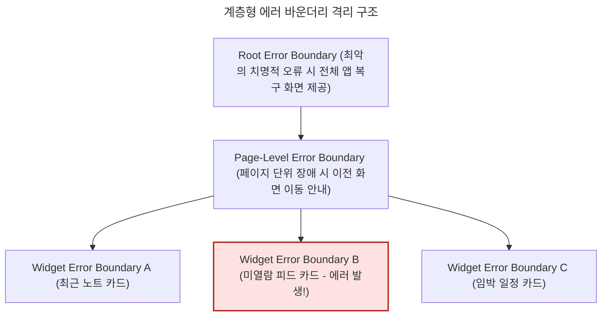

# FE-009 오류와 로딩 상태

## 이 문서는

- **목적**: `my-space` 프론트엔드의 화면 로딩 피드백(스켈레톤, 스피너), 네트워크 장애, 오프라인(PWA) 상태 감지, 에러 바운더리(Error Boundary) 격리 전술 및 사용자 친화적인 에러 피드백 규칙을 정의한다.
- **대상 독자**: 프론트엔드 개발자, QA 엔지니어, AI 에이전트
- **작성 시점**: 프론트엔드 기술 구조([FE-001](fe-001-tech-stack.md)) 및 UI 상태 명세([DSN-009](../design/dsn-009-ui-states-errors.md)) 승인 직후.
- **등급**: 조건부 — UI

UI 상태 분류와 기본 문구는 [DSN-009](../design/dsn-009-ui-states-errors.md)가 기준이며, 이 문서는 프론트엔드 코드 수준의 구현 및 격리 규칙을 정의한다.

## 선행 문서와 관련 문서

| 관계 | 문서 | 이유 |
|---|---|---|
| 선행 | [DSN-009 UI 상태와 오류 상태](../design/dsn-009-ui-states-errors.md) | 빈 상태, 로딩, 오류 피드백 디자인 기준 |
| 선행 | [FE-001 프론트엔드 기술 구조](fe-001-tech-stack.md) | 커스텀 비동기 훅, 세션 세대 가드 및 PWA 오프라인 감지 기술 |
| 관련 | [FE-003 라우팅과 페이지 구성](fe-003-routing-pages.md) | 페이지 단위 에러 바운더리 및 404 경로 |
| 관련 | [FE-006 공통 컴포넌트와 디자인 시스템 연계](fe-006-components-design-system.md) | 스켈레톤, 스피너, 토스트 알림 컴포넌트 규격 |
| 관련 | [ARC-002 아키텍처 원칙과 제약](../architecture/arc-002-principles-constraints.md) | 우아한 성능 저하 원칙(`AP-04`) |

## 로딩 상태 표현 규칙 [필수]

| 로딩 유형 | 적용 영역 | 시각 피드백 | 사용자 상호작용 |
|---|---|---|---|
| 1. 초기 페이지 진입 (Initial Load) | 홈 대시보드 카드, 노트 목록, 피드 리더 목록 | **스켈레톤 UI (Skeleton)**: 레이아웃 깜빡임(CLS) 방지를 위해 실제 카드 모양의 옅은 그레이 박스 펄스 애니메이션 노출 | 화면 읽기 대기 |
| 2. 사용자 액션 처리 (Action Pending) | 버튼 클릭(저장, 삭제, PDF 병합, 다운로드) | **버튼 인라인 스피너 (Inline Spinner)**: 버튼 내 텍스트 옆에 16px 원형 회전 스피너 노출, 버튼 비활성화(`disabled`) | 중복 클릭 방지 |
| 3. 백그라운드 재검증 (Background Revalidation) | 홈 대시보드 5분 주기 백그라운드 재검증 등 사일런트 fetch | **무표시**: 기존 캐시 데이터를 그대로 보여주며 화면을 깜빡이지 않음 | 자유로운 작업 유지 |
| 4. AI 실시간 스트리밍 (AI Streaming) | AI 챗 버블 (`SCR-040`) | **타이핑 커서 펄스 (Blinking Cursor)**: 토큰이 스트리밍될 때마다 텍스트 끝에 점멸 커서 노출 | ESC 또는 중단 버튼으로 즉각 취소 가능 |

## 에러 바운더리 격리 전술 (Error Boundary) [필수]

특정 카드나 모듈에서 런타임 오류가 발생하더라도 **전체 페이지가 백화(White Screen)되는 현상을 원천 방지**한다:

- **카드/위젯 단위 격리**:
  - 홈 대시보드의 '미열람 피드' 조회가 서버 장애로 실패하더라도, '최근 노트'와 '임박 일정'은 정상 작동한다.
  - 실패한 카드 내부에는 오류 메시지("피드 데이터를 불러오지 못했습니다.")와 **`다시 시도` 버튼**만 국소적으로 렌더링된다.

## 네트워크 오류 및 PWA 오프라인 피드백 [필수]

브라우저의 `navigator.onLine` 및 `online`/`offline` 이벤트를 구독하는 `useOnlineStatus` 훅을 연동하여 네트워크 단절 시 시각적 피드백을 제공한다:

1. **오프라인 전환 감지**:
   - 화면 최상단에 얇은 슬레이트 회색 배너 노출: `"현재 오프라인 상태입니다. 단가 비교, 계산기 및 로컬 개발 도구만 사용 가능합니다."`
2. **도구 접근 제어**:
   - 순수 클라이언트 로컬 도구(계산기 5종, Cron/정규식/JWT/타임스탬프)는 오프라인에서도 100% 정상 작동 (`NFR-005`).
   - 서버 저장이 필수적인 공간 기능(노트 저장, RSS 새로고침) 시도 시 "인터넷 연결이 필요합니다" 안내 토스트 출력 및 입력 내용 보존.

## 오류 피드백 패턴 [선택]

| 오류 원인 | 표시 위치 | 표현 방식 | 복구 방법 |
|---|---|---|---|
| 폼 입력 유효성 실패 | 입력 필드 바로 아래 | 빨간색 13px 텍스트 + `aria-invalid` 포커스 링 | 입력 값 유지 상태에서 필드 수정 |
| 일회성 액션 실패 (네트워크 일시 오류) | 우측 상단 플로팅 토스트 | 빨간색 에러 토스트 (3초 자동 소멸 또는 닫기 버튼) | 사용자가 버튼 다시 클릭 |
| 영속 데이터 조회 실패 | 해당 카드/패널 내부 | 에러 일러스트/아이콘 + 안내 문구 + `다시 시도` 버튼 | `다시 시도` 버튼 클릭 (재요청) |
| 파일 크기 초과 (PDF 50MB 초과) | 파일 드롭존 내부 | 인라인 경고 카드 ("파일이 50MB를 초과했습니다.") | 파일 선택 초기화 후 재선택 |

## 검토 체크리스트

- [x] 스켈레톤 UI와 버튼 스피너의 적용 시점이 명확히 분리되어 있다
- [x] 카드/위젯 단위 에러 바운더리를 통해 부분 장애가 전체 화면을 망가뜨리지 않도록 격리되어 있다
- [x] 오프라인(PWA) 상태 감지 시 로컬 도구 사용 가능 여부와 시각 배너가 정의되어 있다
- [x] 오류 발생 시 사용자가 입력한 데이터가 소실되지 않고 보존된다
- [x] 모든 오류 상태에 '다시 시도' 또는 복귀 가능한 액션 버튼이 제공된다

## 작성 예시

예시 없음 — 실무 프로젝트 문서 본문

## 홈 부분 실패와 재시도 계약

초기 진입 시 단일 `GET /api/v1/home/summary`로 전체 섹션을 조회하고, 실패한 카드의 개별 재시도 시 `GET /api/v1/home/summary?sections=카드이름`을 사용한다. OpenAPI HomeSummary의 SUCCESS/data는 정상 UI, ERROR/error와 HTTP 실패는 해당 카드의 오류 UI로 처리한다. React ErrorBoundary는 렌더링 예외를 처리하며 비동기 요청 오류 처리를 대신하지 않는다. 다시 시도는 해당 카드만 재조회하고 다른 성공 카드의 데이터를 지우지 않는다. 401 또는 신원 변경은 FE-005의 전체 세션 폐기 규칙을 적용한다. 서버 연결 자체가 불가능해도 정적 도구 바로가기는 유지한다.

## 변경 이력

| 날짜 | 버전 | 변경 내용 | 작성자 |
|---|---|---|---|
| 2026-11-26 | 0.1.2 | `useOnlineStatus`·커스텀 비동기 훅 기준 용어 정리 및 홈 초기 단일 조회/부분 재시도 계약 현행화 | @bob (Keunhyeok Lim) |
| 2026-11-22 | 0.1.1 | API·화면·검증 범위 계약 불일치 보완 | AI 에이전트 |
| 2026-11-12 | 0.1.0 | my-space v2 오류와 로딩 상태(FE-009) 최초 작성 | @bob (Keunhyeok Lim) |
