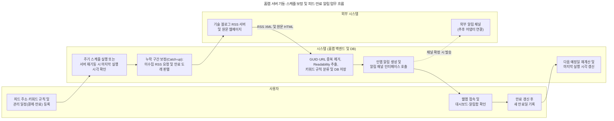
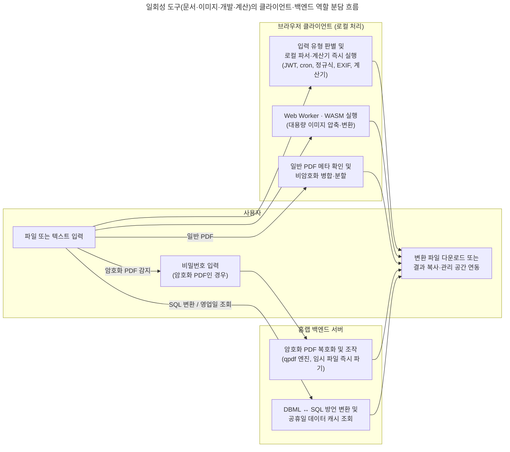

# PRD-004 사용자 여정과 업무 흐름

## 이 문서는

- **목적**: 사용자가 `my-space` v2에서 목표를 이루기까지 거치는 업무 단계(사용자 여정)와, 사용자·브라우저·홈랩 백엔드·외부 시스템이 일을 주고받는 순서(업무 흐름)를 정리한다. 특히 홈랩 서버가 24시간 켜져 있지 않은 환경에서 발생하는 예외 흐름과 클라이언트·백엔드 역할 분담을 검증한다.
- **범위**: 업무 단계와 행위자 단위로 기술하며 **화면 배치나 UI 컴포넌트는 다루지 않는다.** 화면 단위 흐름은 후속 디자인 단계(`DSN`)에서 정의한다.
- **대상 독자**: 프로젝트 소유자, AI 에이전트
- **작성 시점**: [PRD-003 사용자 스토리와 수용 기준](prd-003-user-stories.md) 작성 직후, 디자인 단계 시작 전.
- **등급**: 조건부 — UI가 있는 프로젝트

## 선행 문서와 관련 문서

| 관계 | 문서 | 이유 |
|---|---|---|
| 선행 | [PRD-003 사용자 스토리와 수용 기준](prd-003-user-stories.md) | 여정 단계마다 연결할 사용자 스토리(`US-`) |
| 관련 | [PRD-002 요구사항과 범위](prd-002-requirements-scope.md) | 여정과 예외 흐름에서 도출된 요구사항(`REQ-`) |
| 관련 | [PRD-005 기능 명세](prd-005-functional-spec.md) | 각 단계의 처리를 담당하는 기능(`FN-`) |
| 관련 | [PRD-006 비기능 요구사항](prd-006-nfr.md) | 각 단계의 처리 시간·오프라인 동작·복구 목표(`NFR-`) |
| 관련 | [OPS-001 용어집](../operations/ops-001-glossary.md) | 여정과 흐름에서 사용하는 표준 용어 |

## 여정 목록 [필수]

| 여정 ID | 여정 | 사용자 유형 | 시작 | 끝(목표 달성) |
|---|---|---|---|---|
| J-01 | 결제·만료 일정 등록부터 기한 도래 확인 및 갱신까지 | 사용자 | 새로 가입한 구독 서비스나 갱신할 인증서·보험이 생겨 일정을 기록하려 한다 | 기한이 임박했을 때(서버가 꺼졌다 켜진 경우 포함) 놓치지 않고 확인해 연장·결제를 마치고 다음 일정으로 갱신한다 |
| J-02 | 기술 블로그 구독부터 규칙 기반 선별 열람까지 | 사용자 | 관심 있는 국내외 기술 블로그의 새 글을 한곳에서 골라 읽고 싶다 | 관심 키워드 글을 최상단에서 원문 본문으로 읽고, 제외 키워드 글은 보지 않는다 |
| J-03 | 민감 파일·코드 조각의 일회성 변환 및 검증 | 사용자 | 업무 중 암호 걸린 PDF, 대용량 사진, cron 식, 정규식, JWT 토큰을 즉시 처리해야 한다 | 외부 사이트에 데이터를 유출하지 않고 결과를 얻어 다운로드하거나 복사한다 |
| J-04 | 일상 계산 및 오프라인 단가 비교 | 사용자 | 모임 비용을 정산하거나 마트에서 상품 단가를 비교해야 한다 | 최소 송금표를 계산해 모임 정산을 끝내거나, 오프라인 마트 현장에서 최저가 상품을 고른다 |
| J-05 | 외부 방문자의 테스트 계정 접속 및 기능 체험 | 외부 방문자 | 외부 접속이 열려 있는 워크스페이스에 접속해 실제 기능과 UX를 둘러보려 한다 | 테스트 계정으로 로그인해 공간(샘플 데이터)과 도구를 체험한다 |

## 사용자 여정 [필수]

### J-01 결제·만료 일정 등록부터 기한 도래 확인 및 갱신까지

| 단계 | 사용자 목표 | 행동 | 접점 | 불편·위험 | 개선 기회 | 관련 스토리 |
|---|---|---|---|---|---|---|
| 탐색·진입 | 날짜를 기록할 공간을 찾는다 | `공간 › 관리`로 이동한다 | 웹 | 포맷 기준 메뉴일 때는 어디에 둘지 모호하다 | `공간 › 관리`로 단일화해 모든 날짜·주기 항목을 한곳에 모은다 | US-001 |
| 일정 등록 | 날짜 유형에 맞게 항목을 등록한다 | 정기 결제(구독료·주기), 고정 만료일, D-day 중 유형을 골라 기준일과 주기를 입력한다 | 웹 | 유형마다 다음 날짜 계산 방식이 달라 일반 캘린더로는 관리가 번거롭다 | 공통 날짜 모델 3유형으로 입력 항목을 표준화하고 월 구독 합계를 자동 합산한다 | US-006, US-007, US-008 |
| 기한 도래 판별 | 기한이 다가온 항목을 인지한다 | 홈랩 서버가 켜져 있을 때 또는 재기동 후 웹앱에 접속해 임박·경과 알림을 확인한다 | 웹, 알림 채널(추후 확정) | 홈랩 서버가 꺼져 있는 동안 알림 기준일이 지나가면 알림이 누락될 위험이 있다 | 서버 기동 시 마지막 실행 시각 대비 Catch-up 판별을 수행하고 인앱 대시보드 브리핑에 즉시 노출한다 | US-002, US-007 |
| 실제 수행 및 갱신 | 연장·결제를 마치고 다음 일정을 반영한다 | 고정 만료일은 갱신 후 새 만료일을 입력한다 | 웹 | 갱신 후 새 만료일을 반영하지 않으면 다음 알림 기준이 틀어진다 | 갱신 시 새 만료일을 입력받아 다음 알림 기준일을 재설정한다 | US-007 |

### J-02 기술 블로그 구독부터 규칙 기반 선별 열람까지

| 단계 | 사용자 목표 | 행동 | 접점 | 불편·위험 | 개선 기회 | 관련 스토리 |
|---|---|---|---|---|---|---|
| 피드·규칙 설정 | 읽고 싶은 블로그와 키워드 기준을 정한다 | RSS 주소를 등록하고 관심 키워드·제외 키워드를 입력한다 | 웹 | 블로그마다 채용·이벤트·광고 글이 섞여 들어온다 | 제외 키워드 매칭 시 기본 목록에서 즉시 숨기고 관심 키워드 매칭 시 최상단으로 올린다 | US-004, US-005 |
| 수집·정규화 | 새 글을 중복 없이 모은다 | 주기 스케줄 또는 서버 재기동 시 Catch-up 수집이 돌아 새 글을 가져온다 | 웹(백엔드) | 같은 글이 URL 파라미터 차이로 중복 수집되거나 RSS에 짧은 요약만 들어 있다 | GUID·정규화 URL로 중복을 제거하고 Readability로 원문 본문을 추출한다 | US-004 |
| 선별·열람 | 가치 있는 글을 읽는다 | 상단에 올라온 관심 키워드 글부터 원문 본문을 읽고 읽음 표시한다 | 웹 | 발췌문만 있으면 매번 외부 새 탭을 열어야 한다 | 키워드 하이라이트와 깔끔한 원문 리더 뷰를 제공한다 | US-004, US-005 |

### J-03 민감 파일·코드 조각의 일회성 변환 및 검증

| 단계 | 사용자 목표 | 행동 | 접점 | 불편·위험 | 개선 기회 | 관련 스토리 |
|---|---|---|---|---|---|---|
| 도구 선택 | 작업 목적에 맞는 도구를 연다 | `도구` 아래 `문서`, `이미지`, `개발` 중 해당 도구를 선택한다 | 웹 | 저장이 필요 없는 작업인데 프로젝트 생성 절차를 강제하면 번거롭다 | 상태 저장 없이 입력 즉시 결과를 내는 일회성 흐름으로 구성한다 | US-001 |
| 데이터 입력 | 파일(PDF, 이미지)을 넣거나 텍스트(DBML·NoSQL, cron, 정규식, JWT, timestamp)를 붙여넣는다 | 웹 | 민감한 토큰이나 스키마, 개인 사진 GPS 정보가 외부 서버로 나가면 보안 위험이 된다 | JWT·EXIF·이미지 변환·파서 도구는 브라우저 로컬에서만 처리하고, 암호화 PDF 해제만 자체 홈랩 백엔드(`qpdf`)로 처리한다 | US-010, US-012, US-013, US-015, US-016, US-017 |
| 결과 확인·추출 | 변환된 파일을 내려받거나 생성된 코드·해석 결과를 복사한다 | 다운로드 또는 클립보드 복사를 수행한다 | 웹 | 대용량 이미지 변환 중 브라우저 화면이 멈출 수 있다 | Web Worker·WASM으로 메인 스레드 밖에서 처리해 UI 반응성을 유지한다 | US-010, US-011, US-012, US-013, US-014, US-018 |

### J-04 일상 계산 및 오프라인 단가 비교

| 단계 | 사용자 목표 | 행동 | 접점 | 불편·위험 | 개선 기회 | 관련 스토리 |
|---|---|---|---|---|---|---|
| 현장 단가 비교 | 마트에서 여러 용량·묶음 상품 중 진짜 최저가를 찾는다 | 스마트폰에서 단가 비교기를 열어 가격·용량·수량을 입력한다 | 모바일 웹(PWA) | 마트 지하 매장이나 외출 중 홈랩 서버가 꺼져 있으면 웹앱이 열리지 않을 수 있다 | PWA Service Worker 오프라인 캐싱으로 서버 연결 없이도 계산 도구가 동작하게 한다 | US-022 |
| 모임 정산 계산 | 여러 명이 섞여 결제한 모임 비용을 정산한다 | 참석자와 결제 내역을 입력해 최소 송금 횟수 정산표를 뽑는다 | 웹, 모바일 웹 | 복잡한 모임 정산에서 여러 번 송금하는 번거로움과 계산 오차가 발생한다 | 최소 송금 횟수 알고리즘으로 단순화된 송금표와 상세 산출 근거를 확인하고 클립보드로 복사해 공유한다 | US-019 |
| 금융·영업일 계산 | 연봉 실수령액, 대출·적금 이자, 공휴일 제외 영업일을 계산한다 | 조건을 입력해 공제 내역, 원 단위 상환표, 영업일 수를 확인한다 | 웹 | 부동소수점 연산 오차로 원금 합계가 안 맞거나 공휴일을 수동으로 세야 한다 | 정수(원 단위) 연산과 공공데이터포털 공휴일 데이터 연동으로 정확도를 보장한다 | US-020, US-021, US-023 |

### J-05 외부 방문자의 테스트 계정 접속 및 기능 체험

| 단계 | 사용자 목표 | 행동 | 접점 | 불편·위험 | 개선 기회 | 관련 스토리 |
|---|---|---|---|---|---|---|
| 접속·로그인 | 테스트 계정으로 워크스페이스에 진입한다 | 안내된 테스트 계정 정보로 로그인한다 | 웹 | 빈 화면만 보이면 공간 기능(노트·피드·관리)의 동작을 파악하기 어렵다 | 테스트 계정 전용 샘플 데이터(노트, 피드, 관리 일정)를 기본 제공한다 | US-024 |
| 공간·도구 체험 | 공간 데이터를 열람·조작하고 도구를 실행해 본다 | 공간 메뉴를 탐색해 쓰기 동작을 체험하고 파서·변환·계산 도구를 실행한다 | 웹 | 방문자의 조작이 주 사용자의 실제 개인 데이터나 서버 샘플 원본에 영향을 주면 안 된다 | 계정 단위 데이터 격리 및 클라이언트 인메모리 쓰기(새로고침 시 초기화)로 보호한다 | US-001, US-024 |

## 업무 흐름 [필수]

### 홈랩 비-상시 구동 환경의 스케줄 보정(Catch-up)·만료·피드 처리 업무 흐름

- **목적**: 24시간 상시 구동이 보장되지 않는 홈랩 환경에서 피드 수집과 만료·결제 일정 판별이 어떻게 누락 없이 이어지는지 보여준다.
- **설명**: 시스템은 고정 시각 크론에만 의존하지 않고, 서버가 부팅될 때와 주기 작업이 돌 때마다 DB에 기록된 `마지막 성공 실행 시각`을 확인한다. 서버가 꺼져 있던 동안 지나간 수집 주기와 만료·결제 알림 기준일을 한꺼번에 보정 실행(Catch-up)하여 인앱 알림함과 대시보드에 기록한다. 외부 알림 채널은 어댑터 인터페이스로 분리해 두어 추후 채널 확정 시 연결한다.
- **관련 문서**: [PRD-002](prd-002-requirements-scope.md) REQ-004~012, [PRD-003](prd-003-user-stories.md) US-002, US-004~009

### 클라이언트·백엔드 하이브리드 도구 처리 업무 흐름

- **목적**: 일회성 도구들이 왜 어떤 작업은 브라우저에서 끝내고 어떤 작업은 백엔드를 거치는지 행위자 간 경계를 명확히 보여준다.
- **설명**: JWT 디코딩, EXIF 바이너리 파싱·제거, Web Worker/WASM 이미지 변환, cron·정규식 파싱, 이자·단가 계산은 서버 통신 없이 브라우저 내부에서만 처리되어 외부 유출 위험이 없고 오프라인(PWA)에서도 동작한다. 반면 순수 JS로 복호화가 불가능한 암호화 PDF 작업(`qpdf`), 다중 SQL 방언 정밀 변환은 홈랩 백엔드가 담당한다.
- **관련 문서**: [PRD-002](prd-002-requirements-scope.md) REQ-012~027, [PRD-003](prd-003-user-stories.md) US-010~026

## 예외 흐름 [필수]

| 흐름 | 예외 상황 | 업무 처리 | 담당 행위자 | 관련 스토리·요구사항 |
|---|---|---|---|---|
| J-01 일정 관리 | 홈랩 서버가 며칠간 꺼져 있는 동안 만료일이나 결제일이 지나갔다 | 서버가 다시 켜질 때 부팅 훅에서 마지막 판별 시각 이후 도래·경과한 항목을 일괄 스캔해 `만료됨` 또는 `임박` 알림으로 생성하고 대시보드 최상단에 노출한다 | 시스템, 사용자 | US-002, US-007, REQ-009 |
| J-02 피드 열람 | 대상 블로그 서버 장애나 타임아웃으로 RSS 수집에 실패했다 | 다른 피드 수집은 중단하지 않고 계속 진행하며, 실패한 피드만 오류 상태와 마지막 성공 시각을 표시하고 다음 주기에 재시도한다 | 시스템 | US-004, REQ-004 |
| J-02 피드 열람 | 원문 웹페이지가 스크래핑을 차단하거나 동적 렌더링(SPA)이라 Readability 본문 추출에 실패했다 | RSS에 포함된 기본 발췌문(요약)을 먼저 보여주고 원문 새 탭 열기 링크를 함께 안내한다 | 시스템, 사용자 | US-004, REQ-004 |
| J-03 도구 처리 | 암호화된 PDF에 잘못된 비밀번호를 입력했다 | 백엔드 `qpdf`가 복호화 실패 코드를 반환하고 임시 파일을 즉시 삭제한 뒤, 사용자에게 비밀번호 재입력을 안내한다 | 백엔드, 사용자 | US-010, REQ-012 |
| J-03 도구 처리 | EXIF 메타데이터가 아예 없는 이미지나 손상된 JPEG 파일을 올렸다 | 바이너리 파서가 SOI(`0xFFD8`) 마커 및 APP1 세그먼트 부재를 감지해 오류 없이 "EXIF 메타데이터가 없습니다" 또는 "유효한 JPEG 파일이 아닙니다"를 안내한다 | 브라우저, 사용자 | US-013, REQ-015 |
| J-03 도구 처리 | 잘못된 문법의 cron 표현식이나 정규식을 입력했다 | 파서가 중단되지 않고 잘못된 필드·토큰 위치(인덱스)와 원인을 한국어로 즉시 표시한다 | 브라우저, 사용자 | US-015, US-016, REQ-017, REQ-018 |
| J-04 단가·영업일 계산 | 마트 현장에서 모바일 네트워크가 끊기거나 홈랩 서버가 꺼져 있다 | 단가 비교기 등 순수 클라이언트 도구는 PWA 캐시에서 로드되어 오프라인으로 정상 계산한다. 계산 도구는 클라이언트 사이드 연산으로 네트워크 없이 모든 기능이 정상 동작한다 | 브라우저, 사용자 | US-022, REQ-024, REQ-029 |

## 검토 체크리스트

- [x] 사용자 유형마다 핵심 여정이 하나 이상 있다
- [x] 여정 단계와 업무 흐름에 구체적인 화면 컴포넌트나 버튼 배치 이름이 없다
- [x] 스토리가 없는 여정 단계를 [PRD-002](prd-002-requirements-scope.md)·[PRD-003](prd-003-user-stories.md)에 모두 반영했다
- [x] 업무 흐름마다 예외 흐름이 있다
- [x] 다이어그램과 단계 표의 단계가 일치한다

## 변경 이력

| 날짜 | 버전 | 변경 내용 | 작성자 |
|---|---|---|---|
| 2026-11-01 | 1.0.0 | 사용자 검토 완료에 따라 approved(승인) 상태로 확정 | Antigravity (사용자 승인 완료) |
| 2026-10-31 | 0.1.0 | 순차 문서 번호(`PRD-004`) 부여 및 `PRD-001` 검토 결과(테스트 계정 여정 `J-05` 반영 등) 적용 | Antigravity (사용자 검토 대기) |
